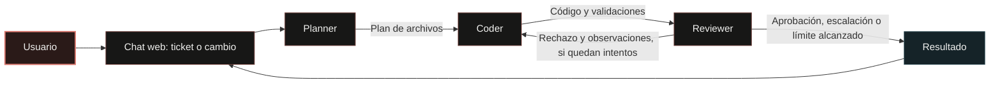
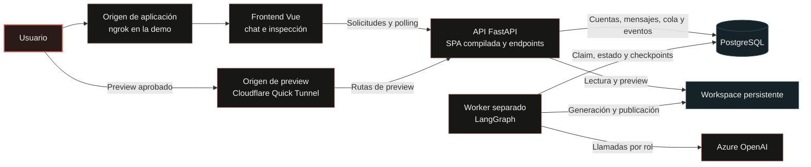

# AI Multi-Agent Coding Platform

Esta plataforma permite crear pequeñas aplicaciones web a partir de una descripción. Desde un chat, el usuario
plantea lo que necesita y pide cambios sobre el mismo proyecto. Tres agentes se encargan de planear los archivos,
generar el código y revisar el resultado.

La demo trabaja con aplicaciones estáticas en HTML, CSS y JavaScript e incluye cuentas de usuario,
conversaciones persistentes e historial de ejecuciones.

[Demo pública](https://version-afar-augmented.ngrok-free.dev) ·
[Diseño técnico — English](docs/architecture.md) ·
[Swagger local](http://localhost:8000/docs)

## Funcionalidades principales

- Solicitudes en lenguaje natural y conversaciones que conservan el contexto de cada proyecto.
- Plan de trabajo, generación de archivos y revisión con observaciones para corregir el código.
- Hasta tres generaciones del Coder por ejecución, incluida la primera; el límite es configurable.
- Historial con estados, validaciones, archivos guardados y consumo de tokens cuando Azure lo informa.
- Explorador de código y vista previa de la última versión aprobada.
- Solicitud de orientación cuando los agentes agotan sus intentos o necesitan una aclaración.
- Interfaz adaptable a teléfonos y escritorio, con una barra lateral para cambiar de chat.

## ¿Cómo funciona?



1. Al enviar el primer mensaje en **Nuevo chat**, se crea un proyecto. Las siguientes solicitudes de ese chat
   trabajan sobre sus archivos.
2. El **Planner** propone entre uno y ocho archivos. El **Coder** escribe su contenido completo a partir del plan
   y de los archivos que ya existen.
3. Se revisa que los archivos estén presentes y que el JavaScript externo tenga sintaxis válida. Después, el
   **Reviewer** compara el código con la solicitud y señala los problemas que encuentra.
4. Si aprueba el resultado, se publica la vista previa. Si pide correcciones, el Coder recibe sus observaciones
   y vuelve a intentarlo. Al llegar al límite, se conserva el trabajo y se pide orientación al usuario.

Cada solicitud se registra como un **run**. Si necesita una aclaración, el usuario puede continuar ese mismo run
en una nueva **ejecución**, que vuelve a pasar por los tres agentes.

## Arquitectura general



La API recibe las solicitudes y permite consultar su avance. El worker ejecuta los agentes en segundo plano,
por lo que el navegador puede seguir consultando el estado durante una generación larga. Ambos procesos usan
la misma imagen de Docker y comparten el almacenamiento.

El backend también sirve las vistas previas, con un hostname distinto para separar el código generado de la
aplicación donde inicia sesión el usuario. El [diseño técnico](docs/architecture.md) explica los contratos,
la persistencia y los límites de esta separación.

## Tecnologías principales

| Tecnología | Responsabilidad y motivo de uso |
|---|---|
| Vue 3, TypeScript, Pinia, Tailwind y Vite | Interfaz del chat, navegación y consulta de resultados. Vite compila la aplicación para servirla desde el backend. |
| FastAPI y Pydantic v2 | API, validación de datos y documentación OpenAPI generada a partir de las rutas. |
| LangGraph | Coordina el orden de los agentes, las revisiones y los checkpoints de cada ejecución. |
| PostgreSQL 17, SQLAlchemy y Alembic | Almacenan cuentas, conversaciones y ejecuciones; PostgreSQL también resuelve la cola y los límites de peticiones de la demo. |
| Azure OpenAI y SDK OpenAI | Proveedor actual de los agentes, con respuestas estructuradas y deployments configurables por rol. |
| Python 3.14 y Node.js | Python ejecuta la API y el worker. Node comprueba la sintaxis del JavaScript generado mediante `node --check`. |
| Docker Compose, ngrok y cloudflared | Levantan los servicios y permiten compartir la demo desde una máquina local, con direcciones separadas para la app y sus vistas previas. |

## Instalación y ejecución local

### Requisitos y configuración

Para ejecutar el proyecto con Docker necesitas Git, Docker Engine y Docker Compose v2. La imagen incluye Python
y Node. La generación de código requiere una cuenta de Azure OpenAI con deployments compatibles con JSON Schema.

Desde la raíz, **solo si aún no existe `.env`**:

```bash
cp .env.example .env
openssl rand -hex 32
```

Guarda el secreto generado en `SECRET_KEY`, cambia `POSTGRES_PASSWORD` y ajusta `DATABASE_URL` para tus procesos
locales. `.env` reúne la configuración de desarrollo y de la demo; si ya lo tienes, conserva sus credenciales
y modifica solo los valores necesarios. Los archivos de ejemplo deben quedarse sin credenciales reales.

| Variable | Qué configurar |
|---|---|
| `APP_ENV` | `development` en local; `production` para la demo pública. |
| `POSTGRES_USER`, `POSTGRES_PASSWORD`, `POSTGRES_DB` | Credenciales de PostgreSQL. Compose arma la conexión interna con el hostname `db`. |
| `DATABASE_URL` | Conexión para los procesos que ejecutas fuera de Docker. |
| `SECRET_KEY` | Secreto para firmar los JWT. En producción debe tener al menos 32 caracteres y un valor distinto al del ejemplo. |
| `PUBLIC_URL`, `FRONTEND_ORIGIN`, `PREVIEW_HOST` | En local: `http://localhost:8000`, `http://localhost:5173` y `http://preview.localhost:8000`. La app y las vistas previas requieren hostnames distintos. |
| `AZURE_OPENAI_API_KEY`, `AZURE_OPENAI_ENDPOINT` | Credencial y endpoint Azure terminado en `/openai/v1/`. |
| `AZURE_OPENAI_DEPLOYMENT_PLANNER`, `AZURE_OPENAI_DEPLOYMENT_CODER`, `AZURE_OPENAI_DEPLOYMENT_REVIEWER` | Nombres reales de deployment; pueden coincidir o ser distintos. |
| `MAX_RUNS_PER_PROJECT`, `MAX_CODER_GENERATIONS` | Por defecto, `10` runs guardados por proyecto y `3` generaciones totales por ejecución. |

Puedes iniciar sesión y consultar la aplicación antes de configurar Azure. Si intentas generar código, el run
indicará qué variable falta. Consulta la [referencia de configuración](docs/architecture.md#93-environment-variables)
para el resto de las opciones.

### Arranque con Docker

```bash
docker compose up -d --build
docker compose ps
curl -fsS http://localhost:8000/health
```

Compose inicia PostgreSQL, aplica las migraciones con el servicio `migrate` y después arranca la app y el worker.
`/health` devuelve `200` cuando puede acceder a la base, escribir en el workspace y detectar un heartbeat reciente
del worker. Durante el arranque puede responder `503`.

- Aplicación y API: <http://localhost:8000> y rutas bajo `/api/v1`.
- Swagger/OpenAPI: <http://localhost:8000/docs> y <http://localhost:8000/openapi.json>.
- Vista previa: el enlace de cada proyecto tiene la forma `http://preview.localhost:8000/preview/{preview_id}/`.
- PostgreSQL: `127.0.0.1:5432`. La API se publica solo en `127.0.0.1:8000`.

```bash
docker compose logs -f --tail=200 app worker
docker compose down
```

`down` conserva los volúmenes. **`docker compose down -v` elimina la base y los archivos persistentes.** Las
credenciales `POSTGRES_*` inicializan un volumen nuevo; cambiarlas no rota automáticamente las de uno existente.

### Desarrollo y pruebas

Para trabajar fuera de Docker, instala Python 3.14 y Node.js/npm. Después, prepara el entorno desde `server/`:

```bash
python -m venv .venv
source .venv/bin/activate
pip install -e '.[dev]'
```

Con `DATABASE_URL` apuntando a tu base de desarrollo, aplica las migraciones con `alembic upgrade head`.
Levanta la API con `uvicorn app.main:create_app --factory --reload` y el worker con `python -m app.worker`, cada
uno en su terminal. Desde `client/`, `npm ci && npm run dev` abre Vite en <http://localhost:5173> y redirige `/api`
a la API local.

**Usa una base exclusiva para las pruebas:** los fixtures de pytest vacían las tablas. Con PostgreSQL disponible,
puedes crear `app_test` desde la raíz:

```bash
docker compose exec db sh -c 'createdb -U "$POSTGRES_USER" app_test'
```

La base se crea una sola vez. Si ya existe, continúa desde `server/` con el entorno virtual activo:

```bash
export DATABASE_URL='postgresql+asyncpg://<usuario>:<password>@127.0.0.1:5432/app_test'
alembic upgrade head
ruff check .
ruff format --check .
pytest
python -m evals.runner
```

Sustituye los valores entre `<...>` y codifica los caracteres especiales de la contraseña para usarlos en una URL.
Las pruebas usan respuestas de modelo simuladas. Para completar la validación, PostgreSQL debe estar disponible.

Desde la raíz, con la app de Compose activa:

```bash
docker compose --profile e2e run --rm browser
```

Playwright recorre el chat, las continuaciones y las pantallas de detalle en móvil y escritorio con una API simulada.
Para evaluar la calidad de las aplicaciones generadas hacen falta tickets reales y pruebas de comportamiento.
Para comprobar la compilación del frontend, ejecuta `npm run build` desde `client/`.

## Demostración pública

La aplicación está disponible en <https://version-afar-augmented.ngrok-free.dev> mientras la máquina que la aloja
permanezca encendida y conectada.

La demo usa ngrok para la app y Cloudflare Quick Tunnel para las vistas previas. El dominio de ngrok está en
[ngrok.yml](ngrok.yml) y debe coincidir con `PUBLIC_URL`.

1. Ajusta `.env`: `APP_ENV=production`, `PUBLIC_URL` al dominio configurado y un `SECRET_KEY` fuerte. Mantén
   `FRONTEND_ORIGIN=http://localhost:5173` si también usarás Vite. `PREVIEW_HOST` debe existir y usar otro hostname;
   el valor local del ejemplo sirve para el arranque inicial.
2. Copia `.env.tunnel.example` a `.env.tunnel` si aún no existe y agrega `NGROK_AUTHTOKEN`. Solo ngrok recibe ese
   archivo; app y worker reciben `.env`.
3. Ejecuta:

```bash
./demo-up.sh
```

El script inicia ambos conectores y la aplicación, lee el hostname del Quick Tunnel, actualiza `PREVIEW_HOST` en
`.env` y recrea app/worker si cambió. Úsalo después de reiniciar la máquina o recrear el túnel. Un reinicio aislado
de cloudflared puede dejar el preview apuntando al hostname anterior hasta volver a ejecutar el script.

## Decisiones de diseño

| Problema | Decisión y beneficio | Compromiso |
|---|---|---|
| Organizar la generación y su revisión | Cada agente tiene una tarea y una salida definida, que el usuario puede consultar. | Aumentan las llamadas al modelo y pueden persistir errores compartidos entre roles. |
| Controlar las correcciones automáticas | Se limita el número de generaciones y se pide orientación al agotarlas. | Algunos problemas requieren otra ejecución con ayuda del usuario. |
| Atender solicitudes durante una generación larga | La API registra y consulta el trabajo; el worker lo ejecuta. | Hay que mantener el polling, los heartbeats y la recuperación de estado. |
| Mantener una infraestructura sencilla | PostgreSQL reúne datos, cola e historial para la carga de la demo. | API y worker comparten recursos de base de datos; ampliar la concurrencia requiere medir esa carga. |
| Conservar el contexto | Cada chat pertenece a un proyecto y reúne sus solicitudes, archivos y memoria. | La asociación entre chat y proyecto es fija. |
| Retomar trabajo pendiente | `awaiting_user` guarda los problemas de la revisión y permite continuar el mismo run con orientación. | El chat queda ocupado hasta continuar o cerrar ese run. |
| Separar el código generado de la sesión del usuario | La vista previa se sirve en otro origen y se abre mediante un enlace compartible. | Cualquier persona con el enlace puede verla. |
| Investigar fallos y consumo | Los eventos, logs y tokens permiten seguir cada ejecución. | La retención de logs es limitada y el consumo observado puede quedar incompleto en un fallo. |

## ¿Qué ocurre cuando el Coder y el Reviewer no llegan a un acuerdo?

El Reviewer puede aprobar el resultado, pedir correcciones o escalar el caso para solicitar orientación.
Cuando pide correcciones, el Coder recibe sus observaciones y vuelve a generar los archivos sobre el mismo plan.

El límite se configura con `MAX_CODER_GENERATIONS`. Su valor inicial, `3`, permite una generación y hasta dos
revisiones. El mínimo es `1`. Cada generación abarca todos los archivos del plan y puede requerir varias llamadas
al modelo; si el Reviewer aprueba antes, la ejecución termina ahí.

Al agotar los intentos o escalar el caso, el run queda en `awaiting_user` y conserva los archivos y las observaciones.
La última vista previa aprobada sigue disponible. Desde los detalles, el usuario puede enviar una aclaración para
iniciar otra ejecución del mismo run, con un nuevo `execution_id` y sus intentos disponibles, o cerrarlo como
`failed`. Los errores técnicos también se registran con ese estado y una explicación para el usuario.

Este límite ayuda a controlar el tiempo y el consumo de cada ejecución. La revisión automática comprueba el plan,
los archivos y la sintaxis; la corrección funcional de la aplicación todavía requiere pruebas de comportamiento.
La demo tampoco aplica un presupuesto monetario o de tokens.

## ¿Qué mejoraría con más tiempo?

**A. Trabajar sobre repositorios existentes.** Ampliaría `Workspace` para consultar una base de código, preparar
cambios, mostrar diffs y abrir pull requests. Eso requiere seleccionar bien el contexto, limitar los permisos del
repositorio y ejecutar las validaciones en un entorno aislado.

**B. Probar más proveedores y modelos.** Cada agente ya puede usar un deployment distinto de Azure. Agregaría
otros proveedores y compararía calidad, latencia, fiabilidad y costo con tickets reales, incluyendo la precisión
del Reviewer al aprobar o rechazar una solución.

**C. Versionar las instrucciones de los agentes.** Guardaría la versión de los prompts usada en cada ejecución
para poder reproducir y comparar resultados. Si fuera necesario cambiarlos durante la operación, una configuración
controlada en PostgreSQL permitiría hacerlo con historial de cambios.

**D. Ampliar la validación.** Empezaría por pruebas funcionales en navegador y casos de regresión con tickets
conocidos, dentro de un entorno aislado y con límites de recursos. Una capacidad de testing dedicada podría ayudar
a preparar y ejecutar esas pruebas.

**E. Seguimiento de la operación.** A partir de los eventos, logs y tokens actuales, agregaría métricas de
latencia, consumo y fallos. OpenTelemetry, Prometheus/Grafana o New Relic serían opciones según el volumen y las
necesidades de diagnóstico.

**F. Desplegar y escalar los servicios por separado.** Separaría los despliegues de frontend, API y workers, con
almacenamiento compartido y una recuperación de tareas más sólida. Mantendría el monorepo mientras facilite el
trabajo del equipo; dividirlo tendría sentido si cambian las responsabilidades o los ciclos de publicación.

## Documentación adicional

- [Diseño técnico en inglés](docs/architecture.md): contratos, datos, seguridad, límites y puntos de extensión.
- [Swagger local](http://localhost:8000/docs), [ReDoc local](http://localhost:8000/redoc) y
  [OpenAPI JSON](http://localhost:8000/openapi.json): requieren la API activa en modo local.
- [Pruebas backend](server/tests/), [evals deterministas](server/evals/runner.py) y
  [journey de navegador](client/e2e/chat.spec.ts).
- [Configuración de ejemplo](.env.example), [Compose](docker-compose.yml) y [arranque de demo](demo-up.sh).

La revisión se basó en el código y las pruebas disponibles. Queda pendiente revisar el PDF original y las reglas
del ejemplo de cupones. El PRD de `tasks/` es un borrador local, excluido de Git.
