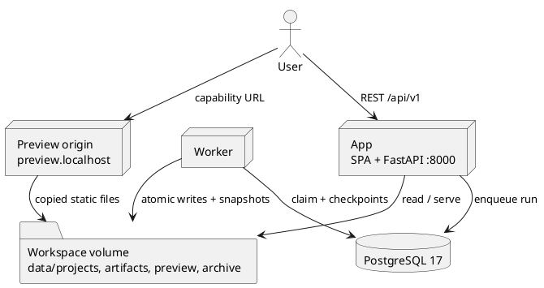

# AI Multi-Agent Coding Platform

Describe a small web app in plain language. The platform plans the files, generates them, reviews the result,
and returns a preview or a handoff with the open issues.

> **Status:** planning phase. This repository holds the architecture, Docker scaffolding, and dependency
> manifest. `server/app/` and `client/` are not implemented yet; the stack below is the target design.

## How it works



The API only enqueues runs. A separate worker claims them from PostgreSQL and executes the LangGraph workflow
(planner → coder → reviewer). The Coder gets three attempts; only a completed result or a handoff reaches the
user. If no project is selected, a resolver agent chooses one from the user's history or creates it. The SPA
polls run state and events.

The [technical design document](docs/architecture.md) is the source of truth for the stack, contracts, security
rules, schema, trade-offs, and the presentation guide. The PRD, in the ignored `tasks/` directory, owns user
stories and acceptance criteria.

## Run the local stack (target)

1. Copy `.env.example` to `.env` and set `DATABASE_URL`, `SECRET_KEY`, and the Azure key and deployments. See
   the [environment table](docs/architecture.md#93-environment-variables).
2. Build and start:

   ```bash
   docker compose build
   docker compose up -d
   docker compose exec app alembic upgrade head
   curl -fsS http://localhost:8000/health
   ```

3. Open:

   - App `http://localhost:8000`
   - API `http://localhost:8000/api/v1`
   - Preview `http://preview.localhost:8000`

Manual development: start PostgreSQL 17, run `alembic upgrade head` and
`uvicorn app.main:create_app --factory --reload` from `server/`, start `python -m app.worker`, and run Vite
from `client/`. See the [serving contract](docs/architecture.md#92-serving-and-topology).

## Security

- JWT authentication; projects, runs, files, and traces are owner-scoped.
- Per-IP and per-user rate limits; over-limit requests return `429` with `Retry-After`.
- Only the developer configures providers, credentials, and models; users have no settings surface.
- Credentials are resolved in infrastructure and never reach domain or application code.
- Preview is a separate origin served from a capability URL. Generated JavaScript is syntax-checked with
  `node --check` and never executed by the server.

See [API design](docs/architecture.md#6-api-design) and the
[security model](docs/architecture.md#7-security-and-abuse-prevention).

## Repository layout

- `client/` — planned Vue 3 / TypeScript SPA.
- `server/` — FastAPI / LangGraph backend, worker, tests, and evaluation harness.
- `shared/` — reserved for shared contracts.
- `docs/` — architecture.
- `tasks/` — ignored working briefs and the PRD.
- `Dockerfile`, `docker-compose.yml`, `.env.example` — target local stack.

## Design notes

### What I would change with more time

Add a dedicated tester agent, so a plausible review is not treated as proof the app works, and grow the
evaluation dataset from real requests. Move generated-app execution from the static iframe to isolated
containers or Git-backed workspaces, and move the worker to a durable external queue with spend limits and
team RBAC.

### Where other models are worth trying

The model layer is a port, so providers change by developer configuration, never by end users. The Reviewer is
the best first experiment: a wrong review is recoverable, while a wrong Coder output consumes an attempt.
Planner and Coder are poor candidates for small models because multi-file coherence, long context, and strict
structured output degrade first. See [providers and secrets](docs/architecture.md#43-providers-and-secrets).

### How Coder and Reviewer disagreement is handled

The review loop is bounded to three Coder attempts and runs without human input. An unresolved disagreement is
never shown as success: the run stops in `awaiting_user` with the latest files, open issues, and both counts.
New guidance reruns the whole planner → coder → reviewer flow with a fresh attempt budget. See the
[state contract](docs/architecture.md#52-state-contract).

## Docs

- [Technical design document](docs/architecture.md) — contracts, diagrams, schema, decisions and trade-offs,
  verification, and the presentation guide, including the
  [adapter recipe](docs/architecture.md#44-adding-an-adapter).
