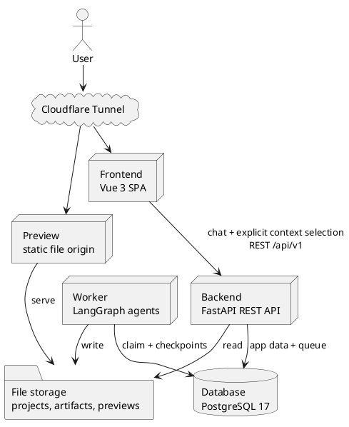
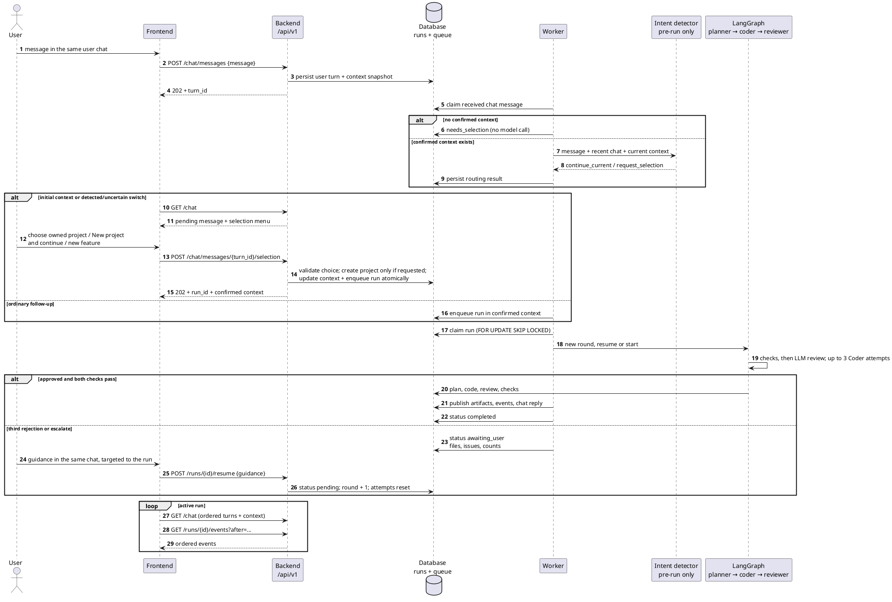
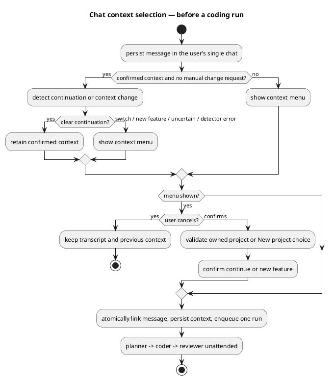
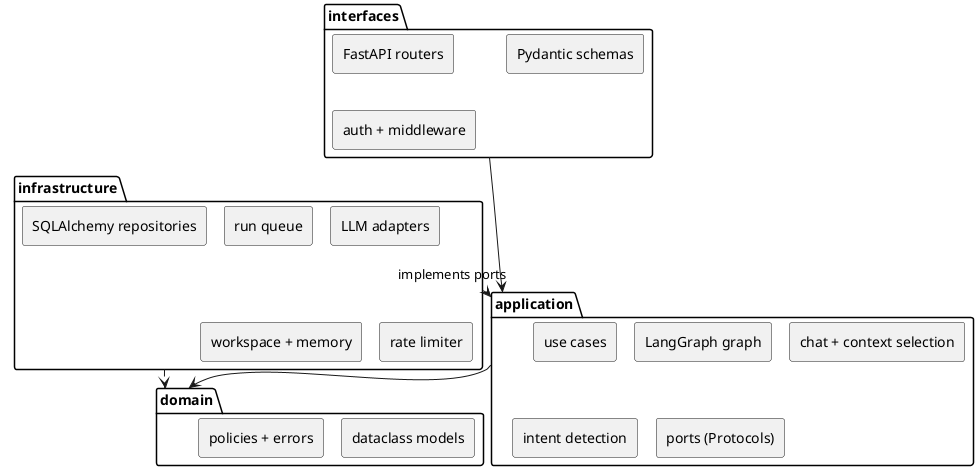
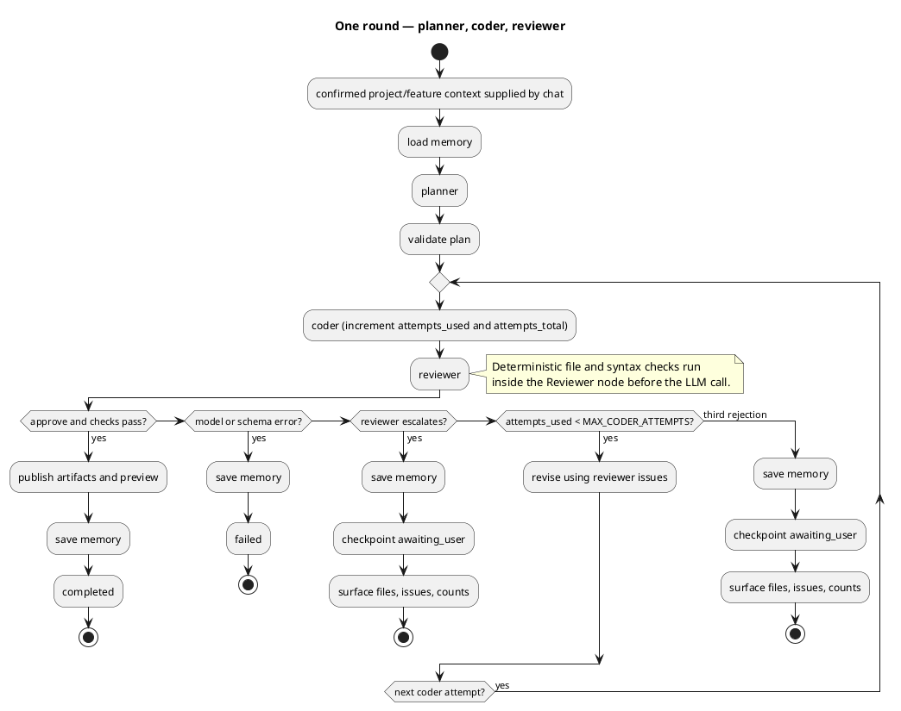
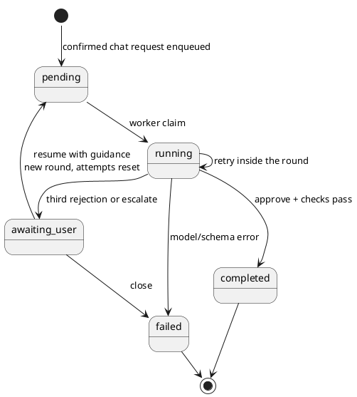
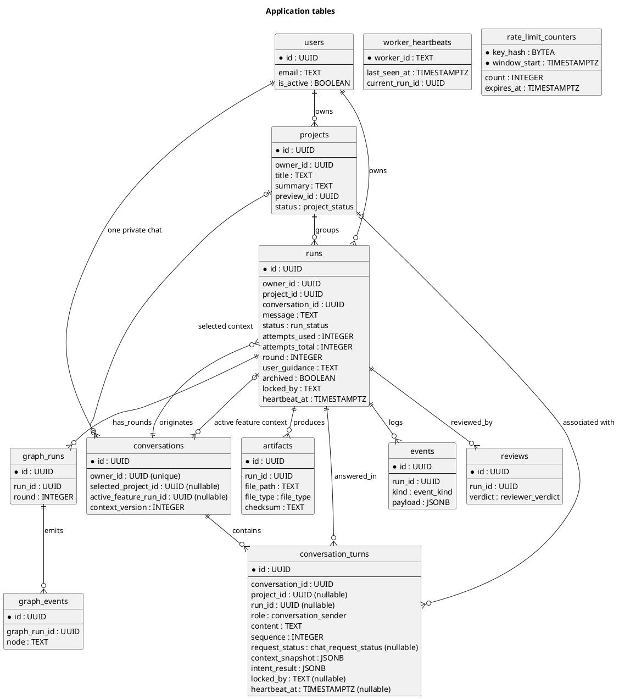

# Technical Design Document — AI Multi-Agent Coding Platform (MVP)

This Technical Design Document (TDD) defines the target architecture, contracts, and technical rationale.
The PRD in `tasks/prd-mvp.md` owns product scope, user stories, acceptance criteria, and success targets.

## 0. Executive summary

A user describes a static app or feature through one persistent, private chat spanning their projects.
Initial requests and detected or uncertain project/feature changes open a selection menu. Only the user can
select an owned project or authorize **New project**; ordinary follow-ups retain the confirmed context.

After context is confirmed, an unattended Planner → Coder → Reviewer round generates complete files and
checks them. Approval publishes a static preview. Three rejected Coder attempts or a valid escalation produce
an `awaiting_user` handoff; guidance reruns the whole round with a fresh attempt budget. Errors fail explicitly.

The system uses a Vue SPA, FastAPI, a separate LangGraph Worker, PostgreSQL, and persistent file storage.
Docker runs locally, with Cloudflare Tunnel exposing separate app and preview origins. Provider configuration
is developer-only, and the server never executes generated code.

## 1. Problem and goals

### 1.1 Problem

Give a non-engineer a working starting point from a plain-language request, without pretending that generated
code is always correct. The hard part is not generation alone; it is producing something reviewable, showing
what was done, and being explicit when the agents cannot agree. A demo that fabricates success is worse than a
demo that shows an honest handoff.

### 1.2 Goals

- Accept a plain-language request and produce a visible plan, complete files, a review outcome, and an explicit
  completed or handoff state.
- Make one user-wide chat the default interaction for creating projects, adding features, and revisiting old work.
- Preserve chat history and explicitly selected project/feature context across follow-up runs and sessions.
- Never report an unresolved result as approved.
- Keep coding rounds unattended; expose progress without requiring mid-round input, and surface an honest
  final result, failure, or handoff.
- Let the user inspect files, preview the result, guide a handoff, and close an abandoned run.
- Support multi-user login with owner-scoped projects, runs, files, and traces.
- Keep model credentials out of the domain, out of the repository, and out of the user interface.
- Survive a worker restart without losing an accepted result.

### 1.3 Non-goals

- Server-side execution of generated backend code or generated JavaScript. The preview is static files only.
- Containerized or Git-backed workspaces, or per-run project versioning beyond approved artifacts.
- Enterprise delegated credentials, SSO federation, or per-user external-system integrations.
- User-facing provider, credential, or model configuration.
- Billing, hard spend caps, or token-budget enforcement.
- RBAC beyond project ownership.
- A broad browser test matrix.
- Automatic project selection or creation by an agent, and multiple independent chats per user.

## 2. Constraints and assumptions

- **$0 hosting for the assessment.** Docker on localhost supplies a durable filesystem and Node subprocesses;
  Cloudflare Tunnel supplies public HTTPS access.
- **PostgreSQL 17 is the only datastore.** No Redis, no broker, no object store in the MVP. This keeps one
  backup story and one failure mode.
- **Azure OpenAI is the only provider in the MVP.** Live verification depends on credentials and deployment
  names supplied by the developer (§13.2); deterministic tests use fake model ports.
- **Node is required at runtime** for `node --check`; the runtime image must include it.
- **The preview cannot be trusted with secrets.** Generated projects are static, unauthenticated, and
  capability-addressed.
- **Only the developer configures the provider.** Azure deployments and credentials come from environment
  configuration, never from the product UI or per-project settings.

## 3. System design

### 3.1 Components

| Component | Responsibility |
|---|---|
| Frontend | Vue 3, TypeScript, Pinia, Tailwind, Vite. One persistent user chat as the landing screen; inline context-selection menu, run progress, plan, files, review, and sandboxed preview. Polls chat and run state over a typed REST client. |
| Backend | FastAPI under `/api/v1`; auth, chat, manual context confirmation, projects, runs, files, preview URL, health. Persists messages, validates ownership and selections, and enqueues work; never calls models or executes the graph in-request. |
| Worker | Classifies chat intent before run creation; continues confirmed context or requests a selection menu. Claims pending runs, executes planner → coder → reviewer, writes files and events, updates memory, and finalizes the run. |
| Database | PostgreSQL 17: application tables, durable run queue, rate-limit counters, LangGraph checkpoints, and the long-term memory store. |
| File storage | Persistent volume for latest project files, approved artifacts, preview snapshots, and archives. |
| Preview | A separate static origin serving copied files at an unguessable capability URL. Never executes generated code. |
| Tunnel | Cloudflare Tunnel exposing the frontend and preview hostnames over HTTPS. |



### 3.2 Request and run flow



- `POST /api/v1/chat/messages` persists a message and returns `202` with its turn id. Intent detection happens
  asynchronously before a run exists. Chat polling exposes `needs_selection` or the associated run id.
- The Backend never executes the graph. The Worker owns the run lock, heartbeat, round, and terminal
  transitions.
- The human is not involved during a round. After three rejected Coder attempts the run stops in
  `awaiting_user`; guidance starts a new round at the Planner, not at the Coder.
- A model-driven run can take minutes; the PostgreSQL-backed queue keeps HTTP requests short and lets the Worker
  restart independently without adding a broker.

### 3.3 Single-chat interaction and context menu

After login, the user returns to the same chat, including messages about previous projects, selection prompts,
results, and handoffs. Project lists, file inspection, run details, and preview are supporting panels linked
from the chat. A project-creation form or separate run page is not the main workflow.

The menu offers the user's existing projects and **New project**. It also distinguishes continuing the current
feature from starting a new feature in the chosen project. For a false-positive switch, **Continue current
context** keeps the original selection; **Cancel** preserves the message without executing it. A manual
change-context action opens the same menu. No menu is required for an ordinary continuation.

A feature is a coding request/run with follow-up work in the selected project, not a separate `features` table
in the MVP. Each new coding request creates a run; guidance on a handoff explicitly targets and resumes that
same run. `active_feature_run_id` identifies the originating run for the current feature: continuations keep
that reference, while a new-feature selection starts a new reference at its first run. The request's context
snapshot records this association. Switching context never retargets an already queued, running, or
awaiting-user run. Returning to a project restores its most recent feature context from its associated turns.

The original message is retained while the menu is open and submitted once after confirmation. The context
badge identifies the current project and feature; messages and result cards retain their own project/run
associations when the user switches away.



## 4. Application architecture

### 4.1 Layers and package layout

Imports flow `interfaces → application → domain`. `infrastructure` implements application ports and may import
domain types. Composition happens only at the entry points and in the hand-written
`infrastructure/container.py`; no mutable global state is shared between requests or runs.

| Layer | Owns | Must not own |
|---|---|---|
| `domain` | Plain dataclasses, errors, and pure policies: retry budget, plan-set guard, approval rules, state transitions. | FastAPI, SQLAlchemy, provider SDKs, filesystem or network I/O. |
| `application` | Chat/context use cases, pre-run intent detection, LangGraph wiring, and narrow `typing.Protocol` ports. | Infrastructure adapters, routers, SDK types. |
| `infrastructure` | PostgreSQL repositories, queue, workspace, LLM providers, memory store, rate limiter, clock. | Business policy. |
| `interfaces` | FastAPI routers, request/response schemas, auth dependencies, middleware, composition. | Domain rules or direct SDK calls. |



```text
server/app/
├── domain/
│   ├── models.py          # chat, context, Plan, Code, Feedback, run state
│   ├── errors.py          # DomainError and subclasses
│   └── policies.py        # retry budget, plan-set guard, approval rules
├── application/
│   ├── ports.py           # Protocol ports listed below
│   ├── graph.py           # LangGraph workflow
│   ├── chat.py            # user chat, context selection, pre-run intent detection
│   ├── checks.py          # deterministic file/syntax checks
│   ├── memory.py          # load/save memory use cases
│   └── use_cases/         # start_run, resume_run, close_run, finalize_run, ...
├── infrastructure/
│   ├── llm/               # Azure LLM registry and OpenAI-compatible adapter
│   ├── persistence/       # SQLAlchemy async repositories
│   ├── queue/             # Postgres run claim/heartbeat adapter
│   ├── workspace/         # WebWorkspace filesystem adapter
│   ├── memory/            # AsyncPostgresStore adapter
│   ├── rate_limit/        # Postgres fixed-window limiter
│   └── container.py       # manual dependency injection
├── interfaces/
│   ├── api/               # /api/v1 routers and preview router
│   ├── schemas/           # Pydantic request/response models
│   ├── middleware/        # rate limiting and request context
│   └── dependencies.py    # auth and ownership dependencies
├── main.py                # create_app() factory
└── worker.py              # worker entry point
```

### 4.2 Ports

| Port | Contract |
|---|---|
| `LLMClient` | One structured model call for a role. Returns validated output or a typed model error. No SDK types cross the boundary. |
| `Workspace` | List, read, write project files; run read-only checks; return a preview URL; delete a project workspace. Writes are plan-guarded and atomic. |
| `RunRepository` | Persist and read the user chat, context, turns, run state, attempts, reviews, and artifacts; atomically confirm selection/enqueue and apply terminal transitions. |
| `RunQueue` | Enqueue, claim, heartbeat, release, and reclaim runs. Hides the SQL queue mechanics. |
| `EventSink` | Append ordered run events. Append-only. |
| `MemoryStore` | Load relevant project memory and save deterministic memory items; maintain the user's project index. Hides the store backend; memory cannot authorize a context change. |
| `RateLimiter` | Consume a named fixed-window budget and report the retry delay. PostgreSQL-backed, shared across API workers. |
| `Clock` | Provide current time for tests and policies. |

### 4.3 Providers and secrets

The infrastructure registry builds one Azure OpenAI `LLMClient` per role from **developer environment
configuration only**. End users have no provider choice. Per-role Azure deployment names are the only
per-role setting; the pre-run intent detector uses the Planner deployment and has no project-selection
authority. Another provider requires a new adapter and verification; compatibility is not assumed.

If `AZURE_OPENAI_API_KEY`, `AZURE_OPENAI_ENDPOINT`, or a role's deployment name is missing, that role gets an
unavailable client that raises a masked setting-specific error. There is no fallback provider. There are no
per-role provider overrides, no per-project credentials, no project settings endpoints, and no `/models`
endpoint.

Azure notes: use the standard `openai` client against the resource's `/openai/v1/` base URL with
`chat.completions` and JSON Schema structured output. For Azure, the request `model` field is the
**deployment name**, not the underlying model name. See §13.2 for the live-verification dependency.

Never pass an API key, token, URL, or provider SDK type into domain or application code. Infrastructure resolves
environment credentials and injects ports. Only infrastructure reads `*_API_KEY` values.

### 4.4 Adding an adapter

1. Implement the port under `infrastructure/`; keep SDK, database, filesystem, URL, and credential values there.
2. Register its factory in `infrastructure/container.py` and in the provider registry.
3. Add a focused external-boundary test and a fake-port fixture for the use case.
4. Run `ruff` and `pytest` from `server/` before swapping an adapter in.

## 5. Agent workflow and state

### 5.1 Graph



`START → load confirmed project memory → planner → coder → reviewer`. Context selection and intent detection
finish before a run is enqueued; neither is a graph node. The Reviewer runs deterministic
checks before the LLM review; approval requires both. The Coder gets at most `MAX_CODER_ATTEMPTS=3` generations
per round, revised only from Reviewer feedback. The third rejection or a valid `escalate` yields
`awaiting_user`, never a false approval. Model/schema errors end the run as `failed` with no model-error retry.
`chat_reply` is written by the application layer, not a graph node.

There is no clarification pause and no mid-round human input. The selection menu is a pre-run chat state, not
`awaiting_user`. A round is unattended until `completed`, `failed`, or `awaiting_user`. `awaiting_user` persists
the handoff for an explicit resume; a context switch does not resume it.

### 5.2 State contract

| Object | Required fields and rules |
|---|---|
| `PlanStep` | UUID4 `id`, `name`, relative `file_path`, `file_type`, `description`, optional artifact IDs, timestamp. |
| `Plan` | `id`, `project_id`, 1–8 steps, `summary`, timestamp. |
| `Code` | `id`, `run_id`, `file_path`, complete `content`, lowercase SHA-256 `checksum`, timestamp. |
| `Feedback` | `verdict`, `summary`, `issues`, optional `suggested_code`, timestamp. |
| `CheckReport` | `file_structure_ok`, `js_syntax_ok`, `files_checked`, `syntax_checked`, `issues`. |
| `Conversation` | UUID `id`, unique `owner_id`, nullable `selected_project_id`, nullable `active_feature_run_id`, monotonic `context_version`, timestamps. One per user; selected references must belong to that user and the feature run must belong to the selected project. |
| `ConversationTurn` | UUID `id`, `conversation_id`, ordered `sequence`, sender, content, nullable `project_id`/`run_id`, and timestamps. User requests additionally persist routing status, context snapshot/version, and validated intent result; chat responses include the linked run's current status. |
| `RunState` | `id`, `owner_id`, non-null confirmed `project_id`, `conversation_id`, `message`, `status`, plan, latest code, feedback, checks, `attempts_used`, `attempts_total`, `round`, latest `user_guidance`, events, trace, terminal `chat_reply`, timestamps. `GraphState` adds LangGraph metadata/next-node fields. The project cannot change after enqueue. |
| `RunEvent` | UUID, event kind, typed payload, timestamp; append-only. |

`RunStatus` is `pending | running | awaiting_user | completed | failed`:

- `pending` queued and claimable.
- `running` a Worker owns the run and is heartbeating.
- `awaiting_user` the Coder budget is spent or the Reviewer escalated; the run needs guidance.
- `completed` and `failed` are terminal.



`attempts_used` counts Coder generations in the current round; `attempts_total` never resets. Each round is a
new LangGraph thread (`graph_runs.round`), so a resume starts at the Planner, not at the interrupted Coder node.
On resume: increment `round`, reset `attempts_used=0`, append guidance, set status `pending`, and let the Worker
claim the run again. Model-call records belong in the trace; counters and `RunStatus` define the retry and
terminal-state policy without a separate failure flag.

- `MAX_CODER_ATTEMPTS=3` means at most three Coder generations per round. Increment both counters once per Coder
  invocation before checks. A checksum or static-check failure consumes the attempt.
- The third rejection or a valid `escalate` persists the latest files, issues, round, and both counts, then
  stops in `awaiting_user`.
- `POST /runs/{id}/resume` is valid only for `awaiting_user`. It keeps the same run and project, starts a new
  round, and reruns the whole flow with attempts restored.
- `POST /runs/{id}/close` marks an abandoned handoff `failed`. `DELETE` is destructive removal of terminal runs
  only. Routing depends only on the validated verdict, error tag, and persisted count.
- Validate the whole state before each checkpoint. The Reviewer uses `temperature=0`.

### 5.3 Agent contracts

| Agent | Input | Output and validation |
|---|---|---|
| Intent detector (pre-run, outside graph) | Message, current confirmed project/feature context, and bounded recent user-chat context | `{action: continue_current or request_selection, reason}`; Pydantic validation. New-project, new-feature, switch, or uncertain intent requests the menu. No returned project id, creation command, or selected target. |
| Planner | `project_id`, message, project-filtered conversation history, relevant memory | `Plan`; Pydantic schema; UUID4 IDs; relative path with no leading `/`, `..`, or backslash and matching `^[A-Za-z0-9_\-./]+$`; allowlisted file type; 1–8 steps. |
| Coder | `project_id`, latest plan/step, complete `existing_files`, step index, project memory | `Code`; path must be in the current plan; application recomputes SHA-256; complete files only, written atomically; local asset references must be relative. |
| Reviewer | project, plan, code list, `CheckReport`, relevant memory | `Feedback` with verdict `approve`, `reject`, or `escalate`; summary, issues, optional suggested code, timestamp; Pydantic validation. |

Use JSON Schema structured output for each role and Pydantic `model_validate` at the boundary; never regex-parse
free text. The adapter may make one repair call for malformed output, recorded within the same Coder attempt
when applicable. Do not treat transport/authentication failures as repairable output. On unrecoverable graph
failure, tag `planner_error`, `coder_error`, or `reviewer_error`, record an error trace and `error → run_end`
events, and show a clear final message. An unparsable
Reviewer response is `reviewer_error`; a valid `escalate` is a handoff. Schema errors never become a valid
verdict. A detector/schema failure occurs before run creation: mark the chat request `needs_selection` with
`intent_error`, leave context unchanged, and let the user explicitly choose via the menu. Do not
silently enqueue against a guessed target.

### 5.4 Static checks

`run_checks` is a read-only application service invoked inside the Reviewer node before the LLM call.

- Stage 1: every planned file exists below the project root, is nonempty, and has an allowed extension.
- Stage 2: every generated `*.js` file passes `node --check`; the process has a timeout and cannot execute the
  file.
- Both stages must pass. A failure enters the Coder retry/handoff policy and is included in the Reviewer input.
- The report is `{file_structure_ok, js_syntax_ok, files_checked, syntax_checked, issues}`.
- The Worker image must contain Node. Generated files must use relative local asset paths so the preview
  capability path keeps resolving assets.

### 5.5 Long-term memory and pre-run intent detection

LangGraph's PostgreSQL-backed `AsyncPostgresStore` is compiled into the graph and initialized with `setup()`,
like the checkpointer. Two namespaces:

- `("user", owner_id, "projects")` — a project index for context summaries. Each entry holds project id,
  title, short summary, last feature, last outcome, and timestamp.
- `("project", project_id, "memory")` — approved plan summary, user guidance, and project conventions used by
  the Planner, Coder, and Reviewer.

When a project exists, write deterministically at the end of every round (completed, awaiting_user, or failed):
update the project summary and its index entry. A failed pre-run intent check creates no run and does not
write project memory. No extra LLM call extracts memories. Load relevant project memory before planning;
cap retrieval at 10 items and 4000 characters. Memory is user- and project-scoped and deleted with its project.

**Intent detection.** The Worker processes a persisted chat request before any coding run exists. If no project
is selected, it requests the menu without a model call. Otherwise a structured model call classifies whether
the message continues the current context or needs selection. The input includes the context badge data and
bounded recent chat turns; it does not authorize selection from project memory. The Backend supplies menu
choices from owned project rows, never from model-invented ids.

Only an explicit user selection can change project/feature context or create a project. Selecting an existing
project loads its latest files, plan/code/feedback, and project-scoped memory. Only chat turns associated with
that project feed the Planner; unrelated projects' chat text is excluded from coding context. Recent global
chat is used for intent detection, not as a substitute for the target project's memory.

Persist the selected context server-side. Snapshot it and `context_version` when receiving each message; lock
and revalidate it before enqueue. A stale selection from another tab returns `409` and preserves the pending
message for a refreshed menu. Selecting a project, linking the request turn, and enqueueing its run are atomic;
confirming **New project** also creates that project in the same transaction. Retries of the same confirmation
return the existing run and never create a duplicate project/run.

Context snapshots contain the project id, originating feature-run id, `feature_mode`, and context version.
Increment the version whenever the selected project/feature changes or is cleared. Continuing a feature does
not change its origin, and late run results never overwrite the currently selected context. Intent calls are
recorded against the request turn and consume neither `attempts_used` nor `attempts_total`. Bound the recent
chat supplied to the detector to 10 turns / 4000 characters, separately from the current message.

Chat request states are `received → classifying → needs_selection | enqueued | failed`, and
`needs_selection → enqueued | cancelled`; an initial request can go directly to `needs_selection`. These are
not `RunStatus` values. Claim/recovery metadata makes detector work durable across restarts, with stale claims
reclaimed after 60 seconds. A cancelled or failed request keeps its transcript entry but creates no run.
An intent-detector error requests manual selection; `failed` is reserved for a pre-run processing failure that
cannot produce a usable selection prompt. The user can submit a fresh request after such a failure.

### 5.6 Checkpoints, traces, and chat

Use `langgraph-checkpoint-postgres` with `AsyncPostgresSaver` for graph state and `AsyncPostgresStore` for
long-term memory. Both use a Psycopg 3 connection and their own lifecycle; do not pass the SQLAlchemy
`postgresql+asyncpg://` URL directly.

- Application tables are Alembic-owned; checkpointer and store tables are package-owned and created by `setup()`
  after `alembic upgrade head`.
- The Worker initializes both at startup. The Backend does not need them to enqueue or read run state.
- Each round uses a new checkpoint thread; `graph_runs` records the round. A resume starts a new thread at the
  Planner.
- Checkpoint after each Planner/Coder/Reviewer node and on reject, approve, graph error, and `run_end`.
- Before a handoff, persist `awaiting_user` with the latest code, feedback, both counts, and round.
- Checkpoints live in PostgreSQL, never under `data/`; retention is defined in §8.4.

One `conversations` row per user holds the user-wide chat; projects do not own separate conversations.
`conversation_turns` stores the user message immediately, including before any project is selected. Selection
prompts/outcomes and completion, failure, or handoff replies are appended to this same transcript by application
use cases, not graph nodes. Guidance is a new user turn linked to the resumed run. Each relevant turn retains
its project/run association so results from an earlier context appear under the correct request.
The trace (`graph_runs`, `graph_events`, plus checkpointer state)
records node executions, timestamps, and snapshots without chat text; `GET /api/v1/runs/{id}/trace` exposes it.
Finalization appends a `chat_reply` event and the corresponding chat turn once; replaying a trace does not
append messages to the conversation.

## 6. API design

### 6.1 Endpoints

All application routes live under `/api/v1`; `/health` and `/preview/{preview_id}/...` are intentionally
unprefixed. Requests and responses are JSON validated by Pydantic v2; errors use `application/problem+json`.

| Method | Path | Purpose | Auth | Rate bucket |
|---|---|---|---|---|
| `POST` | `/api/v1/auth/*` | `fastapi-users` register, login, reset, verify | Public | `auth` |
| `GET` | `/api/v1/users/me` | Current user | Bearer | `read` |
| `GET` | `/api/v1/chat` | The user's single chat, ordered turns (`after` cursor), selected context/version, pending selection, linked run ids and current run statuses | Bearer | `read` |
| `POST` | `/api/v1/chat/messages` | Persist `{message, request_selection?}` and queue pre-run processing; returns `202 {turn_id}` | Bearer | `run_create` |
| `POST` | `/api/v1/chat/messages/{turn_id}/selection` | Confirm manual project/feature choice for that pending message; returns `202 {run_id, project_id, context_version}` | Bearer + owner | `write` + `run_create` when enqueueing |
| `POST` | `/api/v1/chat/messages/{turn_id}/cancel` | Cancel a pending selection without running the message or changing context | Bearer + owner | `write` |
| `GET` | `/api/v1/projects` | List the user's projects | Bearer | `read` |
| `GET` | `/api/v1/projects/{project_id}` | Project detail and summary | Bearer + owner | `read` |
| `DELETE` | `/api/v1/projects/{project_id}` | Delete project, workspace, memory, related data | Bearer + owner | `write` |
| `GET` | `/api/v1/projects/{project_id}/files` | List current files | Bearer + owner | `read` |
| `GET` | `/api/v1/projects/{project_id}/files/{path}` | Read one file; path validated | Bearer + owner | `read` |
| `GET` | `/api/v1/projects/{project_id}/preview-url` | Return the capability URL | Bearer + owner | `read` |
| `GET` | `/api/v1/runs/{run_id}` | Run state, project, plan, latest code/feedback, checks, counts | Bearer + owner | `read` |
| `GET` | `/api/v1/runs/{run_id}/events` | Ordered append-only events; supports `after` cursor | Bearer + owner | `read` |
| `GET` | `/api/v1/runs/{run_id}/trace` | Graph trace | Bearer + owner | `read` |
| `GET` | `/api/v1/runs/{run_id}/artifacts/{artifact_id}` | Artifact metadata/content | Bearer + owner | `read` |
| `POST` | `/api/v1/runs/{run_id}/resume` | Resume `awaiting_user` with `{guidance}`; starts a new round | Bearer + owner | `write` |
| `POST` | `/api/v1/runs/{run_id}/close` | Abandon a handoff; marks `failed` | Bearer + owner | `write` |
| `DELETE` | `/api/v1/runs/{run_id}` | Destructive removal of a terminal run | Bearer + owner | `write` |
| `GET` | `/preview/{preview_id}/{path}` | Capability-protected static preview | Capability URL | `preview_document` / `preview_asset` |
| `GET` | `/health` | DB, filesystem, and worker health | Public | exempt |

### 6.2 Errors and status codes

- `POST /chat/messages` returns `202 {turn_id}` after persisting the user turn and the server-side context
  snapshot. It does not accept an arbitrary target project. `GET /chat` exposes the request status, any menu
  prompt, and the linked run id and current status once enqueued. Recent turns are paginated by an ordered
  sequence cursor.
- `POST /chat/messages/{turn_id}/selection` accepts `context_version`, `choice` (`continue_current`,
  `existing_project`, or `new_project`), and `feature_mode` (`continue` or `new`). `existing_project` requires
  an owned `project_id`; `new_project` requires a user-confirmed title and `feature_mode=new`. Continuing uses
  the confirmed project's feature context; choosing another project restores that project's latest feature
  context unless the user chooses a new feature. The original message is retained and linked to the new run.
- A manual change-context action opens the same menu for the composed message. Message submission may include
  `request_selection=true` to bypass detection and request that menu explicitly; the default is false.
- No public `POST /projects` or `POST /runs` bypass is part of this interaction contract. Project creation and
  run enqueueing are application use cases invoked through the chat flow; read/detail/delete APIs support it.
- At most one non-terminal run per project. Return `409` if one exists or if `MAX_RUNS_PER_PROJECT` is reached.
  At most one unconsumed chat request per user (`received`, `classifying`, or `needs_selection`); a second
  submission returns `409` while the user confirms or cancels the first. An enqueued run does not block chat
  selection for another project. No project-less run is created.
- If a continuation cannot enqueue because its project is busy or capped, keep the message in `needs_selection`
  with a conflict reason and no new run. Selection confirmation returns `409` for the same conflict without
  consuming the message; the user can choose another project or cancel.
- A non-owned selection returns `404`. A stale context version or cancelled/invalid request transition returns
  `409`; the server never falls back to the current project after a rejected choice. Cancel leaves the previous
  context unchanged. A retry after successful selection returns the already linked run rather than enqueueing again.
- `resume` accepts nonblank `{guidance: "..."}` and is valid only for `awaiting_user`; return `409` on a status mismatch.
  It resets the Coder budget and reruns the full flow; `attempts_total` is preserved. Guidance is persisted in
  the same user chat against that run; changing the chat's current context cannot change the resumed project.
- `close` is valid only for `awaiting_user`; it marks `failed` and preserves history.
- `DELETE /runs/{id}` is only valid for terminal runs; active runs return `409`.
- Non-owned resources return `404`, not `403`, to avoid leaking existence.
- Rate-limit responses are `429` with `Retry-After`; a limiter outage is `503`, not a silent bypass.
- Body validation failures return `422` with `application/problem+json`.

## 7. Security and abuse prevention

### 7.1 Authentication and ownership

Use `fastapi-users` with its SQLAlchemy async adapter and JWT bearer transport for register, login, password
reset, and verification (maintenance mode, but the conventional documented FastAPI integration). Local login is
the only MVP identity path; social login and enterprise delegated credentials are out of scope.

`conversations.owner_id`, `projects.owner_id`, and `runs.owner_id` are mandatory FKs. Route dependencies and
repository queries scope every chat, turn, selected context, project, and child row to that user. Every run has
a confirmed project before enqueue. Acceptance tests must prove user B cannot read user A's chat, select one
of A's projects, confirm A's pending message, or read A's runs, files, or trace.

### 7.2 Rate limiting

A shared PostgreSQL fixed-window limiter protects the API. It is consistent across API workers, survives
restarts, and needs no Redis.

- Counters live in Alembic-owned `rate_limit_counters(key_hash, window_start, count, expires_at)`, updated with
  one atomic upsert: `INSERT ... ON CONFLICT (key_hash, window_start) DO UPDATE SET count = count + 1 RETURNING count`.
- The key is an HMAC-SHA-256 hash of bucket + user/IP + route class, using `SECRET_KEY`; raw IPs are not
  stored. The limiter sits behind the `RateLimiter` port; no in-process counters.
- If the store is unavailable, return `503`; never fail open. The Worker maintenance loop deletes expired
  windows.
- Responses include `RateLimit-Limit`, `RateLimit-Remaining`, `RateLimit-Reset`, and on rejection `Retry-After`.
  `/health` and static frontend assets are exempt.
- Trust forwarded headers only when the peer is in `TRUSTED_PROXY_CIDRS`; behind Cloudflare Tunnel use
  `CF-Connecting-IP` (or `X-Forwarded-For`) only from a trusted peer, otherwise the socket address. Default is to
  trust nothing.

| Bucket | Key | Default | Applies to |
|---|---|---|---|
| `auth` | IP | 5/min | register, login, password reset, verification |
| `run_create` | user | 5/min | chat message submission; selection confirmation when it enqueues a run |
| `write` | user | 30/min | context confirmation/cancellation, resume, close, project mutation |
| `read` | user | 120/min | chat/project/run/file/event/trace GETs; supports polling within the shared budget |
| `preview_document` | IP | 60/min | preview document requests |
| `preview_asset` | IP | 600/min | preview CSS/JS/image requests |
| `public` | IP | 30/min | unauthenticated non-auth API requests |
| `health` | exempt | — | `/health` |

All values are code defaults. Only `RATE_LIMIT_ENABLED` is environment-configurable in the MVP. Edge/WAF/adaptive
bot protection is deferred as defense-in-depth, not a substitute for application limits.

### 7.3 Preview isolation and capability URL

FastAPI serves only copied static files under `/preview/{preview_id}/...`; it never executes generated JS or
backend code. Preview runs on a different origin from the API/auth:

- Development: `PREVIEW_HOST=http://preview.localhost:8000`
- Production: `PREVIEW_HOST=https://preview.<domain>`
- The same FastAPI process routes by Host; Cloudflare Tunnel exposes both hostnames.

The preview URL is a bearer capability. Each project gets a random `preview_id` (UUID4) separate from the project
UUID. `GET /api/v1/projects/{id}/preview-url` returns the URL to the owner; the preview route itself requires no
JWT. Anyone holding the URL can view the generated static files — a deliberate trade-off that keeps iframe
navigation and relative asset loading reliable without cookies or bearer headers.

Preview responses set `X-Robots-Tag: noindex` and `Referrer-Policy: no-referrer`. The iframe uses
`sandbox="allow-scripts allow-same-origin allow-forms allow-popups"` with no `allow-top-navigation`; the separate
origin is essential because scripts and same-origin are both allowed. Preview files must use relative local asset
paths. `preview_id` is stable until the project is deleted. Rotation, signed previews, and containerized
execution of generated apps are deferred.

## 8. Data and storage

### 8.1 PostgreSQL schema

PostgreSQL 17 stores application records, the durable queue, rate-limit counters, checkpoints, and the memory
store. Repositories use SQLAlchemy 2.x async with `asyncpg`; Alembic autogenerates migrations from the models. A
fresh database is created with `alembic upgrade head`, never `create_all`.

Fixed value sets are native PostgreSQL ENUMs mirrored as `str` Python enums for Pydantic validation:

| Type | Values |
|---|---|
| `project_status` | `active`, `archived` |
| `run_status` | `pending`, `running`, `awaiting_user`, `completed`, `failed` |
| `reviewer_verdict` | `approve`, `reject`, `escalate` |
| `conversation_sender` | `user`, `assistant`, `system` |
| `chat_request_status` | `received`, `classifying`, `needs_selection`, `enqueued`, `cancelled`, `failed` (user request turns only; distinct from run status) |
| `event_kind` | `planner`, `coder`, `reviewer`, `chat_reply`, `handoff`, `guidance`, `run_start`, `run_end`, `error`, `abandonment` |
| `file_type` | `html`, `css`, `js`, `md`, `json`, `svg`, `png`, `ico` |



`AsyncPostgresSaver` and `AsyncPostgresStore` create their own tables via `setup()`; those are not modelled above.
Every child access joins through `conversations.owner_id`, `projects.owner_id`, or `runs.owner_id`; linked
chat/project/run owners must match. `conversations.owner_id` is unique, yielding one lazily created chat per
user. Selected-project and active-feature FKs use `ON DELETE SET NULL`; deleting a project does not delete the
user's chat. Turn project/run links also use `ON DELETE SET NULL` so the transcript survives resource deletion.

Indexes: `runs(project_id, created_at)`, `runs(owner_id, created_at)`, `runs(status, heartbeat_at)`,
`events(run_id, created_at)`, `artifacts(run_id)`, `reviews(run_id)`,
`conversation_turns(conversation_id, sequence)`, `graph_events(graph_run_id, created_at)`,
`rate_limit_counters(expires_at)`, `worker_heartbeats(last_seen_at)`. `projects.preview_id` is unique. A partial
unique index on `runs(project_id)` where status is non-terminal enforces one active run per project. A partial
unique index on `conversation_turns(conversation_id)` for request states `received`, `classifying`, and
`needs_selection` enforces one unconsumed request per chat. Index request status/heartbeat for pre-run claims,
and `(conversation_id, project_id, sequence)` for project-filtered history. Every coding request turn links to
at most one run; lock the turn when creating that run so confirmation and claim retries cannot duplicate it.

Before production, the initial Alembic migration is the canonical schema and may be updated while the local
database is reset; do not deploy an edited initial migration over an existing database. Once production data
exists, freeze that migration and use additive migrations that preserve chat messages and their project/run
links when changing the schema. Runs without a project must be explicitly resolved or failed with a recorded
reason before enforcing the non-null project constraint; a migration must not guess their target or discard them.

### 8.2 Durable queue and worker

The `runs` table is the coding queue. The chat use case inserts `pending` after context is confirmed; the
Worker claims atomically:

```sql
UPDATE runs
SET status = 'running',
    locked_by = :worker_id,
    locked_at = now(),
    heartbeat_at = now()
WHERE id = (
    SELECT id FROM runs
    WHERE status = 'pending'
       OR (status = 'running' AND heartbeat_at < now() - :stale_after)
    ORDER BY created_at
    FOR UPDATE SKIP LOCKED
    LIMIT 1
)
RETURNING *;
```

- The Worker heartbeats every 15 seconds and writes `runs.heartbeat_at`. A crashed Worker leaves a stale
  `running` run that another Worker reclaims after 60 seconds, resuming from the last checkpoint.
- Execution is at-least-once at node boundaries. File writes are atomic, events are append-only, and terminal
  transitions are idempotent: a reclaimed run must not create duplicate approvals or lose accepted files.
- `awaiting_user` is not claimable; `resume` sets it back to `pending`. At most one non-terminal run per
  project; chat requests waiting for manual selection are not runs. `MAX_RUNS_PER_PROJECT` counts all runs and
  returns `409` at the cap.
- Worker concurrency is a code constant of 2 runs per process. Run one Worker process per container;
  horizontal workers are safe because of `SKIP LOCKED`.
- Graceful shutdown stops claiming, finishes or releases the current checkpoint, and clears the lock. A hard crash
  is recovered by stale-heartbeat reclaim.
- `DELETE /runs/{id}` is terminal-only; there is no mid-run cancellation. The maintenance loop deletes expired
  rate-limit windows and runs the 30-day archive job.

Worker entry point: `python -m app.worker`. The same process also claims pre-run chat requests for intent
detection (§5.5); it never chooses a project or changes selected context. The Backend never executes a graph
or model call in-request. A `needs_selection` request remains unclaimable until confirmation or cancellation.

### 8.3 Workspace and complete files

The `Workspace` port supports list, read, write with plan-set guard, read-only checks, preview URL, and project
deletion. The `WebWorkspace` adapter uses:

- Latest files: `data/projects/{project_id}/`
- Approved snapshots: `data/artifacts/{artifact_id}/`
- Served preview: `data/preview/{project_id}/`
- Archive: `data/archived/{project_id}/{run_id}/`

Latest files are the project source of truth; there is no per-run project versioning beyond approved artifacts.
Writes go to a temporary file in the same directory and use `os.replace` atomically. Follow-up Coder input reads
complete latest contents; approval copies snapshots to artifacts and preview.

The Coder emits complete files only, never patches or appends. The plan-set guard permits writes only to current
`plan.steps`; non-plan files remain byte-for-byte unchanged and an attempted write is refused. The file viewer
and Coder read through the Workspace port; the MVP does not include a manual code editor.

### 8.4 Conversation, deletion, and retention

- A chat request creates a run only after the current context has been retained or a manual choice confirmed.
  An existing project supplies its latest plan/code/feedback, files, project-filtered chat history, and memory.
  A user-confirmed new project starts fresh. New-feature intent in the same project requires the menu too;
  it starts a new feature context while retaining that project's files and conventions.
- `POST /runs/{id}/resume` only re-enqueues an `awaiting_user` run and starts a new round.
- The application layer writes the user turn immediately on receipt, links it to the selected project and run
  at enqueue, and appends replies on completion, failure, or handoff. Selection and intent failures stay in the
  same chat even when no run/project exists. Run cards show their own project/feature labels independently of
  the chat's current context. Guidance targets a specific handoff; selecting that project alone does not resume it.
- `DELETE /runs/{id}` cascades artifacts, events, reviews, and trace rows but leaves the project and latest files.
  `DELETE /projects/{id}` removes the owner's project, workspace, preview snapshot, memory namespace, and related
  run rows. The user-wide chat remains; deleted project/run links become null and corresponding cards indicate
  unavailable resources. Deleting the selected project clears its context and the next request needs selection.
  Deleting an active-feature run clears that feature reference; messages awaiting selection must be revalidated.
- Active runs, including handoffs, are retained indefinitely. Completed runs older than 30 days archive source
  snapshots under `data/archived/{project_id}/{run_id}/` and set `runs.archived=true`. Archive that run's
  artifacts, not another run's latest files; keep the current workspace and served preview intact. Events stay
  with the run; terminal-run checkpoints are retained for 30 days. Do not purge active-run or handoff checkpoints.
- Rate-limit windows and stale heartbeats are cleaned by the maintenance loop; memory is deleted with its
  project. Archival must move to durable object storage before using an ephemeral production host.

## 9. Deployment and operations

### 9.1 Assessment path

Run Docker locally and expose the app and preview hostnames through Cloudflare Tunnel over HTTPS. The local
machine supplies persistent disk and Node subprocesses without cold starts. FastAPI hosts the built SPA and API;
the preview uses a separate hostname. Ephemeral hosting requires durable external storage before deployment.

### 9.2 Serving and topology

| Component | Contract |
|---|---|
| Backend | `uvicorn` in development; `gunicorn` + uvicorn workers in production; factory `app.main:create_app()`. |
| Worker | Same image, command `python -m app.worker`; no public port. |
| Frontend/API | Routers under `/api/v1`; `/` and `/assets` serve built Vite files. After authentication, `/` opens the user's persistent chat; project and run views are supporting detail panels. |
| Preview | `/preview/{preview_id}/...`; separate hostname; no auth; capability URL. |
| Health | `GET /health` returns `{status, checks: {database, filesystem, worker}}`; `503` when a required check fails. |
| CORS | Explicit `FRONTEND_ORIGIN`, no wildcard in production. |
| Trusted proxy | Forwarded client IP headers accepted only from `TRUSTED_PROXY_CIDRS`. |

### 9.3 Environment variables

| Variable | Purpose / development value |
|---|---|
| `APP_ENV`, `LOG_LEVEL` | `development`/`production`; `info`/`debug`. |
| `DATABASE_URL` | SQLAlchemy async URL, e.g. `postgresql+asyncpg://app:change-me@db:5432/app`. The Worker derives a Psycopg URL for the checkpointer and store. |
| `POSTGRES_USER`, `POSTGRES_PASSWORD`, `POSTGRES_DB` | Compose-only database initialization; not read by the app. |
| `SECRET_KEY` | Required JWT signing secret; never regenerated on startup. Missing/empty values fail startup with the setting name and no secret value. |
| `PUBLIC_URL` | Stable external app URL, e.g. `http://localhost:8000`. |
| `FRONTEND_ORIGIN` | Allowed SPA origin, e.g. `http://localhost:5173` in Vite development. |
| `PREVIEW_HOST` | Preview origin, e.g. `http://preview.localhost:8000`. |
| `MAX_RUNS_PER_PROJECT`, `MAX_CODER_ATTEMPTS` | Hard run cap `100`; Coder generations per round `3`. |
| `AZURE_OPENAI_API_KEY`, `AZURE_OPENAI_ENDPOINT` | Azure key and v1 base URL, e.g. `https://<resource>.openai.azure.com/openai/v1/`. |
| `AZURE_OPENAI_DEPLOYMENT_PLANNER`, `AZURE_OPENAI_DEPLOYMENT_CODER`, `AZURE_OPENAI_DEPLOYMENT_REVIEWER` | Azure deployment names. Pre-run intent detection reuses the Planner deployment. |
| `RATE_LIMIT_ENABLED` | `true`; all bucket limits use code defaults. |
| `TRUSTED_PROXY_CIDRS` | Comma-separated trusted proxy networks; empty trusts no forwarded headers. Local tunnel example: `127.0.0.1/32,::1/128`. |

Other values are code constants: Worker poll 1s, heartbeat 15s, stale reclaim 60s, concurrency 2, Node binary
`node`, syntax-check timeout 5s, memory caps 10 items / 4000 characters, rate-limit window 60s. Secrets and the
production `DATABASE_URL` belong in environment settings or a gitignored `.env`. `.env.example` contains
placeholders only; verify that no populated secrets are staged before committing.

### 9.4 Docker and startup

One image builds Vite assets in a Node stage and runs the Python/FastAPI runtime. Compose runs PostgreSQL 17 with a
persistent `pgdata` volume and the app with a persistent `appdata` volume for generated files, previews, and
archives.

- `app`: gunicorn + uvicorn workers, serves the frontend and API, enqueues runs.
- `worker`: same image, `python -m app.worker`, claims and executes runs.
- Runtime Node is required for `node --check`. Do not create application tables with `create_all`.

```bash
docker compose build
docker compose up -d
docker compose exec app alembic upgrade head
curl -fsS http://localhost:8000/health
```

The Worker waits for PostgreSQL and application migrations, initializes the checkpointer and store with
`setup()` (idempotent), then starts claiming runs. Manual development uses PostgreSQL 17 and the
same `DATABASE_URL`, starts FastAPI with `uvicorn app.main:create_app --factory --reload` from `server/`, starts
the worker with `python -m app.worker`, and runs Vite from `client/`.

### 9.5 Observability

- `events` is the user-facing ordered event stream; `graph_events` is the node-level trace.
- `GET /runs/{id}` shows state, project, counts, latest code/feedback, and checks; `GET /runs/{id}/trace` exposes
  graph execution without chat text.
- Logs include request/run IDs, node names, durations, and masked provider errors; never log prompts containing
  secrets or decrypted credentials.
- The Worker heartbeat is the liveness signal for `/health` and the queue.

## 10. Design rationale

| Choice | Reason | Trade-off |
|---|---|---|
| Inward imports, Protocol ports, manual DI | Test policy without frameworks or I/O; keep provider and storage details behind adapters. | Explicit wiring and adapter boundaries. |
| PostgreSQL-backed work queues | Durable claims and reclaim without a second datastore or broker. | Application-owned heartbeat logic and idempotent finalization. |
| LangGraph with PostgreSQL saver/store | Checkpointed node execution and project memory; a new thread per round makes full-flow resume explicit. | Separate Psycopg and asyncpg lifecycles. |
| One user chat, manual context selection | Keep cross-project work in one interaction without allowing a model to choose the target. Retaining context avoids a picker on every follow-up. | Pre-run intent calls and occasional unnecessary menus. |
| Single Azure provider behind an LLM port | Keep provider SDK details and credentials out of application code; adding another provider is an adapter change. | Multi-provider flexibility is deferred; a new provider needs live verification. |
| Complete-file generation with a plan-set guard | Reviewable output and deterministic protection of unrelated files. | More tokens than patch-based edits. |
| Deterministic checks inside Reviewer | Establish file/type/syntax facts before LLM judgment without an extra agent. | Runtime Node is required; syntax checks do not prove app behavior. |
| Three Coder attempts and a full-flow resume | Bound work and expose unresolved issues without false approval; guidance can change the plan. | Resuming repeats planning and generation. |
| Separate-origin capability preview | Relative assets and iframe navigation work without JWT headers; generated scripts remain isolated from the app. | Anyone holding the URL can view the preview. |
| Shared PostgreSQL rate limits | Consistent limits across API workers using the existing datastore. | A database round-trip per limited request; outages fail closed. |
| JWT auth and owner-scoped access | Standard local identity integration; non-owned resources return `404`. | `fastapi-users` is in maintenance mode; enterprise identity is deferred. |
| Atomic files on a persistent volume | Simple, inspectable latest files, artifacts, preview copies, and archives. | Tied to durable disk; ephemeral deployment requires another adapter. |
| Local Docker plus Cloudflare Tunnel | Public HTTPS assessment with persistent disk and Node subprocesses at $0 hosting cost. | Availability depends on the local machine. |

## 11. Verification and evaluation

### 11.1 Test strategy

- Pure policy tests (retry budget, plan-set guard, approval rules, state transitions) need no DB, network, or
  model.
- Adapter tests cover the provider registry, Azure request shape, workspace writes, queue claim/heartbeat, memory
  store, rate limiter, and preview path handling.
- API tests cover auth, the unique user chat, persisted pre-project messages, owned menu options, confirmed new
  project creation, continuing/switching context, cancellation, duplicate confirmation, stale context versions,
  and `404` for user B. Also test validation, 409/429/503 behavior, and problem+json errors.
- Graph tests use fake model ports and synthetic IDs; no model calls in unit tests. Pre-run detector tests cover
  ordinary continuations, new projects/features, switches to old projects, uncertain intent, and invalid output.
  Prove that detection never selects/creates a project or enqueues a switch before user confirmation.
- Resume tests prove a new round starts at the Planner, resets `attempts_used`, preserves `attempts_total`, and
  uses a new graph thread.
- One headless Playwright scenario uses the same chat for initial prompt → menu → new project → plan → generate
  → review → preview/handoff → normal follow-up → menu-confirmed switch → return to the older project. Reload
  preserves chat/context, and replies remain associated with the correct runs. A broad browser matrix is deferred.

### 11.2 Evaluation harness

A local dataset and runner under `server/evals/` measure whether changes improve the product without LangSmith.

- Scenarios: coupon validation, Flappy Bird, follow-up file preservation, manual context selection,
  switch-intent detection, handoff/resume, malformed output, missing credentials, ownership isolation,
  rate limits, worker restart recovery, and retention/cleanup.
- The runner uses fake ports by default; an optional real-provider smoke run exercises the configured Azure
  deployment.
- Reports first-pass approval rate, check pass/fail, handoff correctness, switch-intent detection accuracy,
  manual-selection enforcement, artifact checksum integrity, file preservation, and ownership results.
- Measure the PRD's first-pass target using real-provider coupon runs: first-round approval after exactly one
  Coder generation divided by all executed coupon cases, including failures. Report sample size and provider
  configuration. Fake-port results verify policy, not model quality; exclude selection and failure-injection
  fixtures from the model-quality denominator.

### 11.3 Verification evidence

Retain test/evaluation reports and the browser scenario result for the PRD acceptance review. Report real-provider
checks separately from deterministic fixtures, with any blocked dependency stated explicitly. The demonstration
procedure is in §14; product acceptance criteria remain in the PRD.

## 12. Risks and mitigations

| Risk | Mitigation |
|---|---|
| Azure deployments unnamed or unavailable during the review. | Adapter isolated behind `LLMClient`; fake ports cover tests and evaluation; a real smoke run happens as soon as names are supplied. |
| Model output is malformed or non-schema. | JSON Schema plus Pydantic at the boundary; one repair call for malformed output, then coding errors fail the run and intent errors require manual selection. |
| Generated code is broken despite review. | Deterministic existence/type/syntax checks gate approval; the result is still a static preview. |
| Intent detector misses a switch or requests an unnecessary menu. | Show the confirmed context beside the composer, require a menu for detected/uncertain switches, provide a manual change-context action and Continue current context, and evaluate both missed switches and false positives. The detector cannot select/create a project. |
| A stale tab or late reply changes the wrong context. | Snapshot/version context on submission, lock and revalidate confirmation/enqueue, preserve one run link per request, and label each reply with its originating project/run. |
| Worker crash loses a run. | PostgreSQL checkpoints and heartbeat-based reclaim; terminal transitions idempotent. |
| Cost or latency creep from retries. | Three-attempt round budget, `temperature=0` Reviewer, and the run cap; budget policy is the main open item. |
| Preview exposes data. | Capability URL on a separate origin, `noindex`/`no-referrer`, sandboxed iframe without top-navigation, and no secrets in generated projects. |
| Local demo machine offline. | Document the uptime dependency and verify stack/tunnel restart before assessment. |

## 13. Limits and open items

### 13.1 Limits

- Execution is serialized per project; each chat permits one unconsumed request. There is no mid-run
  cancellation or enforced token-spend budget.
- Intent detection is probabilistic: a missed switch can continue the current context. Keep that context visible
  and provide the manual change-context action; the detector never selects a different project.
- Local storage and the tunnel depend on the assessment machine. Preview URLs are bearer capabilities.
- Deferred: budget metering and spend caps, per-role model evaluation, a separate checker node, object-storage
  adapters, enterprise RBAC/audit, edge/WAF bot protection, signed/rotated preview URLs, containerized execution,
  a separate frontend CDN, social/enterprise login, and a broad browser matrix.

### 13.2 Open items

| Item | Impact |
|---|---|
| Azure live verification used one deployment for all roles. | Per-role model quality, sustained load, and spend behavior are not yet evaluated; deterministic tests use fake ports. |
| API budget policy is undecided. | The MVP uses the static run cap and request rate limits; spend metering/enforcement needs a separate product decision. |

## 14. Presentation guide

1. `docker compose up -d`, `alembic upgrade head`, open `http://localhost:8000`.
2. Log in as user A to the persistent chat, ask for the coupon site, choose **New project** from the menu,
   and confirm its title. Show that no project/run is created before that choice.
3. Walk the plan, the files, the check report, and the preview at `preview.localhost:8000`.
4. Ask for a follow-up that must preserve an unrelated file; show only the intended file changing.
5. Force three rejections (e.g., a request with conflicting constraints) and show the handoff: files, issues,
   counts. Add guidance and show a new round starting at the Planner.
6. `docker restart <worker>` during a run; show recovery and a single final outcome.
7. In the same chat, request Flappy Bird; show the switch menu and choose **New project**. Ask to return to the
   coupon app; manually select it, then send an ordinary follow-up without another menu. Reload to show persistence.
8. Log in as user B and show `404` for user A's chat, pending selection, and project.
