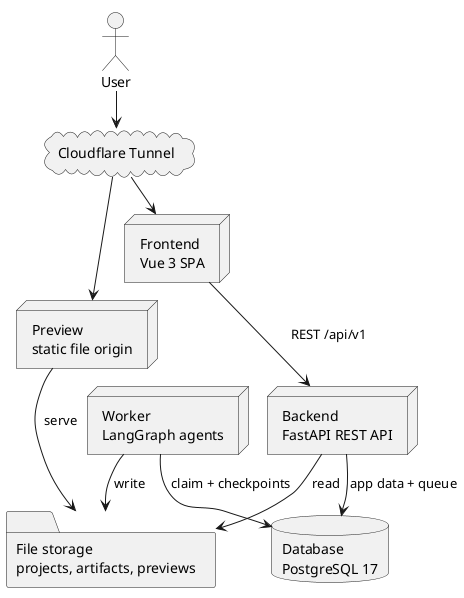
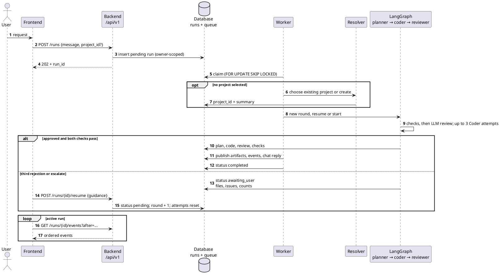
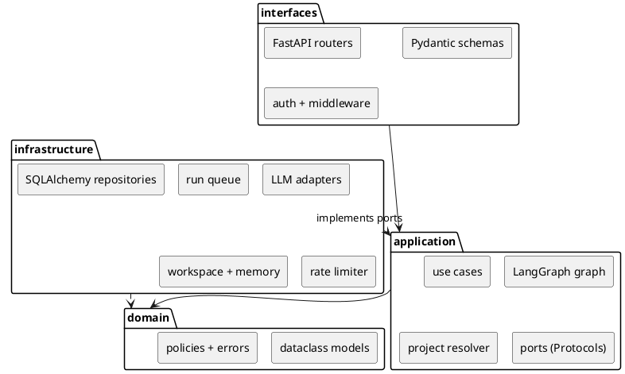
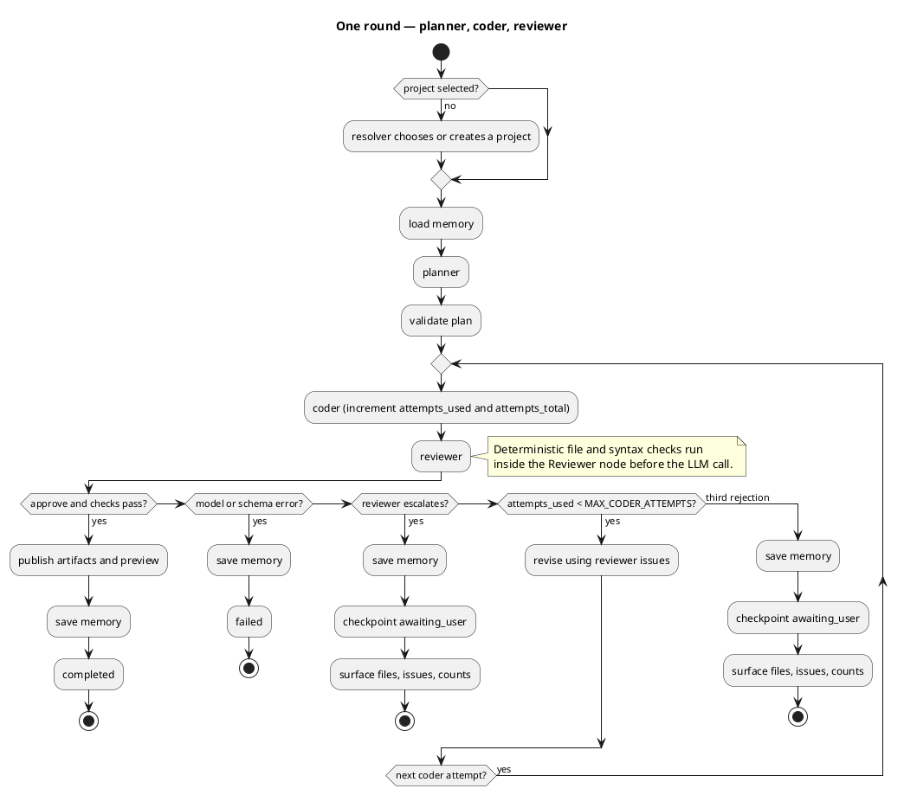
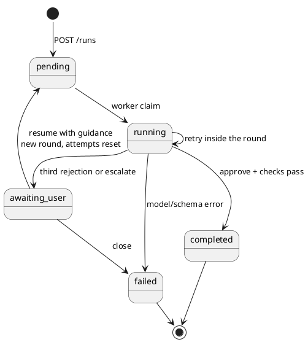
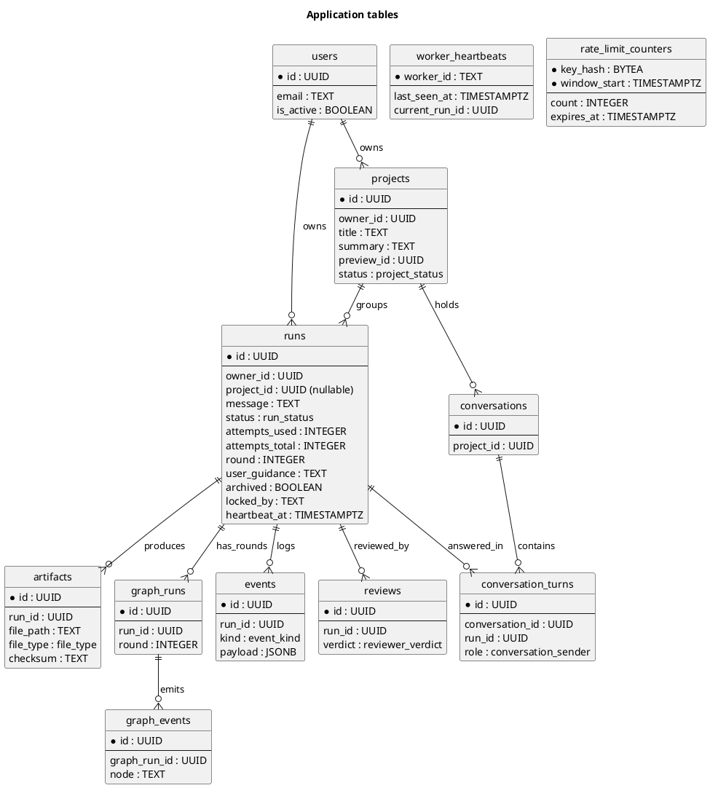

# Technical Design Document — AI Multi-Agent Coding Platform (MVP)

**Status:** planning phase. This is the project's Technical Design Document (TDD): the single source of truth
for the stack, contracts, rules, and the reasoning behind them. It is written to be defended and presented, not
just implemented. The PRD (in the ignored `tasks/` directory) owns user stories and acceptance criteria only.

## 0. Executive summary

We are building a small, honest AI coding loop. A user describes an app or feature in plain language; a
Planner decides which files are needed, a Coder generates complete files, and a Reviewer checks the result with
deterministic checks first, then an LLM review. The platform either publishes a static preview or hands the work back with the unresolved issues. It never reports an unresolved result as approved.

The human is only involved at the boundaries: approve, hand off, or resume with more detail. Inside a round the
agents work unattended through at most three Coder attempts. If the Reviewer still rejects after the third
attempt, the run stops in `awaiting_user`; adding guidance starts a new round that reruns the **whole**
planner → coder → reviewer flow with attempts restored.

When a request does not name a project, a Project Resolver agent uses the user's short- and long-term memory to
choose the best existing project or create a new one. Provider configuration is developer-only: final users
never see or change keys, deployments, or model settings.

Deliberate scope: a Vue 3 frontend, a Python/FastAPI/LangGraph backend, a durable PostgreSQL-backed worker,
owner-scoped multi-user data, and a localhost Docker deployment exposed through Cloudflare Tunnel. We do not
execute generated code, do not add a broker, and do not add enterprise identity in the MVP.

## 1. Problem and goals

### 1.1 Problem

Give a non-engineer a working starting point from a plain-language request, without pretending that generated
code is always correct. The hard part is not generation alone; it is producing something reviewable, showing
what was done, and being explicit when the agents cannot agree. A demo that fabricates success is worse than a
demo that shows an honest handoff.

### 1.2 Goals

- Accept a plain-language request and produce a visible plan, complete files, a review outcome, and an explicit
  completed or handoff state.
- Preserve conversation and project context across follow-up runs.
- Never report an unresolved result as approved.
- Keep the human out of the inner loop; only expose a completed result or a handoff after the Coder budget is
  spent or the Reviewer escalates.
- Let the user inspect files, preview the result, guide a handoff, and close an abandoned run.
- Support multi-user login with owner-scoped projects, runs, files, and traces.
- Keep model credentials out of the domain, out of the repository, and out of the user interface.
- Survive a worker restart without losing an accepted result.

### 1.3 Non-goals

- Server-side execution of generated backend code or generated JavaScript. The preview is static files only.
- Containerized or Git-backed workspaces, or per-run project versioning beyond approved artifacts.
- Enterprise delegated credentials, SSO federation, or per-user external-system integrations.
- User-facing provider, credential, or model configuration.
- Billing, hard spend caps, or token-budget enforcement.
- RBAC beyond project ownership.
- A broad browser test matrix.

### 1.4 Success measures

| Outcome | Measure |
|---|---|
| First-pass completion | At least 70% of canonical coupon evaluations approve on the first pass, measured by the evaluation harness. |
| Preview render | 100% of accepted pages and their relative local assets load in the embedded frame. |
| Honest failure | 100% of malformed agent responses yield an explicit failure or handoff outcome, never a false approval. |
| Ownership | A second user cannot read another user's project, runs, files, or trace. |
| Durability | An interrupted run resumes after a worker restart without duplicate approval or lost accepted files. |
| Project resolution | When no project is selected, the resolver chooses an owned project or creates a new one; it never crosses users. |
| Abuse protection | Over-limit requests return `429` with `Retry-After`; untrusted forwarded headers cannot bypass the limiter. |

## 2. Constraints and assumptions

- **$0 hosting for the assessment.** The stack runs in Docker on localhost and is exposed through Cloudflare
  Tunnel. Free managed hosts were assessed and rejected: ephemeral disks, no Node subprocess, or a paid plan.
- **PostgreSQL 17 is the only datastore.** No Redis, no broker, no object store in the MVP. This keeps one
  backup story and one failure mode.
- **Azure OpenAI is provisioned but unnamed.** The company provides one credential and one endpoint; the
  per-role deployment names have not been supplied, so the Azure adapter remains unverified and tests use fake
  ports.
- **Node is required at runtime** for `node --check`; the runtime image must include it.
- **The preview cannot be trusted with secrets.** Generated projects are static, unauthenticated, and
  capability-addressed.
- **Only the developer configures providers.** Model selection and credentials come from environment
  configuration, never from the product UI or per-project settings.

## 3. System design

### 3.1 Components

| Component | Responsibility |
|---|---|
| Frontend | Vue 3, TypeScript, Pinia, Tailwind, Vite. Chat, project picker, plan, file viewer, review panel, and sandboxed preview. Polls run state over a typed REST client. |
| Backend | FastAPI under `/api/v1`; auth, projects, runs, files, preview URL, health. Validates with Pydantic v2 and enqueues work; never executes the graph. |
| Worker | Claims pending runs, resolves the project if needed, executes the LangGraph workflow, writes files and events, updates memory, finalizes the run. |
| Database | PostgreSQL 17: application tables, durable run queue, rate-limit counters, LangGraph checkpoints, and the long-term memory store. |
| File storage | Persistent volume for latest project files, approved artifacts, preview snapshots, and archives. |
| Preview | A separate static origin serving copied files at an unguessable capability URL. Never executes generated code. |
| Tunnel | Cloudflare Tunnel exposing the frontend and preview hostnames over HTTPS. |



### 3.2 Request and run flow



- `POST /api/v1/runs` returns `202` with the run id. The project may be supplied explicitly or resolved in the
  worker; the run is owner-scoped either way.
- The Backend never executes the graph. The Worker owns the run lock, heartbeat, round, and terminal
  transitions.
- The human is not involved during a round. After three rejected Coder attempts the run stops in
  `awaiting_user`; guidance starts a new round at the Planner, not at the Coder.
- A model-driven run can take minutes; the PostgreSQL-backed queue keeps HTTP requests short and lets the Worker
  restart independently without adding a broker.

## 4. Application architecture

### 4.1 Layers and package layout

Imports flow `interfaces → application → domain`. `infrastructure` implements application ports and may import
domain types. Composition happens only at the entry points and in the hand-written
`infrastructure/container.py`; no mutable global state is shared between requests or runs.

| Layer | Owns | Must not own |
|---|---|---|
| `domain` | Plain dataclasses, errors, and pure policies: retry budget, plan-set guard, approval rules, state transitions. | FastAPI, SQLAlchemy, provider SDKs, filesystem or network I/O. |
| `application` | Use cases, LangGraph wiring, the project resolver, and narrow `typing.Protocol` ports. | Infrastructure adapters, routers, SDK types. |
| `infrastructure` | PostgreSQL repositories, queue, workspace, LLM providers, memory store, rate limiter, clock. | Business policy. |
| `interfaces` | FastAPI routers, request/response schemas, auth dependencies, middleware, composition. | Domain rules or direct SDK calls. |



```text
server/app/
├── domain/
│   ├── models.py          # Plan, PlanStep, Code, Feedback, Issue, Attempts
│   ├── errors.py          # DomainError and subclasses
│   └── policies.py        # retry budget, plan-set guard, approval rules
├── application/
│   ├── ports.py           # Protocol ports listed below
│   ├── graph.py           # LangGraph workflow
│   ├── resolver.py        # project selection from memory
│   ├── checks.py          # deterministic file/syntax checks
│   ├── memory.py          # load/save memory use cases
│   └── use_cases/         # start_run, resume_run, close_run, finalize_run, ...
├── infrastructure/
│   ├── llm/               # provider registry and OpenAI-compatible adapters
│   ├── persistence/       # SQLAlchemy async repositories
│   ├── queue/             # Postgres run claim/heartbeat adapter
│   ├── workspace/         # WebWorkspace filesystem adapter
│   ├── memory/            # AsyncPostgresStore adapter
│   ├── rate_limit/        # Postgres fixed-window limiter
│   └── container.py       # manual dependency injection
├── interfaces/
│   ├── api/               # /api/v1 routers and preview router
│   ├── schemas/           # Pydantic request/response models
│   ├── middleware/        # rate limiting and request context
│   └── dependencies.py    # auth and ownership dependencies
├── main.py                # create_app() factory
└── worker.py              # worker entry point
```

### 4.2 Ports

| Port | Contract |
|---|---|
| `LLMClient` | One structured model call for a role. Returns validated output or a typed model error. No SDK types cross the boundary. |
| `Workspace` | List, read, write project files; run read-only checks; return a preview URL; delete a project workspace. Writes are plan-guarded and atomic. |
| `RunRepository` | Persist and read run state, attempts, reviews, artifacts, and conversation turns; apply terminal transitions. |
| `RunQueue` | Enqueue, claim, heartbeat, release, and reclaim runs. Hides the SQL queue mechanics. |
| `EventSink` | Append ordered run events. Append-only. |
| `MemoryStore` | Load relevant long-term memory and save deterministic memory items; expose the user's project index to the resolver. Hides the store backend. |
| `RateLimiter` | Consume a named fixed-window budget and report the retry delay. PostgreSQL-backed, shared across API workers. |
| `Clock` | Provide current time for tests and policies. |

### 4.3 Providers and secrets

The infrastructure registry builds one `LLMClient` per role from **developer environment configuration only**.
One global `(provider, model)` selection applies to all roles, with per-role Azure deployment names; end users
have no choice. The initial real provider is Azure OpenAI; the same adapter also supports plain OpenAI and any
OpenAI-compatible endpoint (Groq, Together, Fireworks, DeepSeek, xAI, vLLM, Ollama).

Model resolution:

1. Global environment: `MODEL_PROVIDER` / `MODEL_NAME`.
2. Provider default: `azure_openai` with `AZURE_OPENAI_DEPLOYMENT_<ROLE>` when Azure credentials and the role
   deployment exist; otherwise `openai` with `gpt-4o-mini`.

Per-role deployment names are the only per-role setting. There are no per-role provider/model overrides in the
MVP, no per-project credentials, no project settings endpoints, and no `/models` endpoint. The Project Resolver
uses the Planner deployment.

Azure notes: use the standard `openai` client against the resource's `/openai/v1/` base URL, preferring the
Responses API with `text.format` JSON Schema and falling back to `chat.completions` with JSON Schema. For
Azure, the request `model` field is the **deployment name**, not the underlying model name. Deployment names
have not been supplied yet, so the adapter is **unverified** and tests use fake ports.

Never pass an API key, token, URL, or provider SDK type into domain or application code. Infrastructure resolves
environment credentials and injects ports. Only infrastructure reads `*_API_KEY` values.

Role substitution guidance for later evaluation:

| Role | Why |
|---|---|
| Reviewer | Short context, judgment over written files, one call per attempt: cheapest to substitute with a small local model. |
| Coder | Multi-file coherence and strict structured output fail first on small models. |
| Planner / Resolver | Task decomposition and project selection are the hardest steps; a weak choice poisons the run. |

### 4.4 Adding an adapter

1. Implement the port under `infrastructure/`; keep SDK, database, filesystem, URL, and credential values there.
2. Register its factory in `infrastructure/container.py`; register model providers in the provider registry too.
3. Add a focused external-boundary test and a fake-port fixture for the use case.
4. Run `ruff` and `pytest` from `server/` before swapping an adapter in.

## 5. Agent workflow and state

### 5.1 Graph



`START → resolve project if needed → load memory → planner → coder → reviewer`. The Reviewer runs deterministic
checks before the LLM review; approval requires both. The Coder gets at most `MAX_CODER_ATTEMPTS=3` generations
per round, revised only from Reviewer feedback. The third rejection or a valid `escalate` yields
`awaiting_user`, never a false approval. Model/schema errors end the run as `failed` with no model-error retry.
`chat_reply` is written by the application layer, not a graph node.

There is no clarification pause and no mid-round human input. A round is unattended until `completed` or
`awaiting_user`. `awaiting_user` is a persisted pause, not `END`.

### 5.2 State contract

| Object | Required fields and rules |
|---|---|
| `PlanStep` | UUID4 `id`, `name`, relative `file_path`, `file_type`, `description`, optional artifact IDs, timestamp. |
| `Plan` | `id`, `project_id`, 1–8 steps by default, `summary`, timestamp. |
| `Code` | `id`, `run_id`, `file_path`, complete `content`, lowercase SHA-256 `checksum`, timestamp. |
| `Feedback` | `verdict`, `summary`, `issues`, optional `suggested_code`, timestamp. |
| `CheckReport` | `file_structure_ok`, `js_syntax_ok`, `files_checked`, `syntax_checked`, `issues`. |
| `Attempts` | Model-call records (`planner`/`coder`/`reviewer`, verdict/error, round) and terminal `failed` flag. |
| `RunState` | `id`, `owner_id`, `project_id` (nullable until resolved), `message`, `status`, plan, latest code, feedback, checks, attempts, `attempts_used`, `attempts_total`, `round`, latest `user_guidance`, events, trace, terminal `chat_reply`, timestamps. `GraphState` adds LangGraph metadata/next-node fields. |
| `RunEvent` | UUID, event kind, typed payload, timestamp; append-only. |

`RunStatus` is `pending | running | awaiting_user | completed | failed`:

- `pending` queued and claimable.
- `running` a Worker owns the run and is heartbeating.
- `awaiting_user` the Coder budget is spent and the run needs guidance.
- `completed` and `failed` are terminal.



`attempts_used` counts Coder generations in the current round; `attempts_total` never resets. Each round is a
new LangGraph thread (`graph_runs.round`), so a resume starts at the Planner, not at the interrupted Coder node.
On resume: increment `round`, reset `attempts_used=0`, append guidance, set status `pending`, and let the Worker
claim the run again. `Attempts.failed` is true for model-error termination or explicit abandonment, never for a
handoff.

- `MAX_CODER_ATTEMPTS=3` means at most three Coder generations per round. Increment both counters once per Coder
  invocation before checks. A checksum or static-check failure consumes the attempt.
- The third rejection or a valid `escalate` persists the latest files, issues, round, and both counts, then
  stops in `awaiting_user`.
- `POST /runs/{id}/resume` is valid only for `awaiting_user`. It keeps the same run and project, starts a new
  round, and reruns the whole flow with attempts restored.
- `POST /runs/{id}/close` marks an abandoned handoff `failed`. `DELETE` is destructive removal of terminal runs
  only. Routing depends only on the validated verdict, error tag, and persisted count.
- Validate the whole state before each checkpoint. The Reviewer uses `temperature=0`.

### 5.3 Agent contracts

| Agent | Input | Output and validation |
|---|---|---|
| Resolver | `owner_id`, message, recent run summaries, user project index (id, title, summary, last outcome) | `{project_id: UUID or null, title, confidence, reason}`; must choose an owned project or null; null creates a project; Pydantic validation. |
| Planner | `project_id`, message, conversation history, relevant memory, optional template/max steps | `Plan`; Pydantic schema; UUID4 IDs; relative path with no leading `/`, `..`, or backslash and matching `^[A-Za-z0-9_\-./]+$`; allowlisted file type; 1–8 steps by default. |
| Coder | `project_id`, latest plan/step, complete `existing_files`, step index, project memory, optional token/temperature settings | `Code`; path must be in the current plan; application recomputes SHA-256; complete files only, written atomically; local asset references must be relative. |
| Reviewer | project, plan, code list, `CheckReport`, relevant memory | `Feedback` with verdict `approve`, `reject`, or `escalate`; summary, issues, optional suggested code, timestamp; Pydantic validation. |

Use JSON Schema structured output for each role and Pydantic `model_validate` at the boundary; never regex-parse
free text. A single lossy self-repair inside the adapter may recover malformed output and is logged as a model
call within the same Coder attempt. On unrecoverable failure, tag `resolver_error`, `planner_error`,
`coder_error`, or `reviewer_error`, send `graph_error → run_end`, and show a clear final message. An unparsable
Reviewer response is `reviewer_error`; a valid `escalate` is a handoff. Schema errors never become a valid
verdict.

### 5.4 Static checks

`run_checks` is read-only, runs inside the Reviewer node before the LLM call, and is an application service today
so it can become a separate checker node later without changing the domain.

- Stage 1: every planned file exists below the project root, is nonempty, and has an allowed extension.
- Stage 2: every generated `*.js` file passes `node --check`; the process has a timeout and cannot execute the
  file.
- Both stages must pass. A failure enters the Coder retry/handoff policy and is included in the Reviewer input.
- The report is `{file_structure_ok, js_syntax_ok, files_checked, syntax_checked, issues}`.
- The Worker image must contain Node. Generated files must use relative local asset paths so the preview
  capability path keeps resolving assets.

### 5.5 Long-term memory and project resolution

LangGraph's PostgreSQL-backed `AsyncPostgresStore` is compiled into the graph and initialized with `setup()`,
like the checkpointer. Two namespaces:

- `("user", owner_id, "projects")` — the project index used by the Resolver. Each entry holds project id,
  title, short summary, last feature, last outcome, and timestamp.
- `("project", project_id, "memory")` — approved plan summary, user guidance, and project conventions used by
  the Planner, Coder, and Reviewer.

When a project exists, write deterministically at the end of every round (completed, awaiting_user, or failed):
update the project summary and its index entry. A resolver failure has no project and only marks the run
`failed`. No extra LLM call extracts memories. Load relevant project memory before planning;
cap retrieval at 10 items and 4000 characters. Memory is user- and project-scoped and deleted with its project.

**Resolver behavior.** The Resolver runs in the Worker before the Planner, only when the run has no
`project_id`. It receives the message, the user's recent run summaries, and the project index. It returns an
owned project id or `null` with a new title. `null` creates a new project. A resolver error marks the run
`failed`; it never silently attaches the work to the wrong project. If the user supplied a project explicitly,
the resolver is skipped.

### 5.6 Checkpoints, traces, and chat

Use `langgraph-checkpoint-postgres` with `AsyncPostgresSaver` for graph state and `AsyncPostgresStore` for
long-term memory. Both use a Psycopg 3 connection and their own lifecycle; do not pass the SQLAlchemy
`postgresql+asyncpg://` URL directly.

- Application tables are Alembic-owned; checkpointer and store tables are package-owned and created by `setup()`
  after `alembic upgrade head`.
- The Worker initializes both at startup. The Backend does not need them to enqueue or read run state.
- Each round uses a new checkpoint thread; `graph_runs` records the round. A resume starts a new thread at the
  Planner.
- Checkpoint after each Resolver/Planner/Coder/Reviewer node and on reject, approve, graph error, and `run_end`.
- Before a handoff, persist `awaiting_user` with the latest code, feedback, both counts, and round.
- Checkpoints live in PostgreSQL (never under `data/`), retained 30 days for resume/debug.

Conversations (`conversations`, `conversation_turns`) are user-visible and, when a project exists, the user turn
is written when the run resolves to that project and the assistant reply on completion or failure. Both are
written by an application use case, not a graph node. The trace (`graph_runs`, `graph_events`, plus checkpointer state)
records node executions, timestamps, and snapshots without chat text; `GET /api/v1/runs/{id}/trace` exposes it.
`run_end` bridges the two through a `chat_reply` event so traces replay without changing conversation history.

## 6. API design

### 6.1 Endpoints

All application routes live under `/api/v1`; `/health` and `/preview/{preview_id}/...` are intentionally
unprefixed. Requests and responses are JSON validated by Pydantic v2; errors use `application/problem+json`.

| Method | Path | Purpose | Auth | Rate bucket |
|---|---|---|---|---|
| `POST` | `/api/v1/auth/*` | `fastapi-users` register, login, reset, verify | Public | `auth` |
| `GET` | `/api/v1/users/me` | Current user | Bearer | `read` |
| `POST` | `/api/v1/projects` | Create a project explicitly | Bearer | `write` |
| `GET` | `/api/v1/projects` | List the user's projects | Bearer | `read` |
| `GET` | `/api/v1/projects/{project_id}` | Project detail and summary | Bearer + owner | `read` |
| `DELETE` | `/api/v1/projects/{project_id}` | Delete project, workspace, memory, related data | Bearer + owner | `write` |
| `GET` | `/api/v1/projects/{project_id}/files` | List current files | Bearer + owner | `read` |
| `GET` | `/api/v1/projects/{project_id}/files/{path}` | Read one file; path validated | Bearer + owner | `read` |
| `GET` | `/api/v1/projects/{project_id}/conversation` | Conversation turns | Bearer + owner | `read` |
| `GET` | `/api/v1/projects/{project_id}/preview-url` | Return the capability URL | Bearer + owner | `read` |
| `POST` | `/api/v1/runs` | Create and enqueue a run: `{message, project_id?}`; returns `202` | Bearer | `run_create` |
| `GET` | `/api/v1/runs/{run_id}` | Run state, project, plan, latest code/feedback, checks, counts | Bearer + owner | `read` |
| `GET` | `/api/v1/runs/{run_id}/events` | Ordered append-only events; supports `after` cursor | Bearer + owner | `read` |
| `GET` | `/api/v1/runs/{run_id}/trace` | Graph trace | Bearer + owner | `read` |
| `GET` | `/api/v1/runs/{run_id}/artifacts/{artifact_id}` | Artifact metadata/content | Bearer + owner | `read` |
| `POST` | `/api/v1/runs/{run_id}/resume` | Resume `awaiting_user` with `{guidance}`; starts a new round | Bearer + owner | `write` |
| `POST` | `/api/v1/runs/{run_id}/close` | Abandon a handoff; marks `failed` | Bearer + owner | `write` |
| `DELETE` | `/api/v1/runs/{run_id}` | Destructive removal of a terminal run | Bearer + owner | `write` |
| `GET` | `/preview/{preview_id}/{path}` | Capability-protected static preview | Capability URL | `preview_document` / `preview_asset` |
| `GET` | `/health` | DB, filesystem, and worker health | Public | exempt |

### 6.2 Errors and status codes

- `POST /runs` is `202`. The body is `{message, project_id?}`. If `project_id` is supplied it must be owned by
  the caller; otherwise the Resolver chooses or creates one. The response is `{run_id, project_id}`, where
  `project_id` may be null until the Worker resolves it.
- At most one non-terminal run per project. Return `409` if one exists or if `MAX_RUNS_PER_PROJECT` is reached.
  At most one unresolved project-less run per user; a second project-less create returns `409`.
- `resume` accepts `{guidance: "..."}` and is valid only for `awaiting_user`; return `409` on a status mismatch.
  It resets the Coder budget and reruns the full flow; `attempts_total` is preserved.
- `close` is valid only for `awaiting_user`; it marks `failed` and preserves history.
- `DELETE /runs/{id}` is only valid for terminal runs; active runs return `409`.
- Non-owned resources return `404`, not `403`, to avoid leaking existence.
- Rate-limit responses are `429` with `Retry-After`; a limiter outage is `503`, not a silent bypass.
- Body validation failures return `422` with `application/problem+json`.

## 7. Security and abuse prevention

### 7.1 Authentication and ownership

Use `fastapi-users` with its SQLAlchemy async adapter and JWT bearer transport for register, login, password
reset, and verification (maintenance mode, but the conventional documented FastAPI integration). Local login is
the only MVP identity path; social login and enterprise delegated credentials are out of scope.

`projects.owner_id` and `runs.owner_id` are mandatory FKs. Route dependencies and repository queries scope every
project and child row to that user; every child access joins through the owning user or project. A run may exist
before its project is resolved, so `runs.owner_id` is the ownership anchor until `project_id` is set. Acceptance
tests must prove user B cannot read user A's project, runs, files, or trace.

### 7.2 Rate limiting

A shared PostgreSQL fixed-window limiter protects the API. It is consistent across API workers, survives
restarts, and needs no Redis.

- Counters live in Alembic-owned `rate_limit_counters(key_hash, window_start, count, expires_at)`, updated with
  one atomic upsert: `INSERT ... ON CONFLICT (key_hash, window_start) DO UPDATE SET count = count + 1 RETURNING count`.
- The key is an HMAC-SHA-256 hash of bucket + user/IP + route class, using `SECRET_KEY`; raw IPs are not
  stored. The limiter sits behind the `RateLimiter` port; no in-process counters.
- If the store is unavailable, return `503`; never fail open. The Worker maintenance loop deletes expired
  windows.
- Responses include `RateLimit-Limit`, `RateLimit-Remaining`, `RateLimit-Reset`, and on rejection `Retry-After`.
  `/health` and static frontend assets are exempt.
- Trust forwarded headers only when the peer is in `TRUSTED_PROXY_CIDRS`; behind Cloudflare Tunnel use
  `CF-Connecting-IP` (or `X-Forwarded-For`) only from a trusted peer, otherwise the socket address. Default is to
  trust nothing.

| Bucket | Key | Default | Applies to |
|---|---|---|---|
| `auth` | IP | 5/min | register, login, password reset, verification |
| `run_create` | user | 5/min | `POST /runs` |
| `write` | user | 30/min | resume, close, project mutation |
| `read` | user | 120/min | project/run/file/event/trace GETs; supports 1s polling |
| `preview_document` | IP | 60/min | preview document requests |
| `preview_asset` | IP | 600/min | preview CSS/JS/image requests |
| `public` | IP | 30/min | unauthenticated non-auth API requests |
| `health` | exempt | — | `/health` |

All values are code defaults. Only `RATE_LIMIT_ENABLED` is environment-configurable in the MVP. Edge/WAF/adaptive
bot protection is deferred as defense-in-depth, not a substitute for application limits.

### 7.3 Preview isolation and capability URL

FastAPI serves only copied static files under `/preview/{preview_id}/...`; it never executes generated JS or
backend code. Preview runs on a different origin from the API/auth:

- Development: `PREVIEW_HOST=http://preview.localhost:8000`
- Production: `PREVIEW_HOST=https://preview.<domain>`
- The same FastAPI process routes by Host; Cloudflare Tunnel exposes both hostnames.

The preview URL is a bearer capability. Each project gets a random `preview_id` (UUID4) separate from the project
UUID. `GET /api/v1/projects/{id}/preview-url` returns the URL to the owner; the preview route itself requires no
JWT. Anyone holding the URL can view the generated static files — a deliberate trade-off that keeps iframe
navigation and relative asset loading reliable without cookies or bearer headers.

Preview responses set `X-Robots-Tag: noindex` and `Referrer-Policy: no-referrer`. The iframe uses
`sandbox="allow-scripts allow-same-origin allow-forms allow-popups"` with no `allow-top-navigation`; the separate
origin is essential because scripts and same-origin are both allowed. Preview files must use relative local asset
paths; a strict CSP may block `data:`/`blob:` URLs. `preview_id` is stable until the project is deleted. Rotation,
signed previews, and containerized execution of generated apps are deferred. Flappy Bird is one self-contained
`game.html` with a canvas and no external dependencies.

## 8. Data and storage

### 8.1 PostgreSQL schema

PostgreSQL 17 stores application records, the durable queue, rate-limit counters, checkpoints, and the memory
store. Repositories use SQLAlchemy 2.x async with `asyncpg`; Alembic autogenerates migrations from the models. A
fresh database is created with `alembic upgrade head`, never `create_all`.

Fixed value sets are native PostgreSQL ENUMs mirrored as `str` Python enums for Pydantic validation:

| Type | Values |
|---|---|
| `project_status` | `active`, `archived` |
| `run_status` | `pending`, `running`, `awaiting_user`, `completed`, `failed` |
| `reviewer_verdict` | `approve`, `reject`, `escalate` |
| `conversation_sender` | `user`, `assistant`, `system` |
| `event_kind` | `project_resolved`, `planner`, `coder`, `reviewer`, `chat_reply`, `handoff`, `guidance`, `run_start`, `run_end`, `error`, `abandonment` |
| `file_type` | `html`, `css`, `js`, `md`, `json`, `svg`, `png`, `ico` |



`AsyncPostgresSaver` and `AsyncPostgresStore` create their own tables via `setup()`; those are not modelled above.
Every child access joins through `projects.owner_id` or `runs.owner_id`.

Indexes: `runs(project_id, created_at)`, `runs(owner_id, created_at)`, `runs(status, heartbeat_at)`,
`events(run_id, created_at)`, `artifacts(run_id)`, `reviews(run_id)`,
`conversation_turns(conversation_id, sequence)`, `graph_events(graph_run_id, created_at)`,
`rate_limit_counters(expires_at)`, `worker_heartbeats(last_seen_at)`. `projects.preview_id` is unique. A partial
unique index on `runs(project_id)` where `project_id IS NOT NULL` and status is non-terminal enforces one active
run per project; a partial unique index on `runs(owner_id)` where `project_id IS NULL` and status is non-terminal
enforces one unresolved project-less run per user.

### 8.2 Durable queue and worker

The `runs` table is the queue. The Backend inserts `pending`; the Worker claims atomically:

```sql
UPDATE runs
SET status = 'running',
    locked_by = :worker_id,
    locked_at = now(),
    heartbeat_at = now()
WHERE id = (
    SELECT id FROM runs
    WHERE status = 'pending'
       OR (status = 'running' AND heartbeat_at < now() - :stale_after)
    ORDER BY created_at
    FOR UPDATE SKIP LOCKED
    LIMIT 1
)
RETURNING *;
```

- The Worker heartbeats every 15 seconds and writes `runs.heartbeat_at`. A crashed Worker leaves a stale
  `running` run that another Worker reclaims after 60 seconds, resuming from the last checkpoint.
- Execution is at-least-once at node boundaries. File writes are atomic, events are append-only, and terminal
  transitions are idempotent: a reclaimed run must not create duplicate approvals or lose accepted files.
- `awaiting_user` is not claimable; `resume` sets it back to `pending`. At most one non-terminal run per
  project and one unresolved project-less run per user; `MAX_RUNS_PER_PROJECT` counts all runs and returns `409`
  at the cap.
- `WORKER_CONCURRENCY` is fixed at 2 concurrent runs per process. Run one Worker process per container;
  horizontal workers are safe because of `SKIP LOCKED`.
- Graceful shutdown stops claiming, finishes or releases the current checkpoint, and clears the lock. A hard crash
  is recovered by stale-heartbeat reclaim.
- `DELETE /runs/{id}` is terminal-only; there is no mid-run cancellation. The maintenance loop deletes expired
  rate-limit windows and runs the 30-day archive job.

Worker entry point: `python -m app.worker`. The Backend never executes a graph in-request.

### 8.3 Workspace and complete files

The `Workspace` port supports list, read, write with plan-set guard, read-only checks, preview URL, and project
deletion. The `WebWorkspace` adapter uses:

- Latest files: `data/projects/{project_id}/`
- Approved snapshots: `data/artifacts/{artifact_id}/`
- Served preview: `data/preview/{project_id}/`
- Archive: `data/archived/{project_id}/{run_id}/`

Latest files are the project source of truth; there is no per-run project versioning beyond approved artifacts.
Writes go to a temporary file in the same directory and use `os.replace` atomically. Follow-up Coder input reads
complete latest contents; approval copies snapshots to artifacts and preview.

The Coder emits complete files only, never patches or appends. The plan-set guard permits writes only to current
`plan.steps`; non-plan files remain byte-for-byte unchanged and an attempted write is refused. The editor and
Coder both read through `read_file`.

### 8.4 Conversation, deletion, and retention

- `POST /runs` creates a new run for a follow-up request. If it resolves to a project, the run carries that
  project's latest plan/code/feedback and conversation history into the new round; a project-less run starts
  fresh.
- `POST /runs/{id}/resume` only re-enqueues an `awaiting_user` run and starts a new round.
- When a project exists, the application layer writes the user turn when the run resolves to the project, and
  the assistant reply on completion or failure; on handoff, state and events carry the latest files and issues. A
  resolver failure has no project and only records the terminal run state.
- `DELETE /runs/{id}` cascades artifacts, events, reviews, and trace rows but leaves the project and latest files.
  `DELETE /projects/{id}` removes the owner's project, workspace, preview snapshot, memory namespace, and related
  rows.
- Active runs, including handoffs, are retained indefinitely. Completed runs older than 30 days archive source
  files under `data/archived/{project_id}/{run_id}/` and set `runs.archived=true`; events stay with the run and
  checkpoints are retained 30 days for resume/debug.
- Rate-limit windows and stale heartbeats are cleaned by the maintenance loop; memory is deleted with its
  project. Archival must move to durable object storage before using an ephemeral production host.

## 9. Deployment and operations

### 9.1 Assessment path

Run the Docker stack on localhost and expose it through Cloudflare Tunnel for a stable public HTTPS assessment URL
at $0. The local machine supplies CPU, disk, and process support without cold starts. FastAPI hosts the built SPA
and API; the preview is a separate hostname. A separate frontend CDN is deferred.

Hosted alternatives were assessed and rejected for this MVP: Cloudflare Workers (no durable filesystem, no
`node --check` subprocess, too little CPU), Cloudflare Pages (static only), Cloudflare Containers (paid plan),
Render + Neon (ephemeral disk), and Railway (low credit plus external storage). Free hosts have ephemeral disks;
production must replace `WebWorkspace` with an object-storage adapter and keep PostgreSQL external.

### 9.2 Serving and topology

| Component | Contract |
|---|---|
| Backend | `uvicorn` in development; `gunicorn` + uvicorn workers in production; factory `app.main:create_app()`. |
| Worker | Same image, command `python -m app.worker`; no public port. |
| Frontend/API | Routers under `/api/v1`; `/` and `/assets` serve built Vite files. |
| Preview | `/preview/{preview_id}/...`; separate hostname; no auth; capability URL. |
| Health | `GET /health` returns `{status, checks: {db, fs, worker}}`; `503` when a required check fails. |
| CORS | Explicit `FRONTEND_ORIGIN`, no wildcard in production. |
| Trusted proxy | Forwarded client IP headers accepted only from `TRUSTED_PROXY_CIDRS`. |

### 9.3 Environment variables

| Variable | Purpose / development value |
|---|---|
| `APP_ENV`, `LOG_LEVEL` | `development`/`production`; `info`/`debug`. |
| `DATABASE_URL` | SQLAlchemy async URL, e.g. `postgresql+asyncpg://app:change-me@db:5432/app`. The Worker derives a Psycopg URL for the checkpointer and store. |
| `POSTGRES_USER`, `POSTGRES_PASSWORD`, `POSTGRES_DB` | Compose-only database initialization; not read by the app. |
| `SECRET_KEY` | Required JWT signing secret; never regenerated on startup. |
| `PUBLIC_URL` | Stable external app URL, e.g. `http://localhost:8000`. |
| `FRONTEND_ORIGIN` | Allowed SPA origin, e.g. `http://localhost:5173` in Vite development. |
| `PREVIEW_HOST` | Preview origin, e.g. `http://preview.localhost:8000`. |
| `MAX_RUNS_PER_PROJECT`, `MAX_CODER_ATTEMPTS` | Hard run cap `100`; Coder generations per round `3`. |
| `MODEL_PROVIDER`, `MODEL_NAME` | Global model selection. Default provider is `azure_openai` when Azure credentials/deployments exist, otherwise `openai`; OpenAI fallback model `gpt-4o-mini`. |
| `AZURE_OPENAI_API_KEY`, `AZURE_OPENAI_ENDPOINT` | Azure key (unset) and v1 base URL, e.g. `https://<resource>.openai.azure.com/openai/v1/`. |
| `AZURE_OPENAI_DEPLOYMENT_PLANNER`, `AZURE_OPENAI_DEPLOYMENT_CODER`, `AZURE_OPENAI_DEPLOYMENT_REVIEWER` | Azure deployment names; currently unset and unverified. The Resolver reuses the Planner deployment. |
| `OPENAI_API_KEY` | Optional fallback when Azure is not configured. |
| `RATE_LIMIT_ENABLED` | `true`; all bucket limits use code defaults. |
| `TRUSTED_PROXY_CIDRS` | Comma-separated trusted proxy networks; empty trusts no forwarded headers. Local tunnel example: `127.0.0.1/32,::1/128`. |

Other values are code constants: Worker poll 1s, heartbeat 15s, stale reclaim 60s, concurrency 2, Node binary
`node`, syntax-check timeout 5s, memory caps 10 items / 4000 characters, rate-limit window 60s. Secrets and the
production `DATABASE_URL` belong in environment settings or a gitignored `.env`. `.env.example` contains
placeholders only; a repository secret scan rejects populated keys.

### 9.4 Docker and startup

One image builds Vite assets in a Node stage and runs the Python/FastAPI runtime. Compose runs PostgreSQL 17 with a
persistent `pgdata` volume and the app with a persistent `appdata` volume for generated files, previews, and
archives.

- `app`: gunicorn + uvicorn workers, serves the frontend and API, enqueues runs.
- `worker`: same image, `python -m app.worker`, claims and executes runs.
- Runtime Node is required for `node --check`. Do not create application tables with `create_all`.

```bash
docker compose build
docker compose up -d
docker compose exec app alembic upgrade head
curl -fsS http://localhost:8000/health
```

The Worker waits for PostgreSQL, initializes the checkpointer and store with `setup()` (idempotent), then starts
claiming runs. The migration command may be part of an entrypoint. Manual development uses PostgreSQL 17 and the
same `DATABASE_URL`, starts FastAPI with `uvicorn app.main:create_app --factory --reload` from `server/`, starts
the worker with `python -m app.worker`, and runs Vite from `client/`.

### 9.5 Observability

- `events` is the user-facing ordered event stream; `graph_events` is the node-level trace.
- `GET /runs/{id}` shows state, project, counts, latest code/feedback, and checks; `GET /runs/{id}/trace` exposes
  graph execution without chat text.
- Logs include request/run IDs, node names, durations, and masked provider errors; never log prompts containing
  secrets or decrypted credentials.
- The Worker heartbeat is the liveness signal for `/health` and the queue.

## 10. Design decisions and trade-offs

This section is the defense. Each entry states the decision, the reason, the strongest alternative, why it was
rejected, and the cost we accept.

### 10.1 Layered ports and adapters with a framework-free domain

**Decision.** `domain` holds dataclasses and pure policies; `application` holds use cases, the graph, resolver,
and `Protocol` ports; `infrastructure` implements ports; `interfaces` holds FastAPI. Imports flow inward only.
**Why.** The workflow is the product's core and must be testable without a database, network, or model. A pure
domain also keeps provider SDKs and credentials away from business logic.
**Alternative.** Service objects calling SQLAlchemy and SDKs directly, or a DI framework.
**Rejected because.** Direct imports make policy tests require infrastructure and couple the retry/approval rules
to vendor types. A framework adds indirection for a small codebase.
**Accepted cost.** More files and a manual `container.py`.

### 10.2 A separate worker with a PostgreSQL-backed queue

**Decision.** The Backend only inserts `pending` runs; a Worker claims them with `FOR UPDATE SKIP LOCKED` and
executes the graph. `runs` is the queue.
**Why.** Model-driven runs take minutes and must not hold HTTP requests. Decoupling makes restarts and progress
observability trivial.
**Alternative.** Background tasks in the API process, or Celery/RQ/Redis.
**Rejected because.** In-process tasks die with the request worker and cannot be observed or reclaimed. A broker
adds a second datastore and operational surface for a single-node MVP.
**Accepted cost.** Hand-written claim/heartbeat logic and at-least-once semantics that must stay idempotent.

### 10.3 LangGraph with PostgreSQL checkpoints and store

**Decision.** Model the workflow as a LangGraph graph with `AsyncPostgresSaver` checkpoints and
`AsyncPostgresStore` memory. Each round is a new thread.
**Why.** The graph gives explicit nodes, resumable state, and a trace; both persistence pieces already live in
PostgreSQL, so there is no new infrastructure. A thread per round makes "rerun the whole flow" explicit.
**Alternative.** A hand-rolled state machine, or an in-memory checkpointer.
**Rejected because.** A hand-rolled orchestrator is more code to defend and less observable; an in-memory
checkpointer loses runs on restart, violating the durability goal.
**Accepted cost.** Package-owned tables, a Psycopg 3 connection alongside `asyncpg`, and `setup()` lifecycle.

### 10.4 One OpenAI-compatible adapter, developer-configured

**Decision.** A provider registry builds one `LLMClient` per role from environment configuration; the adapter
targets the OpenAI-compatible API, with Azure OpenAI as the first real provider. End users never configure
providers, credentials, or models.
**Why.** One adapter reaches Azure, OpenAI, and many hosted/local endpoints, so adding a provider is developer
configuration. Keeping configuration out of the product removes a credential store, an endpoint surface, and a
whole class of support issues.
**Alternative.** A separate SDK adapter per vendor, a self-hosted gateway, or per-project credentials.
**Rejected because.** Per-vendor adapters multiply code and leak SDK types. A gateway is only justified once
budget caps or fallback routing are real. Per-project credentials are unnecessary because the platform owner
pays for and operates the models.
**Accepted cost.** Users cannot bring their own model; we depend on the provisioned Azure deployments, which are
currently unnamed and unverified.

### 10.5 A dedicated project resolver

**Decision.** When a run has no `project_id`, a Resolver agent chooses the best owned project or creates a new one
from the user's project index, recent runs, and message.
**Why.** Users should be able to keep working on the same feature without remembering project ids, while still
being able to pick a project explicitly. A dedicated agent keeps this decision out of the Planner and out of the
Backend.
**Alternative.** Always require an explicit project, or let the Planner infer it.
**Rejected because.** Requiring an explicit project every time is poor UX for follow-ups; folding selection into
the Planner makes planning and routing inseparable and harder to evaluate.
**Accepted cost.** One extra model call on project-less runs, and a resolver that must be evaluated for
misclassification.

### 10.6 Complete-file generation

**Decision.** The Coder emits complete files; the plan-set guard rejects writes outside the current plan. Non-plan
files stay byte-for-byte unchanged.
**Why.** Complete files are trivially reviewable and immune to patch-context drift. The guard prevents collateral
edits.
**Alternative.** Unified diffs or search/replace patches.
**Rejected because.** Patches fail unpredictably, are harder to validate, and make "what changed" ambiguous in a
demo.
**Accepted cost.** Higher token usage per revision.

### 10.7 Deterministic checks inside the Reviewer node

**Decision.** Before the LLM review, run deterministic checks: every planned file exists, is nonempty, has an
allowed type, then every `*.js` passes `node --check`. Approval requires both stages.
**Why.** Never ask a model whether a file exists or whether JavaScript parses. A cheap deterministic gate makes
approval trustworthy.
**Alternative.** LLM-only review, or a separate checker agent now.
**Rejected because.** LLM-only review approves broken files. A separate node is unwarranted complexity for two
checks; the service boundary keeps that extraction open.
**Accepted cost.** Node must be present at runtime.

### 10.8 Three Coder attempts, then an honest handoff

**Decision.** `MAX_CODER_ATTEMPTS=3` per round. The human is not involved mid-round. The third rejection or a
valid `escalate` stops the run in `awaiting_user` with files, issues, and counts. Guidance starts a new round that reruns planner →
coder → reviewer with attempts restored.
**Why.** Bounds cost and latency, keeps the inner loop unattended, and guarantees the UI never fabricates success.
Rerunning the whole flow lets new guidance change the plan, not just patch the last attempt.
**Alternative.** Unlimited retries, auto-accepting the best attempt, or resuming only the Coder.
**Rejected because.** Unlimited retries burn spend; auto-accepting lies. Resuming only the Coder would ignore
guidance that invalidates the plan.
**Accepted cost.** A resumed round redoes planning and generation work.

### 10.9 Capability-URL preview on a separate origin

**Decision.** Serve copied static files at `/preview/{preview_id}/...` on `preview.<host>`, addressed by a random
`preview_id`; the owner gets the URL from an authenticated endpoint.
**Why.** Iframe navigation and relative assets work without cookies or bearer headers, and a separate origin
isolates generated scripts from the app.
**Alternative.** Owner-authenticated preview, or same-origin preview.
**Rejected because.** Bearer headers do not survive iframe navigation; same-origin would let generated scripts
reach the app. The capability is unguessable and rotatable later.
**Accepted cost.** Anyone with the URL can view the preview; do not put secrets in generated projects.

### 10.10 PostgreSQL-backed rate limiting

**Decision.** A shared fixed-window limiter stores HMAC-hashed counters in PostgreSQL, fails closed with `503`,
and trusts forwarded IP headers only from `TRUSTED_PROXY_CIDRS`.
**Why.** Consistent across API workers, survives restarts, and reuses the existing datastore.
**Alternative.** In-process counters, or Redis.
**Rejected because.** In-process counters are trivially bypassed by more workers; Redis is a second datastore.
**Accepted cost.** One database round-trip per limited request.

### 10.11 Multi-user auth with strict ownership

**Decision.** `fastapi-users` with JWT bearer, owner-scoped queries, and `404` for non-owned resources. Local
login only.
**Why.** Ownership is a hard requirement and `404` avoids leaking existence. `fastapi-users` is the documented
FastAPI integration.
**Alternative.** Custom auth, session cookies, or social/enterprise login now.
**Rejected because.** Custom auth is avoidable risk; bearer tokens fit the SPA and avoid CSRF surface. Social and
enterprise identity are not needed for the MVP.
**Accepted cost.** `fastapi-users` is in maintenance mode; accepted for an MVP.

### 10.12 Filesystem workspace with atomic writes

**Decision.** `WebWorkspace` keeps latest files, approved artifacts, preview copies, and archives on a volume,
written atomically with `os.replace`.
**Why.** Simple, inspectable, and adequate for one node. Atomic writes keep readers from seeing partial files.
**Alternative.** Object storage, or Git-backed workspaces.
**Rejected because.** Object storage needs credentials and a second failure mode; Git adds a write/commit path we
do not need yet. Both are clean follow-ups behind the `Workspace` port.
**Accepted cost.** Tied to a persistent volume; ephemeral hosts would lose data.

### 10.13 Localhost plus Cloudflare Tunnel

**Decision.** Run Docker on localhost and expose it through Cloudflare Tunnel for the assessment.
**Why.** $0, no cold starts, a real public HTTPS URL, and full CPU for the agent loop and `node --check`.
**Alternative.** Free managed hosts (Render, Railway, Cloudflare Workers/Pages/Containers).
**Rejected because.** They either sleep, lose disks, cannot spawn Node, or require a paid plan.
**Accepted cost.** The demo depends on the local machine being online.

## 11. Verification and evaluation

### 11.1 Test strategy

- Pure policy tests (retry budget, plan-set guard, approval rules, state transitions) need no DB, network, or
  model.
- Adapter tests cover the provider registry, Azure request shape, workspace writes, queue claim/heartbeat, memory
  store, rate limiter, and preview path handling.
- API tests cover auth, ownership (`404` for user B), run creation with and without `project_id`, validation,
  409/429/503 behavior, and problem+json errors.
- Graph tests use fake model ports and synthetic IDs; no model calls in unit tests. Resolver tests cover explicit
  project, matched project, new project, and cross-user rejection.
- Resume tests prove a new round starts at the Planner, resets `attempts_used`, preserves `attempts_total`, and
  uses a new graph thread.
- One headless Playwright scenario covers create → resolve → plan → generate → review → preview/handoff. A broad
  browser matrix is deferred.

### 11.2 Evaluation harness

A local dataset and runner under `server/evals/` measure whether changes improve the product without LangSmith.

- Scenarios: coupon validation, Flappy Bird, follow-up preserving unrelated files, project resolution, handoff
  resume, malformed model output, missing credentials, ownership isolation, rate-limit behavior, and worker
  restart recovery.
- The runner uses fake ports by default; an optional real-provider smoke run exercises the configured Azure
  deployment.
- Reports first-pass approval rate, check pass/fail, handoff correctness, resolver accuracy, artifact checksum
  integrity, file preservation, and ownership results. The PRD's 70% first-pass target is measured with this
  harness.

### 11.3 Acceptance evidence for the presentation

- Canonical coupon request produces `coupon.html`, `coupon.css`, `coupon.js`, and `README.md` with a sample
  coupon; a nonempty coupon shows “Valid.”
- Approval happens only after file and script checks pass.
- A malformed model response produces an explicit `failed` outcome.
- After three rejections the run hands off as `awaiting_user` with files, issues, and counts; guidance reruns
  the full flow and resets the round budget.
- A pending or running run survives a worker restart without duplicate approval or lost files.
- With no project selected, the resolver chooses an owned project or creates one; user B cannot read user A's
  project, runs, files, or trace.
- Over-limit requests return `429` with `Retry-After`; spoofed forwarded headers do not change the client IP.

## 12. Risks and mitigations

| Risk | Mitigation |
|---|---|
| Azure deployments unnamed or unavailable during the review. | Adapter isolated behind `LLMClient`; fake ports cover tests and evaluation; a real smoke run happens as soon as names are supplied. |
| Model output is malformed or non-schema. | JSON Schema plus Pydantic at the boundary; one lossy self-repair inside the adapter; otherwise an explicit `*_error` outcome, never a false approval. |
| Generated code is broken despite review. | Deterministic existence/type/syntax checks gate approval; the result is still a static preview. |
| Resolver attaches a feature to the wrong project. | It only sees owned projects, returns a confidence and reason, is covered by an evaluation scenario, and can be overridden by selecting a project explicitly. |
| Worker crash loses a run. | PostgreSQL checkpoints and heartbeat-based reclaim; terminal transitions idempotent. |
| Cost or latency creep from retries. | Three-attempt round budget, `temperature=0` Reviewer, and the run cap; budget policy is the main open item. |
| Preview exposes data. | Capability URL on a separate origin, `noindex`/`no-referrer`, sandboxed iframe without top-navigation, and no secrets in generated projects. |
| Local demo machine offline. | Known limitation of the $0 path; the tunnel and stack restart trivially. |

## 13. Limits, open items, and roadmap

### 13.1 Limits

- Static preview only; the server never executes generated code. Writes are serialized per project; one
  non-terminal run per project; completed runs archive after 30 days; no mid-run cancellation; no budget
  enforcement; no RBAC beyond owner checks. Multi-user login and ownership are in the MVP.
- Preview access is capability-based, not authenticated: anyone with the URL can view the generated static files.
  Do not put secrets in generated projects.
- Users cannot configure providers, credentials, or models; only the developer can, through environment
  variables.
- Deferred: budget metering and spend caps, per-role model evaluation, a separate checker node, object-storage
  adapters, enterprise RBAC/audit, edge/WAF bot protection, signed/rotated preview URLs, containerized execution,
  a separate frontend CDN, social/enterprise login, and a broad browser matrix.

### 13.2 Open items

| Item | Impact |
|---|---|
| Azure deployment names are unset (`AZURE_OPENAI_DEPLOYMENT_PLANNER`, `_CODER`, `_REVIEWER`). | The Azure adapter is unverified until they are supplied with a test key; tests use fake ports meanwhile. |
| API budget policy is undecided. | The MVP enforces only the static run cap. Recommend recording token usage first, then setting a hard cap from observed costs. |

### 13.3 Build order

1. Scaffold the package layout, settings, SQLAlchemy models, and Alembic migration.
2. Add auth/ownership and the shared rate limiter.
3. Add the Postgres run queue, worker loop, and run lifecycle endpoints.
4. Add the provider registry, agent contracts, graph, checks, and memory.
5. Add the project resolver, workspace/artifact/preview handling, and the frontend.
6. Add the evaluation harness, Playwright scenario, and operational checks.

## 14. Presentation and defense appendix

### 14.1 Narrative

1. **Frame the problem honestly.** Generation is easy to demo and easy to fake. The valuable product is a
   reviewable loop that knows when to stop.
2. **Show the loop.** Submit the coupon request; show the plan, the generated files, and the checks.
3. **Show a failure.** Submit a deliberately awkward request, show the Reviewer reject three times, then show the
   handoff with issues. Add guidance and show the full flow rerun with a fresh budget.
4. **Show resilience.** Kill the worker mid-run and show the run resume from its checkpoint.
5. **Show resolution.** Send a follow-up without selecting a project and show the resolver pick the right one.
6. **Close on seams.** Provider registry, `Workspace` port, and the checker node are the production follow-ups.

### 14.2 Demo script

1. `docker compose up -d`, `alembic upgrade head`, open `http://localhost:8000`.
2. Log in as user A, create a project, ask for the coupon validation site.
3. Walk the plan, the files, the check report, and the preview at `preview.localhost:8000`.
4. Ask for a follow-up that must preserve an unrelated file; show only the intended file changing.
5. Force three rejections (e.g., a request with conflicting constraints) and show the handoff: files, issues,
   counts. Add guidance and show a new round starting at the Planner.
6. `docker restart <worker>` during a run; show recovery and a single final outcome.
7. Send a project-less follow-up and show the resolver attach it, or create a new project if unrelated.
8. Log in as user B and show `404` for user A's project.

### 14.3 Anticipated questions

| Question | Answer |
|---|---|
| Why not run generated apps? | Executing untrusted code safely needs sandboxing, resource limits, and a new threat model. The MVP previews static files only; containerized execution is a defined next step. |
| Why not Redis or Celery? | PostgreSQL already provides the queue, checkpoints, memory, and rate-limit counters. Avoiding a broker removes a datastore, a deployment, and a failure mode. `SKIP LOCKED` is sufficient for our concurrency and scales horizontally. |
| Why not one strong model for everything? | The port makes providers swappable by the developer, and per-role deployments are allowed. The Reviewer is the safest first substitution; the Planner and Coder keep the stronger model. |
| How do you know the code works? | We do not claim it does. We prove files exist, are nonempty, are an allowed type, and parse; then a Reviewer judges. Anything unresolved is surfaced, not approved. |
| Why generate whole files? | Reviewability and determinism. Patches hide what changed and fail unpredictably. |
| Why three attempts, and what happens after? | Three bounds cost while giving the Coder a fair chance. The third rejection stops the run in `awaiting_user` for human guidance, then reruns the whole flow with a fresh budget. |
| Why is there no clarification pause? | Mid-loop questions break the "unattended round" contract and make the run harder to reason about. Ambiguity is resolved by the agents or surfaced at the handoff. |
| How does the system know which project to use? | If the user selects one, we use it. Otherwise a Resolver agent reads the user's project index and recent runs and either picks an owned project or creates a new one. |
| Why can't users configure models or credentials? | The platform owner operates the provider account. Removing user-facing configuration eliminates a credential store, a settings surface, and support risk; the provider registry still supports multiple vendors for the developer. |
| What happens if the model returns garbage? | One self-repair inside the adapter, then an explicit `*_error` and `failed`. Schema errors never become approvals. |
| Is the preview secure? | It is a separate origin with an unguessable capability URL, `noindex`, `no-referrer`, and a sandboxed iframe without top-navigation. We never execute generated code server-side and never place secrets in generated projects. |
| How do you prevent abuse? | Shared PostgreSQL fixed-window limits per IP and per user, `429` with `Retry-After`, `503` if the limiter is down, and forwarded headers trusted only from configured proxies. |
| What breaks first at scale? | The single local Docker host and the filesystem workspace. Both are behind ports, so object storage and horizontal workers are additive. |
| What is the biggest open risk? | The unnamed Azure deployments and the undecided budget policy. Both are tracked in §13.2. |
| What would you do next? | Add a dedicated tester agent, move to containerized execution and Git-backed workspaces, add usage metering and spend caps, then team RBAC and object storage. |
