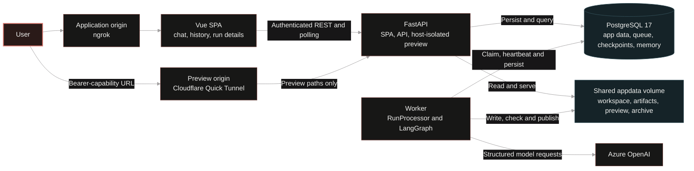
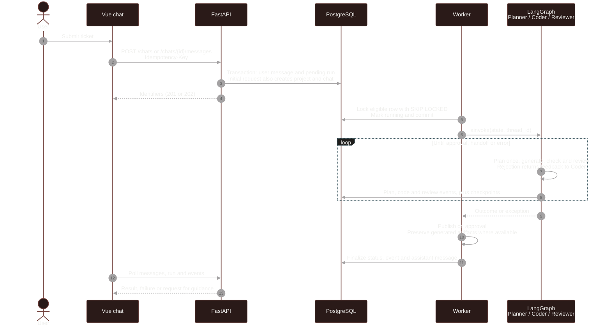
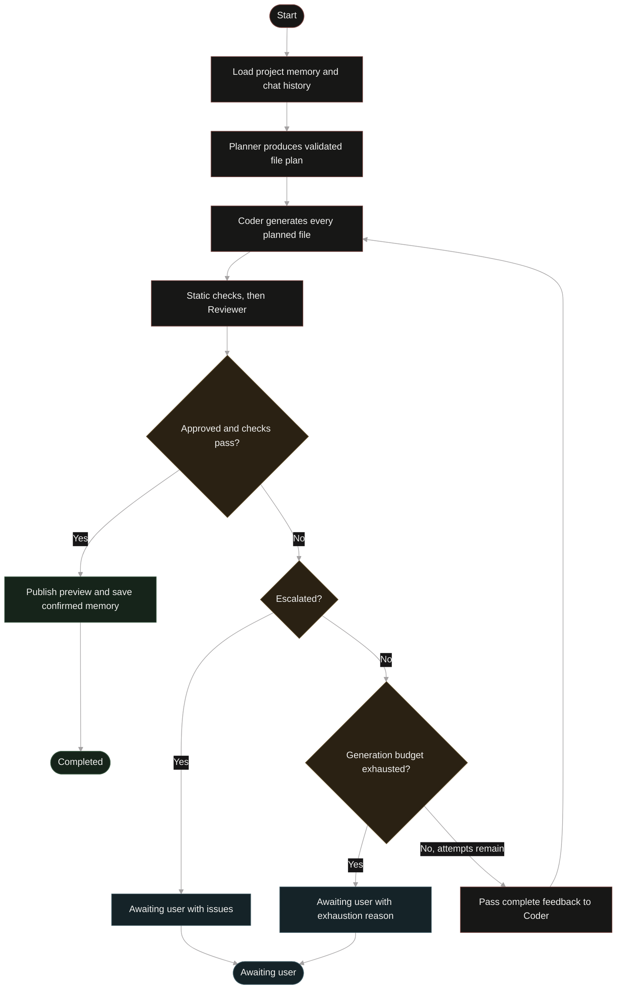
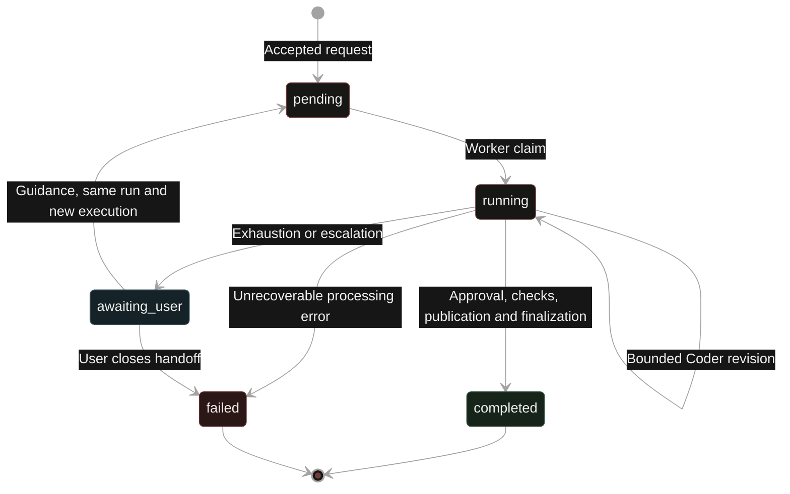
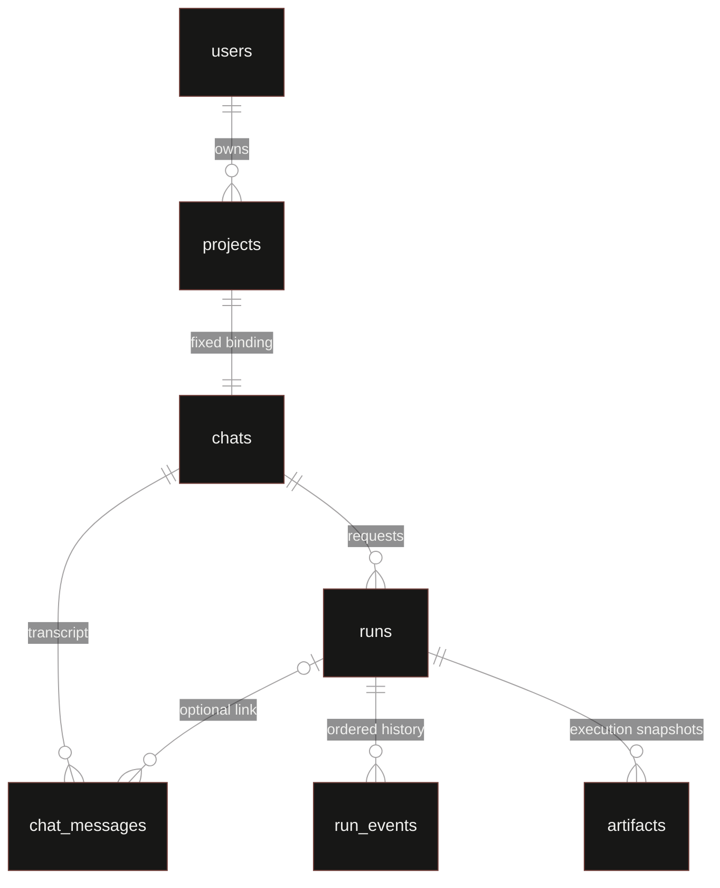

# Technical Design — AI Multi-Agent Coding Platform

This document covers the implementation, contracts and design decisions. See the
[Spanish README](../README.md) for setup and a product overview.

**Reading paths:** [components and lifecycle](#3-system-components-and-request-lifecycle) ·
[agent contracts](#5-agent-workflow-contracts-and-context) · [security](#7-security-and-trust-boundaries) ·
[queue and storage](#8-persistence-queue-and-workspace) ·
[configuration and observability](#9-deployment-configuration-and-observability) ·
[tests](#11-testing-and-validation-strategy) · [known limits](#12-known-limitations-and-operational-risks).

## 0. Executive summary

The platform turns a free-text ticket into a small static web app through a persistent, owner-scoped project chat.
Planner, Coder, and Reviewer have separate structured contracts. Approval publishes a preview; exhaustion of the
revision budget or escalation requests user guidance.

A Vue SPA talks to FastAPI. The API persists requests; a separate worker executes LangGraph. PostgreSQL holds
application records, queue state, rate-limit counters, checkpoints, and project memory. Files live on a persistent
volume. Azure OpenAI is the only implemented model provider. The public demo uses ngrok for the application and
Cloudflare Quick Tunnel for a separate preview hostname, both forwarding to the same FastAPI service.

The review used the source, PostgreSQL-backed tests, mocked browser tests and the running demo. Live-model quality
and exact assessment compliance remain pending: the original PDF was unavailable, and the local draft PRD has
outdated UI requirements. Future work is collected in §14.

Diagrams use PlantUML (`puml` fences), viewable through a PlantUML viewer or the optional Compose `docs` profile.

## 1. Problem and architectural goals

The design focuses on preserving project context across requests, controlling revisions and retaining enough
history to inspect a result or continue unresolved work.

- Accept requests without asking users to configure models or select a project for every message.
- Make planning, implementation, review and outcomes visible through application-owned events and files.
- Keep long model work outside HTTP requests and permit independent API/worker operation.
- Bound unattended iteration and protect the last approved preview from normal rejected/failed generations.
- Test workflow policy without calling live models; keep provider/storage details behind typed ports.
- Use the smallest operational stack appropriate to the current demo workload.

## 2. Scope, constraints and non-goals

### Implemented scope

- Local accounts, JWT login, immutable one-chat/one-project binding, rename and ordered messages.
- A new ordinary request creates a run; guidance continues an unresolved run in a new execution.
- Planner → Coder → Reviewer, complete-file generation, static checks, bounded revisions and explicit outcomes.
- Current files, saved per-execution generated artifacts, project-level latest approved preview and run history.
- PostgreSQL queue claims, heartbeats, two concurrent runs per worker process, basic retention and cleanup.
- Shared fixed-window rate limits, owner-scoped APIs, host-isolated preview serving, structured logs and usage events.

### Constraints

The deployment is a locally hosted technical-assessment demo: durable disk and network/power availability are
operator responsibilities. Azure credentials and deployment names are developer-only environment settings.
`MAX_RUNS_PER_PROJECT` defaults to 10 stored runs. Continuations reuse a run and receive a fresh generation budget.

### Explicit non-goals

No generated backend execution, arbitrary repository modification, manual code editor, Git integration, tenant
teams/RBAC, provider-selection UI, automatic project-routing agent, billing enforcement, running-work cancellation,
functional sandbox, broad browser matrix, centralized observability stack or CI pipeline is implemented.

## 3. System components and request lifecycle

### 3.1 Components



| Component | Responsibility | Principal source |
|---|---|---|
| Frontend | Authentication UI, chat navigation, request submission, progress polling, files and events. | `client/src/App.vue`, `client/src/views/` |
| API | Validate requests, resolve ownership, persist/enqueue, expose history/results, serve static assets and previews. | `server/app/main.py`, `server/app/interfaces/api/` |
| Worker | Claim, heartbeat, execute graph, finalize status/reply, maintain retention. | `server/app/worker.py`, `server/app/application/processor.py` |
| Database | Transactional application records plus package-owned LangGraph tables. | `server/app/infrastructure/persistence/`, `server/alembic/` |
| Workspace | Plan-restricted writes, read-only checks, artifact and preview copies. | `server/app/infrastructure/workspace/web.py` |
| Model adapter | Resolve Azure deployments, perform structured calls, normalize response and usage. | `server/app/infrastructure/llm/client.py` |

### 3.2 Ticket execution sequence



Application events, filesystem writes and LangGraph checkpoints are committed separately.

### 3.3 Chat-bound interaction and frontend

`POST /chats` atomically creates project, chat, initial user message and run. The project title initially comes
from the message; Planner may suggest a 2–6-word title. It applies only to the initial run before manual rename.
`title_locked` and repository checks prevent a late suggestion from replacing a user's chosen title.

Chat switching changes only the selected context; it cannot retarget a run. Each subsequent ordinary message
creates a run in that project. An `awaiting_user` run remains active and blocks a new run until continued or closed.

The sidebar collapses to a rail on wide screens and a drawer on phones. Chat footers show status/details above
event-derived progress. `ChatView.vue` polls every three seconds; `RunView.vue` polls active runs every two seconds.
The UI polls complete event lists. `/` redirects to the `/chats` workspace landing view.

Run details combine project information, the latest approved project preview, run ID/request/result, plan, checks,
review, saved files and events. The old `/projects/:id` frontend route redirects to the project's latest run or chat.
Project/chat deletion is available through the API; the UI provides continuation and close controls.

## 4. Application boundaries and adapters

### 4.1 Dependency direction

Interfaces and infrastructure depend on application/domain contracts. Domain code contains pure rules and
dataclasses; application code coordinates the workflow through ports. LangGraph lives in the application layer.
Manual composition lives in `infrastructure/container.py` and the process entrypoints.

```text
server/app/
  domain/          dataclasses, enums, path rules, errors and pure policies
  application/     graph.py, processor.py, prompts.py, agent_schemas.py, ports.py, usage.py
  infrastructure/ persistence/, llm/, workspace/, memory/, rate_limit/, logging_config.py, container.py
  interfaces/      api/, schemas/, middleware/, dependencies.py
  main.py          create_app() factory
  worker.py        queue loop and maintenance entrypoint
```

HTTP chat operations call the concrete SQLAlchemy repository; processor/graph operations use `RepositoryFactory`.
`application/use_cases/` is currently an empty package.

### 4.2 Effective ports

| Port/type | Actual boundary |
|---|---|
| `LLMClient` | Returns `LLMResult`: parsed object plus normalized usage/duration; SDK response types stay in infrastructure. Pydantic agent validation runs in the graph. |
| `Workspace` | Project file list/read/write, plan guard, checks, publish, artifacts, archive and deletion. |
| `RepositoryFactory` / `RunRepository` | Per-operation async context for workflow persistence, events, memory-related context and finalization. |
| `MemoryStore` | Load/save/delete project summary text. |
| `RateLimiter` | Consume bucket budget and return counters/reset information. |
| `RunQueue`, `EventSink`, `Clock` | Declared Protocols. Current wiring handles claims/events through `SqlAlchemyRepository` and time through the limiter's clock callable. |

### 4.3 Providers and secrets

`ProviderRegistry` builds an Azure client per role, each with a configurable deployment and a shared endpoint/key.
The Azure request's `model` field holds the deployment name. Calls use the resource's `/openai/v1/` endpoint,
`chat.completions` and JSON Schema structured output.

Missing configuration produces an unavailable client that raises `MissingCredentialsError` with the setting name.
Credentials, SDK objects and deployment selection stay in infrastructure and operator configuration.

### 4.4 Adding an adapter

1. Implement the relevant narrow port under `infrastructure/`, keeping SDK and I/O details there.
2. Wire it in `container.py` and, for model providers, `ProviderRegistry`.
3. Add boundary tests and fake-port application tests, including failure behavior.
4. Verify capabilities such as structured output and usage empirically before claiming provider compatibility.

## 5. Agent workflow, contracts and context

### 5.1 Graph and bounded review



`graph.py` implements `START → planner → coder → reviewer`, with Reviewer routing back to Coder or ending the
graph. Processing exceptions are handled by `RunProcessor` and recorded as failures.
The application writes the final `chat_reply`.

`MAX_CODER_GENERATIONS=3` means **three total generations**, including the initial attempt; minimum one. Each
generation invokes Coder once per planned file. Approval exits early. The counter is `coder_generations` in graph
checkpoint state. Graph recursion limits grow to accommodate the configured budget.
Planner is not rerun inside the revision loop. First-generation prompts omit prior-execution feedback; later
generations receive the previous verdict/summary/all issues and existing files, preserving cross-file context.

### 5.2 State contract and outcomes



| Concept | Meaning |
|---|---|
| Project | Owner-scoped mutable workspace and stable preview capability. |
| Chat | Exactly one immutable project binding; stores an ordered conversation. |
| Run | One requested change. Owns current plan/code/feedback/checks and the current execution identifier. |
| Execution | One Planner-led workflow attempt; continuation creates another execution within the same run. |
| `pending` | Accepted and eligible for a worker. |
| `running` | Claimed and processing, with heartbeat. |
| `awaiting_user` | Unapproved work needs guidance. Not claimable; blocks ordinary new requests in its chat. |
| `completed` | Approved output was processed through publication/finalization. |
| `failed` | Processing failed, or the user explicitly closed a handoff. The closing event distinguishes abandonment. |

Continuation requires nonblank guidance, records another user message, sets `pending`, assigns `execution_id`,
clears locks/current reply/error and starts at Planner with a fresh generation budget. It preserves run/chat/project
identity and prior artifacts/events. Model failures do not offer continuation through that endpoint, which accepts
only `awaiting_user`.

`GraphState` is a `TypedDict` containing IDs, message/guidance, memory, plan/code/feedback/checks, generation count,
approval/handoff/reason, aggregate usage and error. Runtime validation applies to individual agent outputs and
domain/path rules. Checkpoint-shape changes require compatibility care.

### 5.3 Agent contracts

| Agent | Inputs | Output and checks |
|---|---|---|
| Planner | Request, latest guidance, last 20 chat messages, project summary memory. | `PlannerResponse`: summary (1–2000 chars), 1–8 steps, optional title. Step name ≤120, relative path ≤300, description ≤1000, allowlisted type. |
| Coder | Current step, plan summary/description, all readable existing text files, memory, guidance, previous review only on revisions. | `CoderResponse`: exact requested `file_path`, complete nonempty text. Null bytes are stripped. Writes limited to the current plan; checksum computed by the application. |
| Reviewer | Original request, latest guidance, plan, generated files and other readable project files, check report and memory. | `ReviewerResponse`: `approve` / `reject` / `escalate`, summary ≤2000, up to 20 issues (message ≤1000 and nullable file path). Approval is changed to rejection if static checks fail. |

`agent_schemas.py` uses Pydantic `extra="forbid"` and exports the provider JSON Schemas. The graph parses and validates
each response. Prompts live in `application/prompts.py`; executions currently use the deployed code's instructions.

Allowed file types are `html`, `css`, `js`, `md`, `json`, `svg`, `png` and `ico`. Paths use ASCII letters/digits,
underscore, hyphen, dot and forward slash; absolute paths, backslashes and any `..` substring are rejected.
Binary-asset limitations are described in §8.3. Persisted plan steps have application-generated UUIDs, and code
records carry the application-computed SHA-256, file type and complete file content.

### 5.4 Static checks and guarantees

`WebWorkspace.check_readable` runs inside Reviewer before the LLM call:

1. Each planned path must resolve under the workspace, exist, be nonempty and have an allowlisted extension.
2. Planned external `.js` files are parsed with `node --check`; default timeout five seconds. Generated JS is not
   executed by the server.
3. Issues are appended to Reviewer feedback. A failed check blocks approval even if the LLM says `approve`.

These checks cover file structure and external JavaScript syntax. Functional behavior, inline scripts, DOM wiring
and browser compatibility still need executable tests. The Reviewer assesses requirement coverage from the code.

### 5.5 Multi-turn context and project memory

Three distinct mechanisms serve different purposes:

- **Transcript:** all messages persist; Planner receives the last 20. Coder receives the current readable workspace.
- **Project memory:** `LangGraphMemoryStore` stores a single `summary` item in namespace
  `("project", project_id, "memory")`. Approval appends request/result text, retaining the last 4000 characters.
- **Checkpoint:** operational graph state for an execution.

Approval updates confirmed memory. Continuation includes the original request, latest guidance and recent
transcript. Complete-file prompts grow with the workspace; token-aware context selection is a future improvement.

### 5.6 Checkpoints versus application persistence

LangGraph stores graph state under thread ID `{run_id}:{execution_id}`. Its saver/store use Psycopg 3 and initialize
their own tables through `setup()`; application records use SQLAlchemy/asyncpg and Alembic. `Settings.psycopg_url`
provides the saver connection scheme. The UI reads application run records and events.

Recovery reuses the thread ID and invokes the graph with a reconstructed input dict. Exact pending-node resume
is unverified, and model calls or other effects may repeat after reclaim (§8.2).

### 5.7 Error handling and the different retry layers

| Layer | Behavior |
|---|---|
| Reviewer loop | A rejection returns to Coder within `MAX_CODER_GENERATIONS`, using the same plan. |
| Provider adapter | `complete()` makes up to two attempts and requests valid JSON on the second. Its catch covers JSON, transport and auth exceptions. Pydantic validation follows in the graph. |
| Temperature compatibility | Starts with `temperature=0`; on a recognized unsupported-value response, retries without it and caches that deployment capability. |
| OpenAI SDK | Retains its default retries, with a 120 s provider timeout. SDK and adapter attempts can extend total request time. |
| Queue recovery | Reclaims stale running rows with the same execution/thread ID. |
| User continuation | Guidance starts a new Planner-led execution of an `awaiting_user` run. |

Unrecovered adapter errors and invalid agent schemas raise a role-tagged `ModelError`. Missing settings raise
`MissingCredentialsError`; unsafe file operations raise `WorkspaceError`. Processor records `run_failed`, writes
a user-facing explanation and releases the lock. Technical details retain the exception type/tag; developer logs
add correlation and stack frames. A database outage during finalization can leave the failure event uncommitted.

## 6. API contracts and OpenAPI

### 6.1 Endpoints

FastAPI provides `/docs`, `/redoc` and `/openapi.json`. Application routes are under `/api/v1`; health and preview
routes are unprefixed. Swagger provides the field-level request/response reference.

| Method | API path | Purpose |
|---|---|---|
| POST | `/api/v1/auth/register`, `/api/v1/auth/login`, `/api/v1/auth/logout` | Registration and JWT authentication. Login is form-encoded (`username`, `password`). |
| POST | `/api/v1/auth/forgot-password`, `/api/v1/auth/reset-password`, `/api/v1/auth/request-verify-token`, `/api/v1/auth/verify` | Installed auth library routes; no email-delivery integration is configured. |
| GET/PATCH | `/api/v1/users/me` | Installed current-user account routes; GET is used by the SPA. |
| GET/PATCH/DELETE | `/api/v1/users/{id}` | Auth-library superuser account operations. |
| GET/POST | `/api/v1/chats` | List owned chats / atomically create first project/chat/message/run. |
| GET/PATCH/DELETE | `/api/v1/chats/{chat_id}` | Read, rename paired chat/project, or API-only deletion. |
| GET/POST | `/api/v1/chats/{chat_id}/messages` | Ordered transcript (`after` sequence cursor) / enqueue subsequent request. |
| GET | `/api/v1/chats/{chat_id}/runs` | Run history, newest first. |
| GET | `/api/v1/projects` and `/api/v1/projects/{project_id}` | Owned project list/detail. |
| DELETE | `/api/v1/projects/{project_id}` | Delete paired project/chat resources, subject to active-run guard. |
| GET | `/api/v1/projects/{project_id}/files` and `/api/v1/projects/{project_id}/files/{path:path}` | List/read current workspace files. |
| GET | `/api/v1/projects/{project_id}/preview-url` | Capability URL; `404` before first approved publication. |
| GET | `/api/v1/runs/{run_id}` and `/api/v1/runs/{run_id}/events` | Current run and ordered history (`after` sequence cursor for events). |
| GET | `/api/v1/runs/{run_id}/artifacts` and `/api/v1/runs/{run_id}/artifacts/{artifact_id}` | Generated-file snapshots by execution and file content. |
| POST | `/api/v1/runs/{run_id}/continuations` | `{guidance}`, same run/new execution, only from `awaiting_user`. |
| POST | `/api/v1/runs/{run_id}/close` | Close unresolved work as `failed`, retaining history. |
| DELETE | `/api/v1/runs/{run_id}` | Terminal-run deletion. |
| GET | `/preview/{preview_id}` and `/preview/{preview_id}/{path:path}` | Static files under the preview capability; empty path uses `index.html`. |
| GET | `/health` | Readiness: database, writable workspace, recent worker heartbeat. |

Resource APIs require bearer authentication and ownership. Health and preview access are public; auth and
administrative routes follow the installed `fastapi-users` requirements.

### 6.2 Submission, idempotency and errors

- First-chat creation and message submission require UUID `Idempotency-Key` headers. Normal requests accept
  `{message}` (trimmed, 1–8000 chars); guidance is 1–4000; rename title is 1–200.
- First creation returns `201`; subsequent enqueue and continuation return `202`. Repeated keys return existing
  resources (`200`); conflicting content is `409`. Project identity comes from the chat.
- Repository transactions and chat row locks serialize submissions; a partial unique index on **runs(chat_id)**
  is the active-run backstop. `awaiting_user` counts as active. The project run cap also returns `409`.
- Non-owned resources return `404`, avoiding an existence leak. Missing/invalid authentication is `401`.
- Rate limiting returns `429` and `Retry-After`; unavailable limiter is `503`; request validation is `422`.
- Custom application HTTP/validation errors use `application/problem+json`; library auth routes retain their
  own error structures.

## 7. Security and trust boundaries

### 7.1 Authentication and ownership

`fastapi-users` supplies account storage/auth routes; `interfaces/dependencies.py` also verifies JWT bearer tokens
and active users for application endpoints. Tokens use HS256, audience `fastapi-users:auth`, seven-day lifetime.
Registration is enabled; email verification is not a prerequisite for normal access. Password reset/verification
routes exist, but token delivery through email is not implemented. JWT logout does not provide server-side
revocation; the SPA removes its token from `localStorage`.

Ownership root is `projects.owner_id`. Chats join projects; runs/messages join chats. File/event/artifact access
is checked through the owned run/project. Tokens in `localStorage` remain vulnerable to application-origin XSS.

### 7.2 Rate limiting

The PostgreSQL fixed-window limiter uses an atomic upsert on `(key_hash, window_start)`. Its HMAC key combines
bucket and identity; raw client IPs are not stored in the counters. Auth/preview buckets use client IP. Other
buckets use a hash of the supplied Authorization header when present, otherwise IP. This gives each token its
own quota. A default `public` bucket is declared but unused by the route selector.

| Bucket | Default per 60 seconds | Selected for |
|---|---:|---|
| auth | 5 | `/api/v1/auth*` requests |
| run_create | 5 | First-chat POST; additional limit on message POSTs and continuations |
| write | 30 | Other writes; message/continuation POSTs also consume this bucket |
| read | 120 | API GET/HEAD, including polling |
| preview_document | 60 | Preview paths other than recognized asset suffixes |
| preview_asset | 600 | Preview css/js/png/ico/svg requests |

`/health` and frontend static routes are exempt. Responses include limit/remaining/reset headers. Store failures
fail closed (`503`). Expired counters are removed by worker maintenance. `RATE_LIMIT_ENABLED` is configurable;
bucket limits are code defaults.

`TRUSTED_PROXY_CIDRS` is empty by default. Forwarded client IP is accepted only for a configured trusted socket
peer, preferring `CF-Connecting-IP`, then the first `X-Forwarded-For` value. Use exact connector peers, not a broad
Docker/private-network range. Connector addresses can change on recreation; no auto-discovery updates this setting.
Without trusted forwarding, requests through a tunnel may share a connector-IP budget. Forwarded host headers
are not used to bypass host isolation.

### 7.3 Preview isolation and capability URL

Generated JavaScript runs in the browser on a separate hostname. `Settings` enforces distinct hostnames;
`HostIsolationMiddleware` returns `404` for cross-host/unknown routes and allows loopback health probes.

The latest approved project is served at `/preview/{preview_id}/`, using a stable random UUID4 capability.
Anyone with that URL can view it. The owner-scoped API exposes the link after `preview_ready`; the UI opens a
new tab with `noopener noreferrer`. Responses set `noindex` and `Referrer-Policy: no-referrer`. Generated scripts
retain browser network access, so generated files must stay free of secrets.

## 8. Persistence, queue and workspace

### 8.1 Schema and transactional ownership

Alembic owns application schema (`server/alembic/versions/`), and SQLAlchemy uses asyncpg. LangGraph creates its
saver/store tables through `setup()`.

| Table | Important fields / constraints |
|---|---|
| users | UUID account, email, password hash and auth flags from `fastapi-users`. |
| projects | `owner_id`, title/summary, unique `preview_id`, `preview_ready`, project status, timestamps. |
| chats | Unique `project_id`, globally unique first-creation key, `title_locked`, timestamps. |
| chat_messages | `chat_id`, nullable `run_id`, role/content, sequence, idempotency key; unique `(chat_id, sequence)` and `(chat_id, idempotency_key)`. |
| runs | `chat_id`, request, status, current `execution_id`, guidance, JSONB plan/code/feedback/checks, reply/error, archive flag, worker lock and heartbeat. Partial unique active-chat index. |
| run_events | `run_id`, optional `execution_id`, ordered sequence, generic string kind, JSONB payload; unique `(run_id, sequence)`. |
| artifacts | `run_id`, `execution_id`, relative file path/type, checksum; unique `(run_id, execution_id, file_path)`. Contents live on disk. |
| worker_heartbeats | Worker ID, last-seen timestamp and nullable current-run ID for coarse liveness. |
| rate_limit_counters | HMAC key hash, minute-window start, count, expiry; composite primary key. |

Native PostgreSQL enums mirror `StrEnum` for run status, project status, message sender and file type. Event kinds
remain strings so adding a workflow event does not require an enum migration. Indexes support owner lists, chat
activity, run history, ordered event polling, artifacts and stale/expiry lookups. A run's project is derived through
its chat.



Event sequencing reads the maximum sequence and inserts under a unique constraint. Finalization locks the run
and checks `running` before committing status, reply and event. Assistant-message idempotency is execution/status-
derived. Filesystem writes precede this commit. A canonical initial migration is used during development;
deployments with persistent user data require additive migrations.

### 8.2 Durable queue and worker

The `runs` table is the queue. Submission commits the user message and pending run together. A worker claims the
oldest pending or stale-running row with `FOR UPDATE SKIP LOCKED`, then sets its status, lock and heartbeat.
PostgreSQL suits the current low-concurrency workload and keeps queue operations in the same datastore.

Each worker handles two runs concurrently, polling every second. Run heartbeats update every 15 seconds; a
running row becomes eligible for reclaim after 60 seconds without a heartbeat. SIGTERM/SIGINT stops claims,
allows 10 seconds to finish, then cancels remaining tasks. Docker's stop grace is 20 seconds.

Recovery may repeat effects (§5.6). Ownership updates currently lack lease fencing; scale-out requires addressing
that and providing shared file storage. Revisit the queue design if contention, throughput or scheduling needs grow.

### 8.3 Workspace and complete files

`WebWorkspace` uses these paths relative to `DATA_DIR` (default `data`):

| Path | Meaning |
|---|---|
| `projects/{project_id}/` | Latest mutable generated files, including unapproved changes. |
| `artifacts/{artifact_id}/{file_path}` | Generated-file snapshot for a run execution; handoffs also retain artifacts. |
| `preview/{project_id}/` | Copied latest approved project, addressed publicly by `preview_id`. |
| `archived/{project_id}/{run_id}/{execution_id}/...` | Completed-run archive organized by execution. |

Resolved paths must remain within the project and belong to the current plan. Writes use a same-directory
temporary file and `os.replace`, giving per-file atomicity and preserving unplanned files. Agents read text files;
PNG/ICO and undecodable content are excluded. Coder currently produces text, including SVG assets.

Finalization saves generated-file snapshots per execution and publishes the readable-text workspace on approval.
Handoffs retain their generated artifacts and the previous preview. Snapshots cover generated files at finalization;
intermediate generations and complete historical projects are not versioned. Each artifact records a SHA-256.
Publication removes and recopies the preview directory before DB finalization, so a crash during copying can leave
a partial preview.

Terminal-run deletion removes events/artifacts while preserving the chat and current files. Project/chat deletion
also removes their workspace, preview and memory; active runs block deletion with `409`. Hourly maintenance archives
completed runs older than 30 days, retaining artifact/event history, and cleans old terminal checkpoints, expired
rate-limit counters and stale worker heartbeats.

## 9. Deployment, configuration and observability

### 9.1 Assessment deployment

`ngrok.yml` pins the application to `https://version-afar-augmented.ngrok-free.dev`. Cloudflare Quick Tunnel
provides a temporary separate preview origin. `demo-up.sh` reads its URL from connector logs, updates `PREVIEW_HOST`
in `.env`, and recreates app/worker when it changes. Rerun the script after an independent connector restart.
Availability depends on the local machine, its network connection and the tunnel services.

### 9.2 Serving and process topology

Compose runs `db`, one-shot `migrate`, `app` and `worker`, with optional tunnel, browser-test and PlantUML profiles.
Startup follows database health → Alembic migrations → API/worker → tunnels. The image combines the compiled
Vue SPA, Python 3.14 and runtime Node; Gunicorn runs two Uvicorn workers, while the worker container runs
`python -m app.worker` from the same image.

`pgdata` and `appdata` persist database and workspace files. API/DB ports bind to loopback (8000/5432); the optional
PlantUML viewer exposes 8080. `/health` checks DB access, workspace write permission and a recent worker heartbeat,
returning `200` or `503`. Setup, shutdown and log commands are in the [README](../README.md#instalación-y-ejecución-local).

### 9.3 Environment variables

There are two ignored runtime files: `.env` for app/database/public settings and `.env.tunnel` for the ngrok token.
Compose injects `.env` into app/worker and overrides `DATABASE_URL` to use `db`; ngrok alone receives `.env.tunnel`.
Examples contain placeholders. Settings read `.env` / `../.env` for host-side processes; environment variables
override dotenv values. Keep populated files outside version control.

| Setting | Default / meaning |
|---|---|
| `APP_ENV`, `LOG_LEVEL` | `development`, `info`; public script requires literal `APP_ENV=production`. |
| `SECRET_KEY` | Required, stable JWT/HMAC secret; nonempty in development, ≥32 non-placeholder characters in production. |
| `DATABASE_URL` | SQLAlchemy asyncpg URL; host-side value must point at the intended development/test DB. Compose derives its internal URL from `POSTGRES_*`. |
| `POSTGRES_USER`, `POSTGRES_PASSWORD`, `POSTGRES_DB` | PostgreSQL initialization; defaults in Settings are `app` / placeholder / `app`. Compose expects supplied values. Changing them does not rotate an existing volume's credentials. |
| `PUBLIC_URL` | `http://localhost:8000`; public demo must match `ngrok.yml`. |
| `FRONTEND_ORIGIN` | `http://localhost:5173`; CORS allows this and `PUBLIC_URL`, not a wildcard. |
| `PREVIEW_HOST` | `http://preview.localhost:8000`; a distinct hostname is mandatory. Public script refreshes it. |
| `MAX_RUNS_PER_PROJECT` | `10`, checked against stored runs on subsequent ordinary submissions. |
| `MAX_CODER_GENERATIONS` | `3` total generations per execution, minimum `1`. |
| `AZURE_OPENAI_API_KEY`, `AZURE_OPENAI_ENDPOINT` | Operator-supplied key and resource `/openai/v1/` endpoint; absent values fail generation explicitly. |
| `AZURE_OPENAI_DEPLOYMENT_PLANNER`, `..._CODER`, `..._REVIEWER` | Actual Azure deployment names; independently configurable, never invented by the app. |
| `RATE_LIMIT_ENABLED`, `TRUSTED_PROXY_CIDRS` | `true`, empty; comma-separated trusted peer networks, preferably exact connector addresses. |
| `DATA_DIR`, `STATIC_DIR` | `data`, `static`; workspace root and compiled SPA directory. |
| `NODE_BINARY`, `JS_CHECK_TIMEOUT_SECONDS` | `node`, `5.0`. |
| `WORKER_POLL_SECONDS`, `WORKER_HEARTBEAT_SECONDS`, `WORKER_STALE_SECONDS` | `1.0`, `15.0`, `60.0`. |
| `NGROK_AUTHTOKEN` | Agent credential supplied through `.env.tunnel`. |

Worker concurrency (2), shutdown grace (10 s), maintenance interval (3600 s), retention (30 days), memory length
(4000 chars), provider timeout (120 s), auth token lifetime (7 days) and rate bucket values are code defaults/
constants. `VITE_API_BASE` is an optional frontend build-time API prefix, defaulting to `/api/v1`.

### 9.4 Observability: events, usage and logs

| Signal | Storage | Purpose |
|---|---|---|
| Run events | PostgreSQL, owner-scoped UI/API | Ordered steps, reviews, outcomes and aggregate model usage. |
| Logs | stdout/stderr → Docker | Request, worker and execution diagnostics. |
| Health | `/health` | Dependency and worker-heartbeat readiness. |

Azure usage is normalized through `LLMResult` / `TokenUsage`. Events record response count, summed adapter duration,
input/output/total tokens and `usage_complete`. Coder usage combines all files in a generation; completion/handoff
events carry execution totals. Use either step-level records or final totals when aggregating to avoid double-counting.
Failed runs may retain only the failing call/generation's usage; timeouts and missing provider metadata can leave
totals incomplete. The event Details UI exposes these fields as JSON.

`infrastructure/logging_config.py` formats application logs as JSON using standard Python logging and `LOG_LEVEL`.
HTTP records contain request IDs, route templates, status and duration; workflow logs use run/execution IDs.
Health requests are excluded. Prompts, generated content and credentials stay out of application log fields.
Docker rotates container output at 10 MB with three files per container; recreating a container removes its old logs.
Gunicorn/Uvicorn startup messages retain their standard format.

```bash
docker compose logs -f --tail=200 app worker
```

## 10. Architectural decisions and trade-offs

| Problem | Choice / benefit | Trade-off and trigger for change |
|---|---|---|
| Generation and validation are different responsibilities | Explicit Planner/Coder/Reviewer contracts make intermediate decisions inspectable. | Roles may share a model and correlated errors; measure real tickets before changing model allocation. |
| Unbounded correction wastes time/resources | Bounded generations and explicit handoff. | More guidance executions remain possible; spend enforcement is separate. |
| Long calls should not block HTTP | Durable enqueue + separate worker. | Polling, heartbeat and recovery semantics must be maintained. |
| Keep deployment small | PostgreSQL queue/data/rate limits. | API and worker share database capacity; measured contention would justify separation. |
| Test application behavior through ports | Inward dependencies, typed ports, manual DI. | Some HTTP use cases remain in the concrete repository. |
| Keep project context stable | Immutable project per chat. | Chat/project associations are fixed. |
| Protect unrelated files | Full-file generation plus current-plan path guard. | More prompt/output tokens; atomicity is per file. |
| Separate generated scripts from auth storage | Separate-host capability preview. | Public to link holders, with browser network access. |
| Diagnose execution problems | Events and JSON logs using current DB/Docker tools. | Bounded log retention and potentially incomplete usage on failure. |

## 11. Testing and validation strategy

### 11.1 Test strategy and commands

`server/pyproject.toml` configures Python 3.14, Ruff line length 100 and pytest asyncio auto mode. `packages = []`
installs dependencies; run backend commands from `server/` so `app` is importable. Verification is currently manual.

| Level | Evidence |
|---|---|
| Pure policy and prompt tests | Status rules, budget, approval guard, prompt inputs, usage/log formatting. |
| Fake-port graph tests | Feedback delivery, early approval, exhaustion, escalation, invalid outputs, multi-file usage aggregation. |
| Adapter tests | Azure request shape/fallback and token metadata with fake responses; real filesystem writes, paths and Node syntax checks. |
| PostgreSQL/API tests | Atomic submissions, idempotency, ownership, active-run/run-cap guards, finalization, snapshots, memory and rate-limit persistence. |
| Worker tests | Two concurrent fake processors, shutdown drain/cancel, release behavior; queue claim/reclaim also has persistence tests. |
| Playwright | Mocked API journey: chat/rename/history, combined run/project view, preview in new tab, continuation, reload, sidebar and 390/1440 px checks. |

Related scenarios use `pytest.mark.parametrize`; shared fixtures live in `tests/conftest.py`. Tests assert observable
outcomes and preserved data with fake models. PostgreSQL must be available for the integration gate.

The autouse fixture truncates tables in the database selected by `DATABASE_URL`. Set it to a dedicated, migrated
`app_test` before running pytest. See [README setup](../README.md#desarrollo-y-pruebas).

```bash
# From server/, with the virtual environment activated and test DATABASE_URL set.
pip install -e '.[dev]'
alembic upgrade head
ruff check .
ruff format --check .
pytest
python -m evals.runner
```

```bash
# From client/ (requires Node/npm): typecheck and production build.
npm ci
npm run build

# From repository root, with Compose app running: mocked browser journey.
docker compose --profile e2e run --rm browser
```

The Dockerfile also executes the client production build. Host-side development uses separate terminals for
`uvicorn app.main:create_app --factory --reload`, `python -m app.worker`, and Vite; keep URLs/APP_ENV consistent.

### 11.2 Evaluation harness

`server/evals/runner.py` exercises five scripted scenarios: coupon workflow, Flappy Bird revision, file preservation,
escalation and malformed Planner output, plus missing credentials. Its `fake_port_policy` metrics cover workflow
behavior and checksums. `real_provider_quality` currently reports `blocked` with sample size zero.

Model-quality evaluation still needs exact ticket rules, repeated live runs, functional checks and recorded
deployment/prompt configuration. The original assessment PDF and its coupon rules remain unavailable locally.

## 12. Known limitations and operational risks

| Limit | Practical consequence |
|---|---|
| Static/syntax checks and LLM judgment only | Functionally broken apps can be approved; inline script errors can be missed. |
| Replay/fencing gaps | Stale or recovered workers can repeat calls, events and filesystem effects. |
| Non-atomic preview publication | Crash during copy can damage the previous preview despite normal rejection preservation. |
| Complete-file/context strategy | Large histories/workspaces increase token usage and latency; no retrieval/context budget. |
| Partial failure telemetry | Failure summary is not necessarily an execution-wide total; unknown provider consumption remains possible. |
| Local volumes and tunnel hosting | No HA/backup automation; preview URLs may change, logs are container-scoped. |
| Token-based rate-limit identity and trusted proxy configuration | A new token can create a new identity bucket; connector-IP grouping can affect public signup/requests. |
| Email delivery | Reset/verification routes need token-delivery integration for a complete recovery workflow. |
| Provider/prompt evaluation | Role-level model selection still needs comparative quality, latency and cost measurements. |

## 13. Limits and open decisions

### 13.1 Limits

Current limits deliberately bound the demo: one active run per chat, ten stored runs per project by default,
three total generations per execution by default, 1–8 planned files, recent transcript plus 4000-character summary,
two worker tasks and static preview. Spend enforcement and functional validation remain future work.

### 13.2 Open items

| Decision | Why it remains open |
|---|---|
| API/model budget policy | Define who pays, token/time/spend ceilings, continuation allowance, and behavior when a budget is reached. No hard spend enforcement exists. |
| Real-provider evaluation | Choose deployments from measured quality, latency, reliability and cost. |
| Recovery contract before scale-out | Define durable resume, fencing, replay-safe publication and aggregation for multiple workers. |
| Assessment acceptance | Obtain the original PDF and exact examples to independently verify required deliverables and thresholds. |
