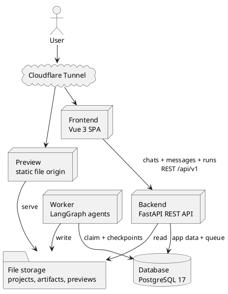
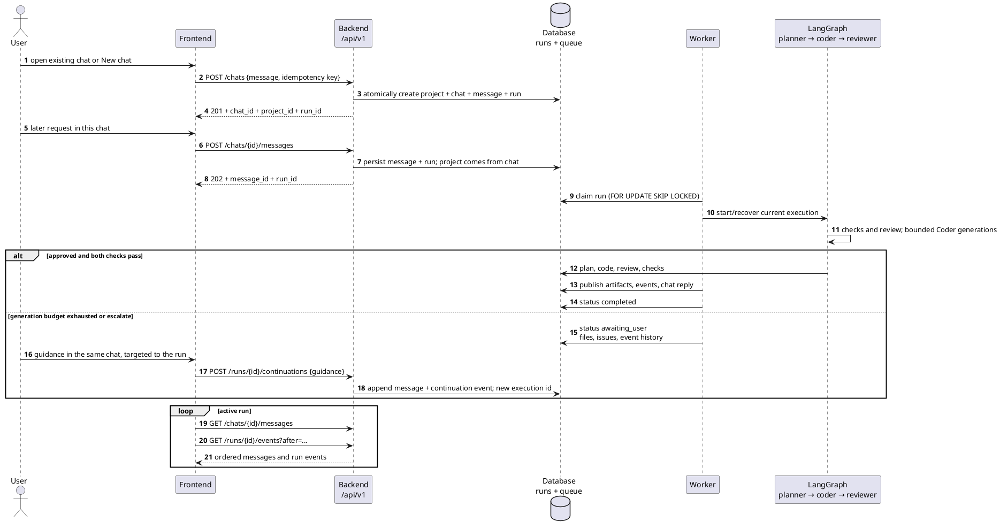
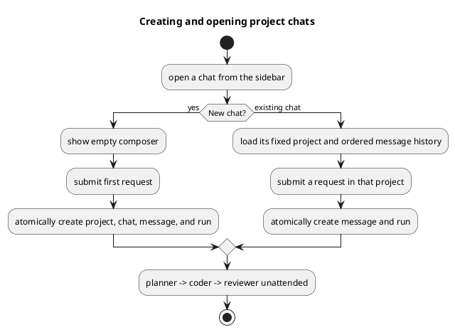
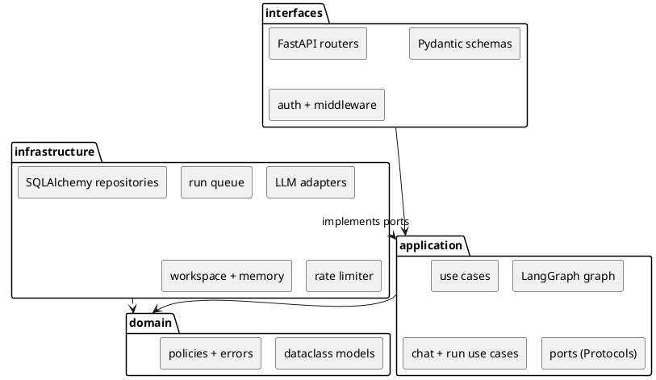
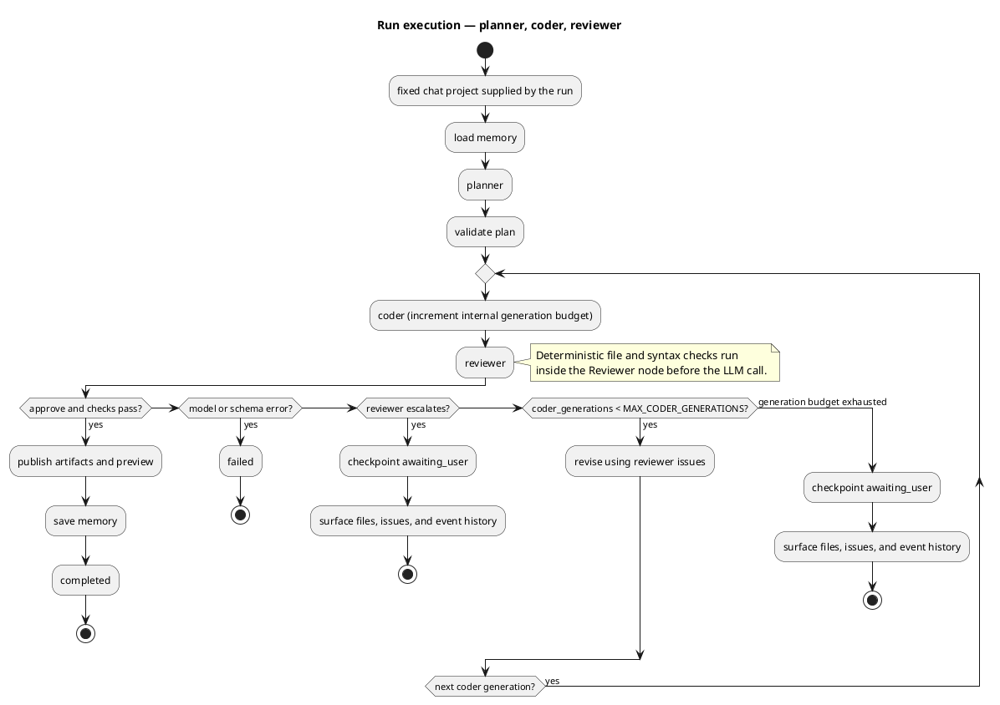
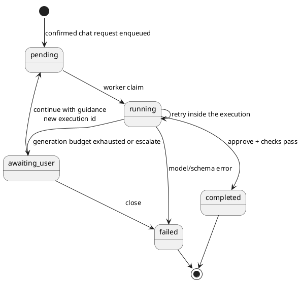
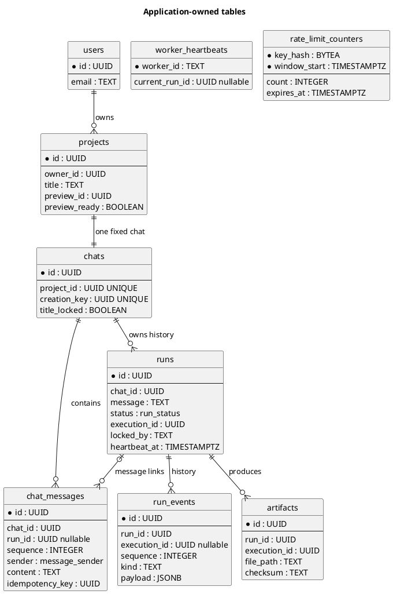

# Technical Design Document — AI Multi-Agent Coding Platform (MVP)

This Technical Design Document (TDD) defines the target architecture, contracts, and technical rationale.
The PRD in `tasks/prd-mvp.md` owns product scope, user stories, acceptance criteria, and success targets.

## 0. Executive summary

A user describes a static app through a private chat bound to exactly one project. The user opens a new chat to
start another project; project context never changes within an existing chat.

Each request creates a run. Its unattended Planner → Coder → Reviewer execution generates complete files and
checks them. Approval publishes a static preview. Three rejected Coder generations or a valid escalation produce
an `awaiting_user` handoff; guidance continues the same run in a new execution. Errors fail explicitly.

The system uses a Vue SPA, FastAPI, a separate LangGraph Worker, PostgreSQL, and persistent file storage.
Docker runs locally, with Cloudflare Tunnel exposing separate app and preview origins. Provider configuration
is developer-only, and the server never executes generated code.

## 1. Problem and goals

### 1.1 Problem

Give a non-engineer a working starting point from a plain-language request, without pretending that generated
code is always correct. The hard part is not generation alone; it is producing something reviewable, showing
what was done, and being explicit when the agents cannot agree. A demo that fabricates success is worse than a
demo that shows an honest handoff.

### 1.2 Goals

- Accept a plain-language request and produce a visible plan, complete files, a review outcome, and an explicit
  completed or handoff state.
- Give each project one persistent chat, with an inbox/sidebar for revisiting chats.
- Preserve chat history, project memory, and run history across follow-up requests and sessions.
- Never report an unresolved result as approved.
- Keep run executions unattended; expose progress without requiring mid-execution input, and surface an honest
  final result, failure, or handoff.
- Let the user inspect files, preview the result, guide a handoff, and close an abandoned run.
- Support multi-user login with owner-scoped chats, projects, runs, files, and run events.
- Keep model credentials out of the domain, out of the repository, and out of the user interface.
- Survive a worker restart without losing an accepted result.

### 1.3 Non-goals

- Server-side execution of generated backend code or generated JavaScript. The preview is static files only.
- Containerized or Git-backed workspaces, or per-run project versioning beyond approved artifacts.
- Enterprise delegated credentials, SSO federation, or per-user external-system integrations.
- User-facing provider, credential, or model configuration.
- Billing, hard spend caps, or token-budget enforcement.
- RBAC beyond project ownership.
- A broad browser test matrix.
- Automatic project selection, project routing/inference agents, and grouping runs under a separate Feature entity.

## 2. Constraints and assumptions

- **$0 hosting for the assessment.** Docker on localhost supplies a durable filesystem and Node subprocesses;
  Cloudflare Tunnel supplies public HTTPS access.
- **PostgreSQL 17 is the only datastore.** No Redis, no broker, no object store in the MVP. This keeps one
  backup story and one failure mode.
- **Azure OpenAI is the only provider in the MVP.** Live verification depends on credentials and deployment
  names supplied by the developer (§13.2); deterministic tests use fake model ports.
- **Node is required at runtime** for `node --check`; the runtime image must include it.
- **The preview cannot be trusted with secrets.** Generated projects are static, unauthenticated, and
  capability-addressed.
- **Only the developer configures the provider.** Azure deployments and credentials come from environment
  configuration, never from the product UI or per-project settings.

## 3. System design

### 3.1 Components

| Component | Responsibility |
|---|---|
| Frontend | Vue 3, TypeScript, Pinia, Tailwind, Vite. Collapsible chat sidebar; each chat shows one project, messages, run activity, history, and project files. Approved preview opens in a new tab. |
| Backend | FastAPI under `/api/v1`; auth, chats, projects, runs, messages, run events, files, preview URL, health. Persists messages/runs atomically and enqueues work; never calls models or executes the graph in-request. |
| Worker | Claims pending runs, executes Planner → Coder → Reviewer, writes files and generic run events, updates project memory, and finalizes the run. |
| Database | PostgreSQL 17: application tables, durable run queue, rate-limit counters, LangGraph checkpoints, and the long-term memory store. |
| File storage | Persistent volume for latest project files, approved artifacts, preview snapshots, and archives. |
| Preview | A separate static origin serving copied files at an unguessable capability URL. Never executes generated code. |
| Tunnel | Cloudflare Tunnel exposing the frontend and preview hostnames over HTTPS. |



### 3.2 Request and run flow



- `POST /api/v1/chats` creates the initial project/chat/message/run; `POST /api/v1/chats/{id}/messages` creates
  later messages and runs in that fixed project.
- The Backend never executes the graph. The Worker owns the run lock, heartbeat, execution id, and terminal
  transitions.
- The human is not involved during an execution. When the configured total Coder generations are exhausted, the
  run stops in `awaiting_user`; guidance continues the same run in a new execution at the Planner, not at the Coder.
- A model-driven run can take minutes; the PostgreSQL-backed queue keeps HTTP requests short and lets the Worker
  restart independently without adding a broker.

### 3.3 Chat-bound project interaction

The sidebar lists a user's chats, ordered by recent activity. Each chat is bound to one project for its lifetime.
**New chat** opens a draft composer; submitting the first message atomically creates the project, chat, message,
and run. A temporary title is derived from the first message. The initial Planner response can suggest a concise
2–6 word title in the user's language; no extra model call is made. A missing or unusable suggestion keeps the
temporary title. User renames lock the title, so a late Planner response cannot overwrite them. There is no
project selector or project inference; choosing a different chat is the only way to change project context.

Every subsequent user message in the chat creates a run against its bound project. A run is one requested
change; explicit guidance continues an `awaiting_user` run. No separate Feature entity is needed. Messages and
run cards keep stable associations, so switching chats never retargets work or rewrites history.

The main chat shows a compact current-run activity card. A History view lists runs for that project and opens a
detailed timeline with plans, generated files, checks, reviews, handoffs, and continuations. Chat/project deletion
is API-only for now; no deletion control is shown in the user interface.



## 4. Application architecture

### 4.1 Layers and package layout

Imports flow `interfaces → application → domain`. `infrastructure` implements application ports and may import
domain types. Composition happens only at the entry points and in the hand-written
`infrastructure/container.py`; no mutable global state is shared between requests or runs.

| Layer | Owns | Must not own |
|---|---|---|
| `domain` | Plain dataclasses, errors, and pure policies: retry budget, plan-set guard, approval rules, state transitions. | FastAPI, SQLAlchemy, provider SDKs, filesystem or network I/O. |
| `application` | Chat/message/run use cases, LangGraph wiring, and narrow `typing.Protocol` ports. | Infrastructure adapters, routers, SDK types. |
| `infrastructure` | PostgreSQL repositories, queue, workspace, LLM providers, memory store, rate limiter, clock. | Business policy. |
| `interfaces` | FastAPI routers, request/response schemas, auth dependencies, middleware, composition. | Domain rules or direct SDK calls. |



```text
server/app/
├── domain/
│   ├── models.py          # chat, project, Plan, Code, Feedback, run state
│   ├── errors.py          # DomainError and subclasses
│   └── policies.py        # retry budget, plan-set guard, approval rules
├── application/
│   ├── ports.py           # Protocol ports listed below
│   ├── graph.py           # LangGraph workflow
│   ├── chats.py           # chat creation, messages, run enqueue/history
│   ├── checks.py          # deterministic file/syntax checks
│   ├── memory.py          # load/save memory use cases
│   └── use_cases/         # start_run, continue_run, close_run, finalize_run, ...
├── infrastructure/
│   ├── llm/               # Azure LLM registry and OpenAI-compatible adapter
│   ├── persistence/       # SQLAlchemy async repositories
│   ├── queue/             # Postgres run claim/heartbeat adapter
│   ├── workspace/         # WebWorkspace filesystem adapter
│   ├── memory/            # AsyncPostgresStore adapter
│   ├── rate_limit/        # Postgres fixed-window limiter
│   └── container.py       # manual dependency injection
├── interfaces/
│   ├── api/               # /api/v1 routers and preview router
│   ├── schemas/           # Pydantic request/response models
│   ├── middleware/        # rate limiting and request context
│   └── dependencies.py    # auth and ownership dependencies
├── main.py                # create_app() factory
└── worker.py              # worker entry point
```

### 4.2 Ports

| Port | Contract |
|---|---|
| `LLMClient` | One structured model call for a role. Returns validated output or a typed model error. No SDK types cross the boundary. |
| `Workspace` | List, read, write project files; run read-only checks; return a preview URL; delete a project workspace. Writes are plan-guarded and atomic. |
| `RunRepository` | Persist and read owned chats, messages, runs, run events, and artifacts; atomically create chats/runs and apply transitions. |
| `RunQueue` | Enqueue, claim, heartbeat, release, and reclaim runs. Hides the SQL queue mechanics. |
| `EventSink` | Append ordered run events. Append-only. |
| `MemoryStore` | Load and save deterministic project memory. Hides the store backend; memory does not route work. |
| `RateLimiter` | Consume a named fixed-window budget and report the retry delay. PostgreSQL-backed, shared across API workers. |
| `Clock` | Provide current time for tests and policies. |

### 4.3 Providers and secrets

The infrastructure registry builds one Azure OpenAI `LLMClient` per role from **developer environment
configuration only**. End users have no provider choice. Per-role Azure deployment names are the only
per-role setting. Another provider requires a new adapter and verification; compatibility is not assumed.

If `AZURE_OPENAI_API_KEY`, `AZURE_OPENAI_ENDPOINT`, or a role's deployment name is missing, that role gets an
unavailable client that raises a masked setting-specific error. There is no fallback provider. There are no
per-role provider overrides, no per-project credentials, no project settings endpoints, and no `/models`
endpoint.

Azure notes: use the standard `openai` client against the resource's `/openai/v1/` base URL with
`chat.completions` and JSON Schema structured output. For Azure, the request `model` field is the
**deployment name**, not the underlying model name. See §13.2 for the live-verification dependency.

Never pass an API key, token, URL, or provider SDK type into domain or application code. Infrastructure resolves
environment credentials and injects ports. Only infrastructure reads `*_API_KEY` values.

### 4.4 Adding an adapter

1. Implement the port under `infrastructure/`; keep SDK, database, filesystem, URL, and credential values there.
2. Register its factory in `infrastructure/container.py` and in the provider registry.
3. Add a focused external-boundary test and a fake-port fixture for the use case.
4. Run `ruff` and `pytest` from `server/` before swapping an adapter in.

## 5. Agent workflow and state

### 5.1 Graph



`START → load project memory → planner → coder → reviewer`. A run's project comes from its bound chat; there is
no routing or selection stage. The Reviewer runs deterministic checks before the LLM review; approval requires
both. `MAX_CODER_GENERATIONS` defaults to three total Coder generations per execution, including the initial
generation; the minimum is one. Revisions receive the previous Reviewer feedback. Exhaustion or a valid
`escalate` yields `awaiting_user`, never a false approval. Model/schema errors end the run as `failed` with no
model-error retry.
`chat_reply` is written by the application layer, not a graph node.

There is no mid-execution human input. An execution is unattended until `completed`, `failed`, or `awaiting_user`.
`awaiting_user` preserves the run for explicit guidance; a continuation starts a new execution with a new id.

### 5.2 State contract

| Object | Required fields and rules |
|---|---|
| `PlanStep` | UUID4 `id`, `name`, relative `file_path`, `file_type`, `description`, optional artifact IDs, timestamp. |
| `Plan` | `id`, `project_id`, 1–8 steps, `summary`, timestamp. |
| `Code` | `id`, `run_id`, `file_path`, complete `content`, lowercase SHA-256 `checksum`, timestamp. |
| `Feedback` | `verdict`, `summary`, `issues`, optional `suggested_code`, timestamp. |
| `CheckReport` | `file_structure_ok`, `js_syntax_ok`, `files_checked`, `syntax_checked`, `issues`. |
| `Chat` | UUID `id`, unique `project_id`, creation idempotency key, `title_locked`, timestamps. Ownership is derived through the project; the binding is immutable. |
| `ChatMessage` | UUID `id`, `chat_id`, optional `run_id`, ordered `sequence`, sender, content, idempotency key, timestamp. No routing state or project pointer. |
| `RunState` | `id`, `chat_id`, request `message`, `status`, current plan/code/feedback/checks, current `execution_id`, latest guidance, worker lock/heartbeat, timestamps. Project is derived through chat. |
| `RunEvent` | UUID, `run_id`, optional `execution_id`, ordered sequence, free-form event kind, JSON payload, timestamp; append-only and not agent-enum-bound. |

`RunStatus` is `pending | running | awaiting_user | completed | failed`:

- `pending` queued and claimable.
- `running` a Worker owns the run and is heartbeating.
- `awaiting_user` the generation budget is spent or the Reviewer escalated; the run needs guidance.
- `completed` and `failed` are terminal.



`execution_id` identifies the current LangGraph checkpoint thread (`{run_id}:{execution_id}`). Worker recovery
reuses it; explicit guidance replaces it and starts at the Planner. Retry counts are bounded checkpoint state,
not relational columns or product concepts. The event stream records observable execution progress.

- `MAX_CODER_GENERATIONS=3` means at most three total Coder generations per execution, including the initial
  attempt; the minimum is one. Each generated file in the plan is produced once per generation, and a checksum
  or static-check failure consumes that generation.
- The generation budget is a maximum, not a target: approval exits early. Exhaustion or a valid `escalate`
  persists the latest files and issues, explicitly reports the handoff reason, then stops in `awaiting_user`.
- LangGraph's recursion limit is raised as needed to accommodate the configured number of Coder/Reviewer cycles.
- `POST /runs/{id}/continuations` is valid only for `awaiting_user`. It keeps the same run and chat/project,
  records guidance, assigns a new execution id, and reruns the flow.
- `POST /runs/{id}/close` marks an abandoned handoff `failed`. `DELETE` is destructive removal of terminal runs
  only.
- Completion, handoff, and failure events include aggregate model usage when available; Coder usage is combined
  across files per generation, not recorded per file.
- Validate the whole state before each checkpoint. The Reviewer uses `temperature=0`.

### 5.3 Agent contracts

| Agent | Input | Output and validation |
|---|---|---|
| Planner | `project_id` resolved from the run's chat, request, chat history, relevant project memory | `Plan` plus an optional-validity `suggested_project_title`; Pydantic schema. A title is applied only to the initial run and only before manual rename. Plan has UUID4 IDs, safe relative paths, allowlisted file types, and 1–8 steps. |
| Coder | `project_id`, latest plan/step, complete `existing_files`, previous Reviewer feedback on revisions, user guidance, project memory | `Code`; path must be in the current plan; application recomputes SHA-256; complete files only, written atomically; local asset references must be relative. |
| Reviewer | original request, latest guidance, project, plan, generated code, unchanged project files, `CheckReport`, relevant memory | `Feedback` with verdict `approve`, `reject`, or `escalate`; summary, issues, optional suggested code, timestamp; Pydantic validation. |

Use JSON Schema structured output for each role and Pydantic `model_validate` at the boundary; never regex-parse
free text. The adapter may make one repair call for malformed output, recorded within the same bounded Coder
generation when applicable. Do not treat transport/authentication failures as repairable output. On unrecoverable
graph failure, tag `planner_error`, `coder_error`, or `reviewer_error`, record a `run_failed` event, and show a
clear final message. An unparsable
Reviewer response is `reviewer_error`; a valid `escalate` is a handoff. Schema errors never become a valid
verdict. User messages always target an explicit chat and therefore a known project; there is no inference fallback.

### 5.4 Static checks

`run_checks` is a read-only application service invoked inside the Reviewer node before the LLM call.

- Stage 1: every planned file exists below the project root, is nonempty, and has an allowed extension.
- Stage 2: every generated `*.js` file passes `node --check`; the process has a timeout and cannot execute the
  file.
- Both stages must pass. A failure enters the Coder retry/handoff policy and is included in the Reviewer input.
- These checks prove file structure and JavaScript syntax only, not that the application behaves as requested;
  the Reviewer compares requirements with the generated project files.
- The report is `{file_structure_ok, js_syntax_ok, files_checked, syntax_checked, issues}`.
- The Worker image must contain Node. Generated files must use relative local asset paths so the preview
  capability path keeps resolving assets.

### 5.5 Project memory

LangGraph's PostgreSQL-backed `AsyncPostgresStore` is initialized with `setup()`. Memory is project-scoped;
the chat supplies project identity, so no user-level project index or selector lookup is needed. Load relevant
project memory before planning. Append a bounded request/result summary only after approval; handoffs and failures
do not overwrite established project memory. No extra LLM call extracts memories. Cap retrieval at 10 items /
4000 characters. Memory is deleted with the project through the API-only deletion path.

### 5.6 Checkpoints, events, and chat

Use `langgraph-checkpoint-postgres` with `AsyncPostgresSaver` for graph state and `AsyncPostgresStore` for
long-term memory. Both use a Psycopg 3 connection and their own lifecycle; do not pass the SQLAlchemy
`postgresql+asyncpg://` URL directly.

- Application tables are Alembic-owned; checkpointer and store tables are package-owned and created by `setup()`
  after `alembic upgrade head`.
- The Worker initializes both at startup. The Backend does not need them to enqueue or read run state.
- Each run execution uses thread id `{run_id}:{execution_id}`. Worker recovery reuses the current id; explicit
  guidance assigns a new id and starts at the Planner. No application table mirrors checkpoint rows.
- Checkpoint after each Planner/Coder/Reviewer node and on reject, approve, graph error, and `run_end`.
- Before a handoff, persist `awaiting_user` with the latest code, feedback, and execution id.
- Checkpoints live in PostgreSQL, never under `data/`; retention is defined in §8.4.

Each `chats` row references exactly one project. `chat_messages` contains ordered user/assistant messages and
optional run links. Creating the first chat message atomically creates its project and first run; later messages
create runs in that chat. Guidance is an additional user message linked to its existing handoff run.

`run_events` is the application-owned execution history: generic kinds with validated JSON payloads record
workflow step starts/completions, progress, checks, reviews, retries, handoffs, failures, and completion. It
replaces agent-specific `reviews`, `graph_runs`, and `graph_events` tables. Event `step_key` and provider/agent
labels are payload data, not schema enums or foreign keys. `GET /api/v1/runs/{id}/events` exposes this ordered
timeline. Finalization appends the assistant message once; retrying a worker transition must not duplicate it.

## 6. API design

### 6.1 Endpoints

All application routes live under `/api/v1`; `/health` and `/preview/{preview_id}/...` are intentionally
unprefixed. Requests and responses are JSON validated by Pydantic v2; errors use `application/problem+json`.

| Method | Path | Purpose | Auth | Rate bucket |
|---|---|---|---|---|
| `POST` | `/api/v1/auth/*` | `fastapi-users` register, login, reset, verify | Public | `auth` |
| `GET` | `/api/v1/users/me` | Current user | Bearer | `read` |
| `GET` | `/api/v1/chats` | Owner's chats with project title and latest activity | Bearer | `read` |
| `POST` | `/api/v1/chats` | Create a project/chat and first message/run atomically; requires an idempotency key; returns `201` | Bearer | `run_create` |
| `GET` | `/api/v1/chats/{chat_id}` | Chat and its immutable project binding | Bearer + owner | `read` |
| `PATCH` | `/api/v1/chats/{chat_id}` | Rename the chat/project | Bearer + owner | `write` |
| `DELETE` | `/api/v1/chats/{chat_id}` | API-only deletion of chat and project resources; `409` while any run is nonterminal | Bearer + owner | `write` |
| `GET` | `/api/v1/chats/{chat_id}/messages` | Ordered chat messages (`after` sequence cursor) | Bearer + owner | `read` |
| `POST` | `/api/v1/chats/{chat_id}/messages` | Persist a message and enqueue its project-bound run atomically; requires idempotency key | Bearer + owner | `run_create` |
| `GET` | `/api/v1/chats/{chat_id}/runs` | Project run history | Bearer + owner | `read` |
| `GET` | `/api/v1/projects` | List the user's projects | Bearer | `read` |
| `GET` | `/api/v1/projects/{project_id}` | Project detail and summary | Bearer + owner | `read` |
| `GET` | `/api/v1/projects/{project_id}/files` | List current files | Bearer + owner | `read` |
| `GET` | `/api/v1/projects/{project_id}/files/{path}` | Read one file; path validated | Bearer + owner | `read` |
| `GET` | `/api/v1/projects/{project_id}/preview-url` | Return the capability URL only after an approved run | Bearer + owner | `read` |
| `GET` | `/api/v1/runs/{run_id}` | Run state and current outputs | Bearer + owner | `read` |
| `GET` | `/api/v1/runs/{run_id}/events` | Ordered execution history; supports `after` sequence cursor | Bearer + owner | `read` |
| `GET` | `/api/v1/runs/{run_id}/artifacts` | Saved file snapshots grouped by execution | Bearer + owner | `read` |
| `GET` | `/api/v1/runs/{run_id}/artifacts/{artifact_id}` | Artifact metadata/content | Bearer + owner | `read` |
| `POST` | `/api/v1/runs/{run_id}/continuations` | Continue `awaiting_user` with `{guidance}`; starts a new execution | Bearer + owner | `write` |
| `POST` | `/api/v1/runs/{run_id}/close` | Abandon a handoff; marks `failed` | Bearer + owner | `write` |
| `DELETE` | `/api/v1/runs/{run_id}` | Destructive removal of a terminal run | Bearer + owner | `write` |
| `GET` | `/preview/{preview_id}/{path}` | Capability-protected static preview | Capability URL | `preview_document` / `preview_asset` |
| `GET` | `/health` | DB, filesystem, and worker health | Public | exempt |

### 6.2 Errors and status codes

- `POST /chats` receives the first `{message}` and an `Idempotency-Key`. In one transaction, it creates the
  project, chat, initial message, and run. The response includes `chat_id`, `project_id`, and `run_id`.
- `POST /chats/{id}/messages` receives `{message}` and an `Idempotency-Key`. It creates the user message and
  project-bound run atomically; no project target or selector fields are accepted. `GET /chats/{id}/messages`
  returns the durable transcript in sequence order.
- A repeated idempotency key returns the original chat/run or message/run and never duplicates work. A busy chat
  returns `409` without creating a message or run.
- Projects are created through `POST /chats`; there is no project selector, chat-to-project reassignment, or
  separate `POST /runs` bypass. A chat's project binding is immutable.
- At most one nonterminal run per project/chat. Return `409` when busy or when `MAX_RUNS_PER_PROJECT` is reached.
  The project partial unique index remains the concurrency backstop.
- `POST /runs/{id}/continuations` accepts nonblank `{guidance}` only for `awaiting_user`; it appends a user
  message linked to the existing run, changes its status to `pending`, assigns a new execution id, and returns
  `202`. A retry with the same idempotency key returns the existing continuation.
- `close` is valid only for `awaiting_user`; it marks `failed` and preserves history.
- `DELETE /runs/{id}` is only valid for terminal runs; active runs return `409`.
- Non-owned resources return `404`, not `403`, to avoid leaking existence.
- Rate-limit responses are `429` with `Retry-After`; a limiter outage is `503`, not a silent bypass.
- Body validation failures return `422` with `application/problem+json`.

## 7. Security and abuse prevention

### 7.1 Authentication and ownership

Use `fastapi-users` with its SQLAlchemy async adapter and JWT bearer transport for register, login, password
reset, and verification (maintenance mode, but the conventional documented FastAPI integration). Local login is
the only MVP identity path; social login and enterprise delegated credentials are out of scope.

`projects.owner_id` is the ownership root. Chats reference exactly one project, and messages/runs reference a
chat; every ownership query joins through `chats.project_id → projects.owner_id`. Acceptance tests prove user B
cannot read user A's chats, messages, projects, runs, files, events, or artifacts.

### 7.2 Rate limiting

A shared PostgreSQL fixed-window limiter protects the API. It is consistent across API workers, survives
restarts, and needs no Redis.

- Counters live in Alembic-owned `rate_limit_counters(key_hash, window_start, count, expires_at)`, updated with
  one atomic upsert: `INSERT ... ON CONFLICT (key_hash, window_start) DO UPDATE SET count = count + 1 RETURNING count`.
- The key is an HMAC-SHA-256 hash of bucket + user/IP + route class, using `SECRET_KEY`; raw IPs are not
  stored. The limiter sits behind the `RateLimiter` port; no in-process counters.
- If the store is unavailable, return `503`; never fail open. The Worker maintenance loop deletes expired
  windows.
- Responses include `RateLimit-Limit`, `RateLimit-Remaining`, `RateLimit-Reset`, and on rejection `Retry-After`.
  `/health` and static frontend assets are exempt.
- Trust forwarded headers only when the peer is in `TRUSTED_PROXY_CIDRS`; behind Cloudflare Tunnel use
  `CF-Connecting-IP` (or `X-Forwarded-For`) only from a trusted peer, otherwise the socket address. Default is to
  trust nothing.

| Bucket | Key | Default | Applies to |
|---|---|---|---|
| `auth` | IP | 5/min | register, login, password reset, verification |
| `run_create` | user | 5/min | first chat request and subsequent message submissions/continuations |
| `write` | user | 30/min | chat rename, close, project mutation |
| `read` | user | 120/min | chat/project/run/file/event GETs; supports polling within the shared budget |
| `preview_document` | IP | 60/min | preview document requests |
| `preview_asset` | IP | 600/min | preview CSS/JS/image requests |
| `public` | IP | 30/min | unauthenticated non-auth API requests |
| `health` | exempt | — | `/health` |

All values are code defaults. Only `RATE_LIMIT_ENABLED` is environment-configurable in the MVP. Edge/WAF/adaptive
bot protection is deferred as defense-in-depth, not a substitute for application limits.

### 7.3 Preview isolation and capability URL

FastAPI serves only copied static files under `/preview/{preview_id}/...`; it never executes generated JS or
backend code. Preview runs on a different origin from the API/auth:

- Development: `PREVIEW_HOST=http://preview.localhost:8000`
- Production: `PREVIEW_HOST=https://preview.<domain>`
- The same FastAPI process routes by Host. A host-isolation middleware allows app/API routes only on configured
  app hosts and capability routes only on the configured preview host; all cross-host routes and unknown hosts
  return `404`. App and preview settings must use distinct hostnames. Loopback `/health` is allowed for container
  health probes. The Vite preview proxy is omitted so local previews also use a separate origin.

The preview URL is a bearer capability. Each project gets a random `preview_id` (UUID4) separate from the project
UUID. `GET /api/v1/projects/{id}/preview-url` returns the URL only after an approved result exists; the preview
route itself requires no JWT. Anyone holding the URL can view the generated static files.

The Project page opens the approved preview in a new tab with `rel="noopener noreferrer"`. Preview responses set
`X-Robots-Tag: noindex` and `Referrer-Policy: no-referrer`; the separate origin isolates generated scripts from
the authenticated application. Preview files must use relative local asset paths. The server never executes
generated code; scripts execute only in the user's preview tab.
`preview_id` is stable until the project is deleted. Rotation, signed previews, and containerized execution of
generated apps are deferred.

## 8. Data and storage

### 8.1 PostgreSQL schema

PostgreSQL 17 stores application records, the durable run queue, rate-limit counters, LangGraph checkpoints, and
the memory store. Repositories use SQLAlchemy 2.x async with `asyncpg`; Alembic owns all application tables.
Never use `create_all`.

Native enums are reserved for stable product state: `project_status`, `run_status`, and `message_sender`.
`run_events.kind` is `TEXT`, not a native enum, so workflow steps and agents can evolve without schema changes.
File types remain the current fixed allowlist.



`chats.project_id` is unique and immutable. `title_locked` records that the user explicitly renamed the chat,
preventing a late Planner suggestion from overwriting it. Chat ownership is derived through its project, avoiding duplicated
owner/project pointers. `runs.chat_id` is authoritative; run project identity is derived through the chat.
Messages and runs are owner-scoped by joining `chats → projects → users`.
`projects.preview_ready` is set only when an approved run publishes successfully; handoffs and failures leave the
last approved preview unchanged. `GET /projects/{id}/preview-url` returns `404` until this flag is true.

The first-chat creation key and per-chat message idempotency keys prevent duplicate resources on request retry.
`run_events` has a unique `(run_id, sequence)` index; event `kind` and step/agent metadata live in data, not
schema. A partial unique index on `runs(chat_id)` where status is nonterminal allows one active run per project
and chat. Artifacts have a unique `(run_id, execution_id, file_path)` key so a continuation preserves prior
execution outputs instead of overwriting them. Other indexes support sidebar ordering, ordered messages, run
history, event polling, artifact lookup, heartbeat recovery, and expired rate-limit cleanup. `projects.preview_id`
remains unique.

`AsyncPostgresSaver` and `AsyncPostgresStore` own their tables through `setup()`; no application table mirrors
their checkpoints. The initial migration is canonical and may be replaced while local development data is reset.
Before production, freeze it; afterward use additive, data-preserving migrations.

### 8.2 Durable queue and worker

The `runs` table is the coding queue. Chat creation or message submission inserts a `pending` run atomically
with its user message; the Worker claims atomically:

```sql
UPDATE runs
SET status = 'running',
    locked_by = :worker_id,
    locked_at = now(),
    heartbeat_at = now()
WHERE id = (
    SELECT id FROM runs
    WHERE status = 'pending'
       OR (status = 'running' AND heartbeat_at < now() - :stale_after)
    ORDER BY created_at
    FOR UPDATE SKIP LOCKED
    LIMIT 1
)
RETURNING *;
```

- The Worker heartbeats every 15 seconds and writes `runs.heartbeat_at`. A crashed Worker leaves a stale
  `running` run that another Worker reclaims after 60 seconds, resuming from the last checkpoint.
- Execution is at-least-once at node boundaries. File writes are atomic, events are append-only, and terminal
  transitions are idempotent: a reclaimed run must not create duplicate approvals or lose accepted files.
- `awaiting_user` is not claimable; a continuation sets it back to `pending` with a new `execution_id`. At most
  one non-terminal run per chat/project. `MAX_RUNS_PER_PROJECT` counts all runs and returns `409` at the cap.
- Worker concurrency is a code constant of 2 runs per process. Run one Worker process per container;
  horizontal workers are safe because of `SKIP LOCKED`.
- SIGTERM/SIGINT stops new claims. The Worker gives active processing 10 seconds to finish, then cancels the
  remainder so run locks are released and execution is recovered through stale-heartbeat reclaim. Docker allows
  20 seconds before force-killing the Worker.
- `DELETE /runs/{id}` is terminal-only; there is no mid-run cancellation. The maintenance loop deletes expired
  rate-limit windows and runs the 30-day archive job.

Worker entry point: `python -m app.worker`. It claims coding runs only. The Backend never executes a graph or
model call in-request.

### 8.3 Workspace and complete files

The `Workspace` port supports list, read, write with plan-set guard, read-only checks, preview URL, and project
deletion. The `WebWorkspace` adapter uses:

- Latest files: `data/projects/{project_id}/`
- Approved snapshots: `data/artifacts/{artifact_id}/`
- Served preview: `data/preview/{project_id}/`
- Execution archives: `data/archived/{project_id}/{run_id}/{execution_id}/`

Latest files are the project source of truth; there is no per-run project versioning beyond approved artifacts.
Writes go to a temporary file in the same directory and use `os.replace` atomically. Follow-up Coder input reads
complete latest contents; approval copies snapshots to artifacts and preview.

The Coder emits complete files only, never patches or appends. The plan-set guard permits writes only to current
`plan.steps`; non-plan files remain byte-for-byte unchanged and an attempted write is refused. The file viewer
and Coder read through the Workspace port; the MVP does not include a manual code editor.

### 8.4 Chat, deletion, and retention

- `POST /chats` atomically creates a project, immutable chat binding, initial message, and run. Every later
  message in that chat creates a run for that project. The sidebar changes the current chat; it never retargets a
  run or changes project identity.
- `POST /runs/{id}/continuations` adds guidance to the same chat and run, assigns a new execution id, and starts
  another workflow execution. Worker recovery within an execution reuses its id.
- `DELETE /runs/{id}` is API-only and terminal-only. It removes run events/artifacts and nulls message run links,
  while retaining the project and ordered chat transcript.
- `DELETE /chats/{id}` and `DELETE /projects/{id}` are API-only. They remove the paired chat/project, workspace,
  preview, memory, and related runs. Any nonterminal run returns `409` and leaves resources intact. The UI has no
  deletion controls.
- Completed runs older than 30 days archive artifacts under
  `data/archived/{project_id}/{run_id}/{execution_id}/` without disturbing current files or preview. Keep run
  events and per-execution artifact snapshots as history; retain terminal checkpoints for 30 days;
  never purge active or awaiting-user checkpoints.
- Rate-limit windows and stale heartbeats are cleaned by maintenance. Move archives to durable object storage
  before using an ephemeral production host.

## 9. Deployment and operations

### 9.1 Assessment path

Run Docker locally and expose the app and preview hostnames through separate HTTPS tunnel endpoints. For the
assessment, ngrok supplies a stable app hostname defined in committed `ngrok.yml`; use a Cloudflare Quick Tunnel
for previews. Quick Tunnel preview URLs change when restarted, so `demo-up.sh` syncs `PREVIEW_HOST` after starting
the stack. The local machine supplies persistent disk and Node subprocesses without cold starts, so it must remain
awake and online. Ephemeral hosting requires durable external storage before deployment.

### 9.2 Serving and topology

| Component | Contract |
|---|---|
| Backend | `uvicorn` in development; `gunicorn` + uvicorn workers in production; factory `app.main:create_app()`. |
| Worker | Same image, command `python -m app.worker`; no public port. |
| Frontend/API | Routers under `/api/v1`; `/` and `/assets` serve built Vite files. After authentication, `/` opens the user's persistent chat; project and run views are supporting detail panels. |
| Preview | `/preview/{preview_id}/...`; separate hostname; no auth; capability URL. |
| Health | `GET /health` returns `{status, checks: {database, filesystem, worker}}`; `503` when a required check fails. |
| CORS | Explicit `FRONTEND_ORIGIN`, no wildcard in production. |
| Trusted proxy | Forwarded client IP headers accepted only from peers in `TRUSTED_PROXY_CIDRS`; forwarded host headers are not trusted. |

### 9.3 Environment variables

| Variable | Purpose / development value |
|---|---|
| `APP_ENV`, `LOG_LEVEL` | `development`/`production`; `info`/`debug`. |
| `DATABASE_URL` | SQLAlchemy async URL, e.g. `postgresql+asyncpg://app:change-me@db:5432/app`. The Worker derives a Psycopg URL for the checkpointer and store. |
| `POSTGRES_USER`, `POSTGRES_PASSWORD`, `POSTGRES_DB` | Compose-only database initialization; not read by the app. |
| `SECRET_KEY` | Required JWT signing secret; never regenerated on startup. Production rejects placeholders and values shorter than 32 characters without exposing the value. |
| `PUBLIC_URL` | Stable external app URL, e.g. `http://localhost:8000`. |
| `FRONTEND_ORIGIN` | Allowed SPA origin, e.g. `http://localhost:5173` in Vite development. |
| `PREVIEW_HOST` | Preview origin, e.g. `http://preview.localhost:8000`. |
| `NGROK_AUTHTOKEN` | ngrok agent credential in ignored `.env.tunnel`, provided only to ngrok connector containers. Endpoint names and URLs live in committed `ngrok.yml`. |
| `MAX_RUNS_PER_PROJECT` | Per-project run cap; default `10`. |
| `MAX_CODER_GENERATIONS` | Total Coder generations per execution, including the initial attempt; default `3`, minimum `1`. Three means one initial attempt plus two revisions. |
| `AZURE_OPENAI_API_KEY`, `AZURE_OPENAI_ENDPOINT` | Azure key and v1 base URL, e.g. `https://<resource>.openai.azure.com/openai/v1/`. |
| `AZURE_OPENAI_DEPLOYMENT_PLANNER`, `AZURE_OPENAI_DEPLOYMENT_CODER`, `AZURE_OPENAI_DEPLOYMENT_REVIEWER` | Azure deployment names. |
| `RATE_LIMIT_ENABLED` | `true`; all bucket limits use code defaults. |
| `TRUSTED_PROXY_CIDRS` | Comma-separated trusted proxy peer addresses; empty trusts no forwarded client-IP headers. Trust only exact connector peers, never broad private networks. |

Other values are code constants: Worker poll 1s, heartbeat 15s, stale reclaim 60s, concurrency 2, Node binary
`node`, syntax-check timeout 5s, memory caps 10 items / 4000 characters, rate-limit window 60s. Application
secrets and public tunnel origins belong in ignored `.env`; the ngrok token is stored separately in ignored
`.env.tunnel`. `.env.example` and `.env.tunnel.example` contain placeholders only; verify that no
populated secrets are staged before committing.

### 9.4 Docker and startup

One image builds Vite assets in a Node stage and runs the Python/FastAPI runtime. Frontend package manifests are
copied before source files so ordinary source edits can reuse the `npm ci` layer. Compose runs PostgreSQL 17 with
a persistent `pgdata` volume and the app with a persistent `appdata` volume for generated files, previews, and
archives. App and worker share one image. Host ports bind only to `127.0.0.1`; the database is never a tunnel
target.

- `app`: gunicorn + uvicorn workers, serves the frontend and API, enqueues runs.
- `worker`: same image, `python -m app.worker`, claims and executes runs.
- `migrate`: one-shot `alembic upgrade head`, after PostgreSQL is healthy and before app/worker startup.
- Optional `ngrok` and `cloudflared-preview` profiles expose only the app listener. `ngrok` runs `start --all`
  over committed `ngrok.yml` and gets its token from ignored `.env.tunnel`; Quick Tunnel needs no credential.
- Application request/run/agent logs and worker logs are JSON lines; Gunicorn/Uvicorn startup messages retain
  their standard format. Docker stores all container output with the `json-file` driver, rotated at 10 MB with
  three files per container; inspect them with `docker compose logs`.
- HTTP logs use request IDs and route templates, while worker logs correlate by run and execution ID. Do not log
  prompts, generated files, credentials, or raw request URLs.
- Runtime Node is required for `node --check`. Do not create application tables with `create_all`.
- Long-running services use `restart: unless-stopped`; `docker compose down` preserves named volumes.
  `docker compose down -v` deletes local database and workspace data.

```bash
docker compose up -d --build
curl -fsS http://localhost:8000/health
```

Compose waits for PostgreSQL, runs migrations to completion, then starts the app and worker. `/health` returns
`503` until database, filesystem, and a fresh worker heartbeat are available. The Worker initializes the
checkpointer and store with `setup()` (idempotent), then starts claiming runs. Manual development uses PostgreSQL 17 and the
same `DATABASE_URL`, starts FastAPI with `uvicorn app.main:create_app --factory --reload` from `server/`, starts
the worker with `python -m app.worker`, and runs Vite from `client/`.

### 9.5 Observability

- `run_events` is the ordered, user-inspectable execution history. It contains generic workflow step keys and
  validated payloads; private model reasoning and raw checkpoints are not exposed.
- `GET /runs/{id}` shows current state and outputs; `GET /runs/{id}/events` exposes the full run history.
- Logs include request/run IDs, node names, durations, and masked provider errors; never log prompts containing
  secrets or decrypted credentials.
- The Worker heartbeat is the liveness signal for `/health` and the queue.

## 10. Design rationale

| Choice | Reason | Trade-off |
|---|---|---|
| Inward imports, Protocol ports, manual DI | Test policy without frameworks or I/O; keep provider and storage details behind adapters. | Explicit wiring and adapter boundaries. |
| PostgreSQL-backed work queues | Durable claims and reclaim without a second datastore or broker. | Application-owned heartbeat logic and idempotent finalization. |
| LangGraph with PostgreSQL saver/store | Checkpointed execution and project memory; a new execution id makes continuation explicit. | Separate Psycopg and asyncpg lifecycles. |
| One immutable project per chat | Chat switching makes project context explicit and keeps messages/runs permanently associated. | A project cannot move between chats. |
| Single Azure provider behind an LLM port | Keep provider SDK details and credentials out of application code; adding another provider is an adapter change. | Multi-provider flexibility is deferred; a new provider needs live verification. |
| Complete-file generation with a plan-set guard | Reviewable output and deterministic protection of unrelated files. | More tokens than patch-based edits. |
| Deterministic checks inside Reviewer | Establish file/type/syntax facts before LLM judgment without an extra agent. | Runtime Node is required; syntax checks do not prove app behavior. |
| Bounded workflow generation and continuation | Bound unattended work and expose unresolved issues without false approval; guidance can change the plan. | Continuation repeats planning and generation. |
| Separate-origin capability preview | Full-page preview opens without JWT headers while generated scripts remain isolated from the app origin. | Anyone holding the URL can view the preview. |
| Shared PostgreSQL rate limits | Consistent limits across API workers using the existing datastore. | A database round-trip per limited request; outages fail closed. |
| JWT auth and owner-scoped access | Standard local identity integration; non-owned resources return `404`. | `fastapi-users` is in maintenance mode; enterprise identity is deferred. |
| Atomic files on a persistent volume | Simple, inspectable latest files, artifacts, preview copies, and archives. | Tied to durable disk; ephemeral deployment requires another adapter. |
| Local Docker plus Cloudflare Tunnel | Public HTTPS assessment with persistent disk and Node subprocesses at $0 hosting cost. | Availability depends on the local machine. |

## 11. Verification and evaluation

### 11.1 Test strategy

- Pure policy tests (retry budget, plan-set guard, approval rules, state transitions) need no DB, network, or
  model.
- Adapter tests cover the provider registry, Azure request shape, workspace writes, queue claim/heartbeat, memory
  store, rate limiter, and preview path handling.
- API tests cover first-message chat/project/run creation, idempotent retries, immutable project binding,
  per-chat messages/run history, continuation, ownership, deletion, and `409/429/503` behavior.
- Graph tests use fake model ports and synthetic IDs; no model calls in unit tests. They cover Planner/Coder/
  Reviewer success, bounded generations, escalation, malformed output, and file preservation.
- Continuation tests prove guidance stays in the same chat/run, receives a new execution id, and starts a new
  LangGraph thread at the Planner. Worker recovery reuses the existing execution thread.
- One headless Playwright scenario covers new chat → first request → preview/handoff → new project chat → switch
  back to older chat → follow-up → reload persistence. Run it against Compose with the command in the README;
  API responses are deterministic fakes. A broad browser matrix is deferred.

### 11.2 Evaluation harness

A local dataset and runner under `server/evals/` measure whether changes improve the product without LangSmith.

- The combined pytest/evaluation gate covers coupon validation, Flappy Bird, follow-up file preservation,
  chat/project isolation, handoff/continuation, malformed output, missing credentials, rate limits, worker restart
  recovery, and retention/cleanup.
- The runner uses fake ports by default and labels those policy metrics separately from real-provider quality.
  Without a real-provider sample, quality is explicitly `blocked`; fake-port results never count toward it.
- Reports sample size and first-pass approval rate, check pass/fail, handoff correctness, artifact checksum
  integrity, file preservation, and ownership results.
- Measure the PRD's first-pass target using real-provider coupon runs: first-execution approval after exactly one
  Coder generation divided by all executed coupon cases, including failures. Report sample size and provider
  configuration. Fake-port results verify policy, not model quality; exclude failure-injection fixtures from
  the model-quality denominator.

### 11.3 Verification evidence

Retain test/evaluation reports and the browser scenario result for the PRD acceptance review. Report real-provider
checks separately from deterministic fixtures, with any blocked dependency stated explicitly. The standard
verification gate uses `pytest`, `python -m evals.runner`, and the Playwright command in §11.1; browser API
responses are mocked, and no real-provider quality result is inferred from them. The demonstration procedure is
in §14; product acceptance criteria remain in the PRD.

## 12. Risks and mitigations

| Risk | Mitigation |
|---|---|
| Azure deployments unnamed or unavailable during the review. | Adapter isolated behind `LLMClient`; fake ports cover tests and evaluation; a real smoke run happens as soon as names are supplied. |
| Model output is malformed or non-schema. | JSON Schema plus Pydantic at the boundary; one repair call for malformed output, then coding errors fail the run explicitly. |
| Generated code is broken despite review. | Deterministic existence/type/syntax checks gate approval; the result is still a static preview. |
| A request is submitted in the wrong project chat. | Keep the project name visible in the composer/header and make switching chats explicit; the API derives project identity from the immutable chat binding. |
| A late reply is shown under the wrong request. | Keep run/message associations immutable, finalize the reply once transactionally, and display its originating run. |
| Worker crash loses a run. | PostgreSQL checkpoints and heartbeat-based reclaim; terminal transitions idempotent. |
| Cost or latency creep from retries. | Three-generation execution budget, `temperature=0` Reviewer, and the run cap; budget policy is the main open item. |
| Preview exposes data. | Capability URL on a separate origin, opened with `noopener noreferrer`, `noindex`/`no-referrer`, and no secrets in generated projects. |
| Local demo machine offline. | Document the uptime dependency and verify stack/tunnel restart before assessment. |

## 13. Limits and open items

### 13.1 Limits

- Execution is serialized per project/chat; each chat permits one nonterminal run. There is no mid-run
  cancellation or enforced token-spend budget.
- Users can submit work to the wrong chat. Keep chat/project identity visible and allow a request to be cancelled
  only through run policy; switching chats never changes a run's project.
- Local storage and the tunnel depend on the assessment machine. Preview URLs are bearer capabilities.
- Deferred: budget metering and spend caps, per-role model evaluation, a separate checker node, object-storage
  adapters, enterprise RBAC/audit, edge/WAF bot protection, signed/rotated preview URLs, containerized execution,
  a separate frontend CDN, social/enterprise login, and a broad browser matrix.

### 13.2 Open items

| Item | Impact |
|---|---|
| Azure live verification used one deployment for all roles. | Per-role model quality, sustained load, and spend behavior are not yet evaluated; deterministic tests use fake ports. |
| API budget policy is undecided. | The MVP uses the static run cap and request rate limits; spend metering/enforcement needs a separate product decision. |

## 14. Presentation guide

1. `docker compose up -d`, `alembic upgrade head`, open `http://localhost:8000`.
2. Log in as user A, click **New chat**, request the coupon site, and show that its project, chat, message, and run
   are created together.
3. Walk the plan, the files, the check report, and the preview at `preview.localhost:8000`.
4. Ask for a follow-up that must preserve an unrelated file; show only the intended file changing.
5. Force three rejections (e.g., a request with conflicting constraints) and show the handoff: files, issues,
   and execution history. Add guidance and show the same run starting a new execution at the Planner.
6. `docker restart <worker>` during a run; show recovery and a single final outcome.
7. Click **New chat** for Flappy Bird, then switch back to the coupon chat in the sidebar and send an ordinary
   follow-up. Reload to show that both chats and their separate project histories persist.
8. Log in as user B and show `404` for user A's chats, messages, projects, runs, and events.
